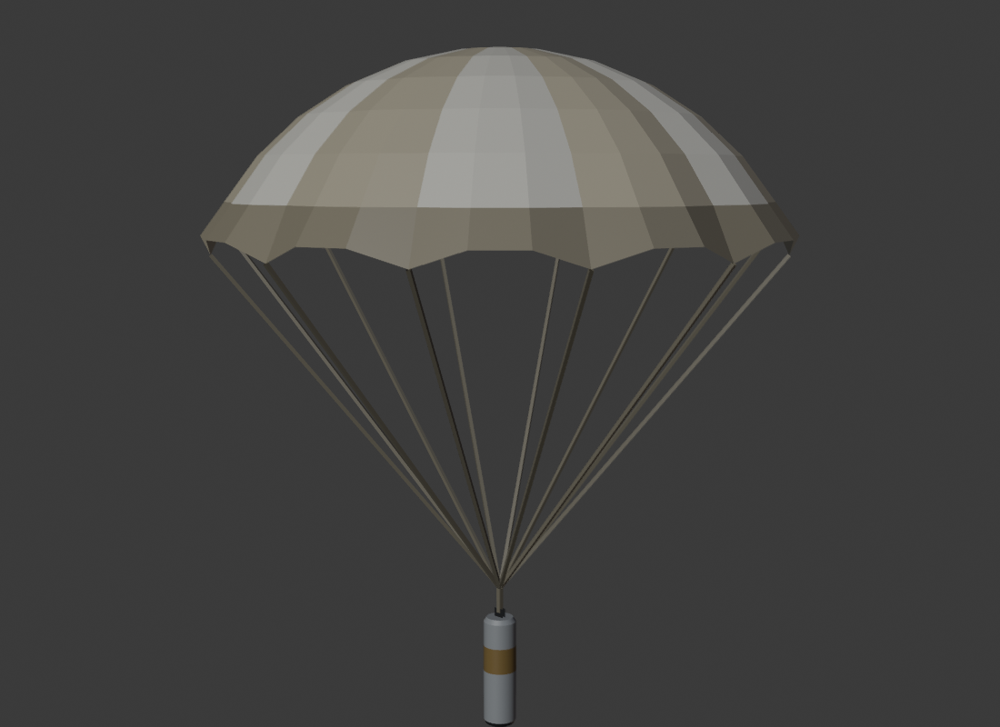
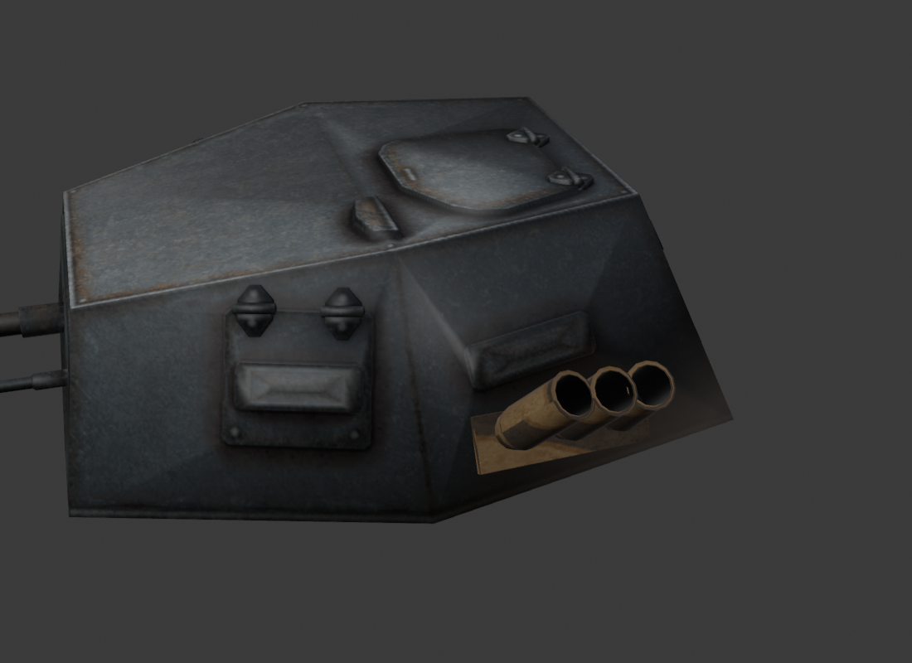
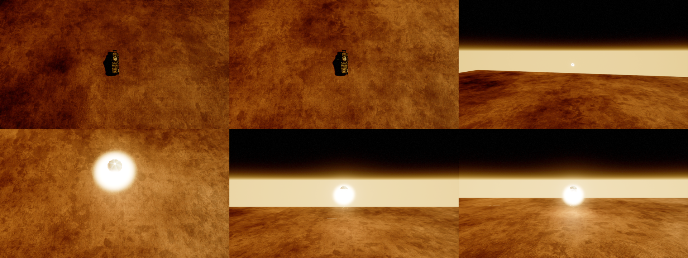
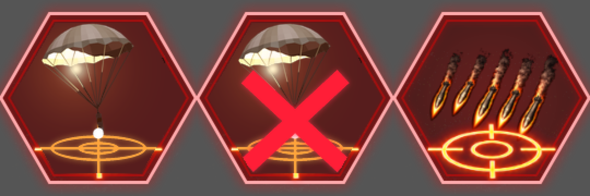

# Flare aim ability

A parachute flare fired from a smoke discharger on a turret. The unit drives into range, the flare leaves the
discharger tube, climbs to a set height above the aimed spot, ignites and opens its parachute, and gives a fog of
war vision bubble while it sinks to the ground. First user: the Sd.Kfz. 231 (`Ger_ArmoredCar_Sdkfz_231`).

 





| Setting (`UFlareAimAbilityComponent` → Flare) | 231 value | What it does |
|---|---|---|
| `FireRange` | 7000 | The unit drives until the target is this close, then launches |
| `ApexHeight` | 1200 | Height above the ground at the target where the flare ignites. Keep it below the RTS camera (~28 m above the ground it looks at) |
| `HangTimeSeconds` | 20 | Seconds of vision; the flare sinks from its apex to the ground in this time |
| `VisionRadius` | 3000 | Radius of the vision bubble; also the radius of the aim preview |
| `AscentSpeed` | 3000 | Average climb speed (cm/s) |
| `LaunchSocketName` | `FlareLaunch` | Socket on the unit, its turret or any child actor; +X is the tube direction |
| `Visuals` | | Launcher rack, flare and parachute meshes, launch / trail / burn Niagara, sounds, light, `MeshScale` 1.5 |

The base aim ability settings carry the rest: `AimAbilityType` = `FlareLaunch`, card slot 11, cooldown 60 s,
`LargeCrosshair` aim assist.

## Code

| Class | File |
|---|---|
| `UAimAbilityComponent` (base, now with hooks for non-weapon aim abilities) | `RTSComponents/AbilityComponents/AimAbilityComponent/AimAbilityComponent.h` |
| `UFlareAimAbilityComponent` | `.../AimAbilityComponent/FlareAimAbility/FlareAimAbilityComponent.h` |
| `AFlareProjectile`, `FFlareFlightPath` | `.../AimAbilityComponent/FlareAimAbility/FlareProjectile.h` |
| `EAimAbilityType::FlareLaunch` (card key 5) | `.../AimAbilityComponent/AimAbilityTypes/AimAbilityTypes.h` |

### Base class hooks

`UAimAbilityComponent` used to assume every aim ability drives weapons. Four virtuals now split that out; the weapon
path (Tank / Squad aim components) behaves exactly as before:

- `GetUsesWeaponBehaviour()` (default true): false skips the weapon behaviour instance, its validation and the
  `BehaviourDuration` check.
- `GetAbilityMaxRange()` (default: range of `CollectWeaponStates`): the move-to-range distance and aim range.
- `ExecuteAbilityInRange()` (default: apply behaviour, fire weapons, start the duration timer). An override must end
  with `HandleBehaviourDurationFinished(true)`, or the command queue stalls.
- `OnAbilityInRangeFinished()` (default: remove the behaviour, weapons back to auto engage).

`GetAimAbilityRadius()` is virtual too (the flare returns `VisionRadius`).

Two things found on the shared aim ability flow while testing the flare:

- **Cancel button error (fixed).** The cancel button calls `ICommands::CancelAimAbility(bSetUnitToIdle = true)`.
  Going idle already terminates the aim ability (stops the move, swaps the card back), so the cancel command it
  then queued failed validation with "Queued subtype ability command is no longer allowed" for every aim ability.
  `CancelAimAbility` now returns `NoError` without queuing when going idle already did the cancel, and still calls
  `OnUnitIdleAndNoNewCommands()` as the refused command's empty queue did. Weapon aim abilities (Brummbar, Pz IV,
  squads) go through the unchanged weapon path but were not run in a test; one barrage in PIE is a good smoke check.
- **Short ranges can stall (not changed).** The unit drives to `range * (1 - RangePercentage%)`; if that buffer is
  smaller than the vehicle's move acceptance radius (~3 m) it stops just outside the range and waits with the cancel
  button up. Fine for the 231's 70 m (7 m buffer); keep `FireRange * RangePercentage%` above ~3.5 m.

### Flow

1. `ICommands::AimAbility(Target, ..., FlareLaunch)` → `ExecuteAimAbility`. Out of `FireRange` the unit drives
   closer (`RequestMoveToLocation`, tank AI controller; the card shows the cancel button).
2. In range: `LaunchFlareAt` spawns `AFlareProjectile` at the socket, plays `LaunchEffect` attached to the socket and
   the launch sound, then `HandleBehaviourDurationFinished(true)` completes the command right away: cooldown starts,
   the queue moves on. The flare lives on by itself; weapons are never touched.
3. `AFlareProjectile` follows `FFlareFlightPath`: an eased Bézier from the socket (first along the tube) to the apex
   `ApexHeight` above the ground under the target (`COLLISION_TRACE_LANDSCAPE` trace). The control point is clamped
   to the apex height, so the flare never overshoots it. Trail effect while climbing.
4. Ignition at the apex: parachute opens (scales up), burn effect + flickering point light, and its `UFowComp`
   starts: `Fow_Active` for player 1 (vision bubble), `Fow_PassiveEnemyVision` for the AI (gives the AI vision,
   never the player). It has no RTS component, so it draws no minimap icon.
5. It sinks at a steady speed and sways under the canopy (the sway only moves the meshes, the vision bubble stays
   above the target). After `HangTimeSeconds` it lies on the ground: vision stops, burn effect stops, light fades,
   the actor removes itself 5 s later.

## Assets

| Asset | Path |
|---|---|
| Flare cartridge, parachute, `M_Flare`, `T_Flare_Palette` | `/Game/RTS_Survival/SpecialEffects/Flare/` |
| `NS_Flare_Launch` (flash, smoke along the tube, sparks; one shot), `NS_Flare_Trail`, `NS_Flare_Burn` (core, halo, dripping sparks, rising smoke) | `/Game/RTS_Survival/SpecialEffects/Flare/` |
| `SM_FlareDischarger_231` (three-tube rack, UV'd on the 231 camo atlas, pivot = mouth of the launch tube) | `/Game/RTS_Survival/Blueprints/Turrets/German/Light/Sdkfz_231Turret/Meshes/` |
| `FlareLaunch` socket (bone `B_Turret`; relative scale 0.0301 cancels the bone's 33x scale) | skeleton `SK_sdkfz_231_Turret_Skeleton` (only this turret uses it) |
| Card icons `T_AimAbility_Flare`, `T_Cancel_AimAbility_Flare`; card key 5 on rows `IdAimAbility` / `IdCancelAimAbility` | `/Game/RTS_Survival/Textures/GameUI/ActionUI/AimAbility/`, `Buttons_DataTableb` |

The flare component attaches `Visuals.LauncherMesh` to the launch socket at BeginPlay, so giving another vehicle the
ability needs only the component and a socket; the turret Blueprint is not edited.

### Rebuilding

- Meshes: `(KADO-3D)/Sdkfz-231/FlareAbility/build_flare.py` (headless Blender, `-- --render` for previews). It ray
  casts the turret FBX to place the rack and writes the socket frame to `(EXPORTS)/FlareAbility/flare_socket.json`.
  Import with `Source/Tools/FlareAbility/ue_flare_import.py` (expects the exports copied to
  `Saved/AgentScripts/FlareAbility/src`). It prints the `add_mesh_socket` call for the socket: `socket_name` is
  read-only from Python, so the socket goes in through the UECP bridge action, with array transforms (dicts are
  silently ignored).
- Niagara: `Source/Tools/FlareAbility/flare_niagara.py` (stateless emitters from FountainLightweight; spec per
  emitter, reads every value back). Gotchas: rotator inputs take only `ConeRotation.Pitch` style components,
  `SubImageSize.X/Y` likewise; this project's glows need colours in the thousands (`M_Fire_Spark_1`), the smoke is the
  10x10 `M_SmokeScreen_1` flipbook. `capture_flare_vfx.sh <round>` pictures them offscreen (DebugGame -Cmd).
- Card: `Source/Tools/FlareAbility/compose_flare_icon.py` (+ `render_flare_icon.py` in the Blender folder),
  `ue_add_flare_cards.py` (idempotent; `Buttons_DataTableb` is often held by headless game runs, re-run then).
- Blueprint: `Source/Tools/FlareAbility/ue_wire_flare_231.py` (adds and fills the component, idempotent).

## Tests

Both are compiled out of shipping builds (`WITH_DEV_AUTOMATION_TESTS` / `RTS_WITH_MAP_TESTS`); the map test has no
UObjects and registers itself only when its switch is on the command line. Test-only access goes through
`FFlareAbilityTestAccess` (friend, also behind `RTS_WITH_MAP_TESTS`).

Automation (`Tests/FlareProjectileTests.cpp`): flight path (apex, landing, monotonic climb without overshoot, steady
sink, tilt of a downward tube), projectile life (phases, ignition height, vision radius, parachute, light, burn time,
burn-out, lifespan) and AI flares giving enemy vision.

```powershell
& 'D:\UnrealEngine\UE5.5_ReleaseBranch\UnrealEngine\Engine\Binaries\Win64\UnrealEditor-Win64-DebugGame-Cmd.exe' 'D:\UE5Projects\RTS_Survival\RTS_Survival.uproject' -ExecCmds="Automation RunTests RTS.Abilities.Flare; Quit" -unattended -nullrhi -nosound -DisablePlugins=Fab,BpGeneratorUltimate -abslog='D:\UE5Projects\RTS_Survival\Saved\Logs\FlareAutomation.log'
```

Map test (`Tests/FlareAbilityTestScenario.cpp`, `-FlareAbilityTest`): spawns the 231 for the player, checks the
card entry, range, preview radius, socket and rack; orders a flare out of range and cancels the move (no flare, no
cooldown); orders again and follows the drive into range, the launch from the socket, the command completing with
cooldown, the climb to `ApexHeight` above the target, the vision bubble in the fog of war manager with
`VisionRadius`, the steady sink, the vision lasting `HangTimeSeconds`, the burn-out on the ground and the actor
removing itself. With a renderer it saves pictures to `Saved/FlareAbilityTest/`. It prints
`RTS_FLARE_TEST RESULT PASS|FAIL` and quits (`-FlareTestNoQuit` keeps it open, `-FlareTestAt=X,Y` picks the spot).
The test shortens `FireRange` to 35 m (the map is small) and the cooldown to 3 s, so a cooldown left by the cancelled
order cannot block the real one; both go back to the Blueprint values only in that run. It moves the start spot onto
the nearest navmesh (`RTS_ToCopySmall`'s start lies off it) after the HUD and navmesh are up, like the grenade tests.

Last run (2026-10-20, DebugGame): automation 3/3, map test 37/37 checks with `-nullrhi` and with
`-RenderOffscreen` (~45 s game time). The startup map is loaded before `EndOfEngineInit`, so the test polls for the
game world on the core ticker instead of listening for world initialisation.

```powershell
& 'D:\UnrealEngine\UE5.5_ReleaseBranch\UnrealEngine\Engine\Binaries\Win64\UnrealEditor-Win64-DebugGame-Cmd.exe' 'D:\UE5Projects\RTS_Survival\RTS_Survival.uproject' /Game/RTS_Survival/Maps/UnitTests/RTS_ToCopySmall -game -unattended -nosound -RenderOffscreen -windowed -ResX=1280 -ResY=720 -DisablePlugins=Fab,BpGeneratorUltimate -FlareAbilityTest -abslog='D:\UE5Projects\RTS_Survival\Saved\Logs\FlareAbilityTest.log'
```

Use `-nullrhi` instead of `-RenderOffscreen` for a run without pictures. Leave out `BpGeneratorUltimate` only when
you need the UECP bridge: a second editor with it fights the open editor for port 9855.
