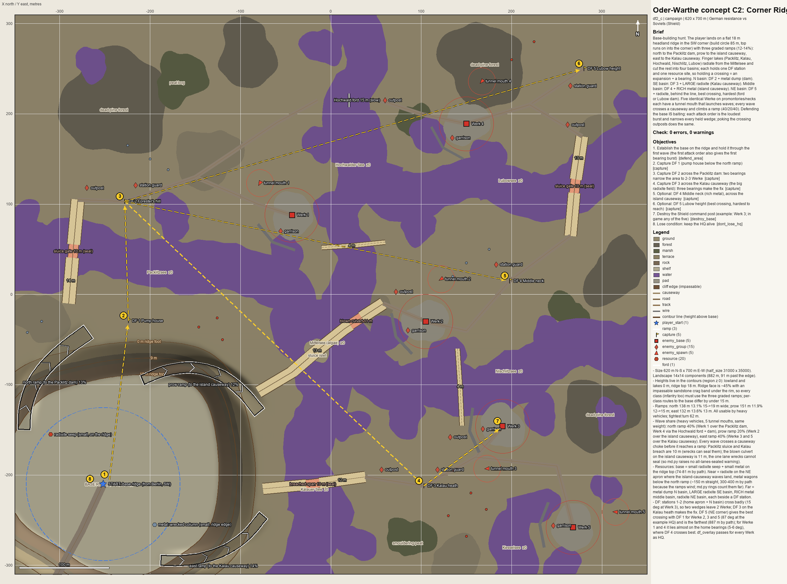

# Oder-Warthe mission: mission logic and flow (draft for review)

Status: first draft 2026-11-16; reviewed and extended with a full mission skeleton on 2026-11-22 (sections 8-10);
owner decisions from the 2026-11-22 questionnaire in section 11 (they win where older sections differ).
The map is built (`Ger_OderWarthe`, see [OderWartheMap.md](OderWartheMap.md)); no mission scripting is built yet. This document covers **what happens in the mission, in what order,
and the rules behind it**. The background (lore, location, alternatives) is in
[OderWartheMission.md](OderWartheMission.md). Every number here is a starting value to tune, and every item marked
**(open)** needs the owner's decision.

Layout: sketch C "Corner Ridge over the Lakes" (`MapDesigner/OderWarthe/df2_c.layout.json`).

Names used below come from the sketch: the base ridge (south-west), the three ramps (north, prow, east), the crossings
(Packlitz dam, island causeway, Kalau causeway, Lubow dam, Hochwald ford, two infantry boardwalks), the stations DF 1-5,
the bunker groups Werk 1-5 with their tunnel mouths, and the six outposts at the crossing heads.

## 1. The mission in one paragraph

The player arrives on a ridge in the south-west corner and builds a base. Somewhere in one of five identical bunker
groups across the lakes sits a Shield command post. The player cannot see it; they can only hear it. They take
direction-finder stations across the causeways, and each station draws a bearing wedge on the minimap. The wedges
narrow each time the command post transmits, and it transmits most when it orders attacks. Every wave the player
survives therefore brings them closer. Two stations narrow the search to two bunker groups, three find it. The player
then assaults the command post and destroys it.

## 2. Pacing at a glance

Target length: **30-40 minutes** on Normal (proposal).

| Phase | Rough time | What the player does | What the enemy does | Ends when |
|---|---|---|---|---|
| 0. Arrival | 0:00-1:00 | Watches the location intro and the briefing; the HQ truck drives up the ridge | Nothing | Briefing ends |
| 1. Dig in | 1:00-6:00 | Deploys the HQ, builds a refinery and metal extraction, takes DF 1 below the north ramp | Grace period, then the first wave | First wave is beaten |
| 2. Second bearing | 6:00-14:00 | Crosses the Packlitz dam, takes DF 2 and the metal dump, learns to bait the outposts | Waves on a timer, outposts reply | Two wedges overlap |
| 3. They notice | 14:00-25:00 | Takes a third station (DF 3, 4 or 5) and expands into its basin | Counterattacks held stations, bigger waves | Fix: one bunker group left |
| 4. The fix | about 30 s | Watches the reveal and the camera tour | The command post stops hiding | Tour ends |
| 5. Assault | 25:00-35:00 | Destroys the command post's three targets | Last-stand defence, all tunnel mouths launch | All three targets destroyed |
| 6. Aftermath | about 1:00 | (Optional) recovers the signals archive | Waves stop, garrisons stop reinforcing | Victory |

## 3. Step by step

### Phase 0: Arrival

1. **Location intro** (existing `ShowLocationIntro` node): "Festungsfront Oder-Warthe-Bogen, Lebus district, 1976."
2. The **HQ truck and a light escort** drive in on the old road from Frankfurt (Oder) and up onto the ridge. **(open)**
   whether the player starts with only the HQ truck, or also a barracks truck and a refinery truck.
3. **Briefing** (GermanAnnouncer portrait, about 30 s):
   - "The radio in Berlin caught Shield command traffic. One bearing points here, into the old bunker line. One bearing
     is a direction, not a place."
   - "There are five bunker groups out there. One of them is talking. Build up, take the listening posts, and find it."
4. **Fog:** the unexplored-fog reveal is on (`AMissionManager::bRevealUnexploredFog`), so the player sees the lakes,
   causeways and the five bunker groups as landscape. Enemy units and buildings stay hidden until seen.

### Phase 1: Dig in

5. **Objective "Establish the base":** deploy the HQ inside the ridge's build circle, then build a refinery on the
   radixite seep and metal extraction on the wrecked column. (The sketch uses "hold the ridge" as a stand-in; this
   step needs a small "build these buildings" objective, see section 6.)
6. **Objective "Take the listening post":** DF 1 Pump house sits at the foot of the north ramp, in the home basin, with
   no crossing and no guard. It is the tutorial station. When it is captured:
   - the first wedge appears on the minimap, wide (about +-20 degrees);
   - advisor: "Now we listen."
7. **The first wave** (proposal: released when DF 1 is held, or after the grace period at the latest, 5 minutes on
   Normal). It comes from one tunnel mouth, crosses its causeway and climbs one ramp.
   - The moment the wave is ordered, DF 1 hears the **attack-order burst** and its wedge visibly snaps narrower.
   - Advisor names the core rule: **"When they attack, they talk."**
8. The phase ends when the first wave is beaten. Reward: a small resource drop, or just the advisor line **(open)**.

Note: this order is a change from the sketch's objective chain, which has "hold through the first wave" before DF 1.
DF 1 comes first here so that the first wave teaches the mechanic.

### Phase 2: Second bearing

9. **Objective "Cross the Packlitz dam and take DF 2 Forester's hill"** in the north basin. The metal dump beside it
   is the first real expansion.
10. **Bait lesson:** the Packlitz outpost holds the north head of the dam. When the player attacks it, the command post
    answers 10-20 s later (the **reply burst**) and DF 1's wedge narrows. Advisor: "Every time we hit them, someone
    reports to the command post, and the command post answers."
11. When DF 2 is held, the **two wedges overlap**. The minimap shades the overlap. On this layout it always contains
    two of the five bunker groups.
    - Advisor: "Two bearings, a rough area. We need a third, and from a different angle."
12. Waves continue on a timer (section 4.4). Each wave launch is an attack-order burst for every held station.

### Phase 3: They notice

Triggered by the first two-wedge overlap.

13. **The command post reacts** (Shield operator line in Russian, with subtitles: "Someone is listening on our
    frequency."):
    - **station counterattacks:** every few minutes a small force tries to retake the most recently captured station;
    - **routine traffic drops** (bursts every 90-120 s instead of 60-90 s), so the player has to bait more;
    - **waves grow** one step (section 4.4).
14. **The third station is the player's choice.** Each one sits with a resource site, so the hunt and the economy pull
    the same way:

    | Station | Crossing | Resource beside it | Notes |
    |---|---|---|---|
    | DF 3 Kalau heath | Kalau causeway from the east ramp | Large radixite field | The default third station; makes the fix on every bunker group |
    | DF 4 Middle neck | Island causeway from the prow ramp | Rich metal (rail yard) | Between two bunker groups; strongly guarded |
    | DF 5 Lubow height | Hochwald ford or Lubow dam | Radixite vein | Hardest to reach; best angle for three of the five groups |

15. **Destroying a bunker group** is allowed. If it is not the command post, it drops out of the search (and its tunnel
    mouth stops launching waves). It is expensive, because every group has the same garrison, but it is a fair way to
    narrow the search.

### Phase 4: The fix

16. **Fix condition:** the overlap of three or more held wedges contains exactly one bunker group (section 4.3).
17. **Reveal**, reusing `USecureBaseMission`'s reveal, tour and markers:
    - vision bubbles over the bunker group for about 60 s;
    - a camera tour of about 20 s: "the transmitter array", "the command bunker entrance", "the tunnel railway entrance";
    - destroy markers and minimap icons on those three targets. They were camouflaged and could not be targeted until
      now.
    - Advisor: "There you are."

### Phase 5: Assault

18. **Objective "Destroy the Shield command post":** the three targets above.
19. **Last stand** (proposal):
    - the command post's own garrison digs in (an existing `AEnemyStrongpoint` with dig-in);
    - the other tunnel mouths launch waves at the player's **assault force**, not at the base;
    - routine bursts stop, because the bearings no longer matter.
20. **(open, Brutal only, from the main doc):** if the command post is not destroyed within N minutes of the fix, the
    commander escapes by the tunnel railway to another group, and the wedges reset to grey. Off by default.

### Phase 6: Aftermath

21. When the last target dies: waves stop, the remaining garrisons no longer reinforce, and the advisor celebrates.
22. **Optional objective "Recover the signals archive":** an infantry squad enters the destroyed command bunker.
    Reward: the Act 1 lore clue (1946 Red Army quarantine orders about "Fitofag" in the wheat) and the campaign-map
    reward **(open)**.
23. Victory.

## 4. The rules underneath

### 4.1 The command post

- At mission start, one of the five bunker groups is chosen as the command post. **(open)** random each playthrough
  (proposal), or fixed. Every group has the same garrison, the same surface buildings and a tunnel mouth, so nothing on
  the surface gives it away.
- The command post's three targets exist from the start, but they are hidden and cannot be targeted until the fix, or
  until the player's units reach that group's tunnel mouth.

### 4.2 Stations and wedges

- **Station states:** enemy-held, contested (the flag moves), player-held, lost. Only player-held stations hear bursts
  and narrow their wedge.
- **Wedge:** each station keeps a half-angle `H` and a centre error `E`.
  - Start: `H` = 20 degrees, `E` = a random angle up to 35% of `H`.
  - Each burst multiplies `H` (and `E` with it) by the burst's factor. Minimum `H` = 2 degrees.
  - A lost station keeps its wedge, drawn grey, and stops narrowing. Retaking it continues from the same wedge.

### 4.3 Bursts

| Burst | When | Factor (proposal) |
|---|---|---|
| Routine traffic | Every 60-90 s (90-120 s after phase 3) | x 0.9 |
| Reply | 10-20 s after the player attacks an outpost or any bunker group; at most once per outpost per 60 s | x 0.7 |
| Attack order | When any wave launches | x 0.5 |

- **Overlap:** the area covered by every held wedge. The minimap shades it.
- **Narrowed:** at least two held wedges; the overlap is shown.
- **Fix:** at least three held wedges, and the overlap touches exactly one bunker group that is still standing.
- **Feedback:** each burst plays a short Morse tone and jumps a signal-strength needle in the mission UI. The wedge
  narrowing is animated so the player sees which event caused it.

### 4.4 Waves

- **Source:** each wave comes from the tunnel mouth of a random standing bunker group, all with the same weight. Waves
  cross a causeway and climb one of the three ramps. The sketch's split is north ramp 40%, prow ramp 20%, east ramp 40%.
- **Interval** (proposal, Normal): first wave after DF 1 or at 5:00, then every 3:00. After phase 3, every 2:30.
- **Size** grows in steps: by time, and one step more after phase 3. Unit mix is **(open)** (Soviet infantry and light
  armour early, T-34s and AT teams later).
- Wrecks can seal the Packlitz sluice and the Kalau breach (both 10 m). The island causeway's blown culvert is 11 m on
  purpose, so one lane always stays open.

### 4.5 Win and lose

- **Win:** the command post's three targets are destroyed.
- **Lose:** the player's HQ is destroyed (`UDontLoseHQMission`).
- No hard timer.

## 5. Difficulty (proposal)

| Setting | Normal | Hard | Brutal / Ironman |
|---|---|---|---|
| Grace period before the first wave | 5:00 | 4:00 | 3:00 |
| Wave interval | 3:00 then 2:30 | 2:30 then 2:00 | 2:00 then 1:45 |
| Starting wedge half-angle | 20 degrees | 22 degrees | 25 degrees |
| Station counterattacks | One small force | Two forces | Two forces, more often |
| Decoy radio truck (main doc) | Off | **(open)** | **(open)** |
| Commander escapes by tunnel (main doc) | Off | Off | **(open)** |

## 6. What has to be built

| Piece | Exists? |
|---|---|
| Mission chain, objectives, triggers (`UMissionBase`, `AMissionManager`, trigger areas) | Exists |
| Reveal, camera tour, destroy markers (`USecureBaseMission`) | Exists |
| Waves from placed spawners (`AEnemyWaveSpawner`) | Exists; needs the "random standing group" picker and a hook that fires the attack-order burst |
| Dug-in defenders (`AEnemyStrongpoint`) | Exists |
| Lose condition (`UDontLoseHQMission`) | Exists |
| Location intro, portrait lines with subtitles | Exist |
| Unexplored-fog reveal | Exists |
| Capturable station with a rising flag | `ASupplyPoint` has capture; reuse unchecked |
| "Build these buildings" objective | **New** (small) |
| Direction-finding manager: command post pick, stations, bursts, wedges, overlap, fix | **New** (core of the mission) |
| Wedges and overlap on the minimap and the full map | **New** (the minimap draws lines today, not wedges) |
| Signal needle and Morse feedback | **New** |
| Hidden command post targets that unlock at the fix | **New** (small) |
| Station, bunker group and tunnel mouth assets | **New** assets |

## 7. Open questions for this review

1. Is the phase order right, in particular DF 1 before the first wave?
2. What does the player start with (HQ truck only, or more), and is the base-building kit limited?
3. Is the command post random each playthrough, or fixed?
4. Should destroying a wrong bunker group remove it from the search (step 15), or is that too easy a shortcut?
5. Wave timing and sizes: are the proposed intervals in the right range for a 30-40 minute mission?
6. Do station counterattacks belong in the mission, or do they make holding stations a chore?
7. The finale: last-stand waves at the assault force, and is the signals archive optional or required?
8. Decoy truck and tunnel escape: keep as optional difficulty modules, or drop?

## 8. Review against the built map (2026-11-22)

What the built map gives the mission, and where it changes the draft above.

| Draft assumption | On the built map | Consequence |
|---|---|---|
| Five identical bunker groups | Three designs: W1-W3 **7c Kasemattennase**, W4 **Peilturm**, W5 **8b Flankierend**. Each design looks different. | The puzzle still holds: the command post is picked from all five, and every group gets the same garrison and the same three hidden targets. The briefing says "five bunker groups", not "five identical". |
| The three command post targets are camouflaged objects | Every Werk mesh has the sockets `HQ_Command`, `HQ_Transmitter` and `HQ_Rail` | At mission start, the targets spawn at the chosen Werk's sockets. They stay hidden and untargetable until the fix. |
| Garrison points from the sketch (`garr_w*`) | They land on the flanks of the new hills, and W2's point cannot be reached | Garrisons spawn on each design's walkable top (`WERK_TOP`), with posts on the `Tobruk<N>` and `Leitstand<N>` sockets. |
| The rail yard is set dressing | Two tracks with three switches run from the yard at `metal_c` (beside DF 4) to the east edge | The rail line can carry Soviet trains (`UTrainMission` exists): reinforcements, the decoy transmitter and the Brutal escape (section 9). |
| The decoy transmitter is a radio truck on the roads | A moving decoy is hard to read (question 8) | A radio car on the rail line moves along a line the player can see on the map. |
| Ground forces counterattack the stations | `AEnemyAirDrop` (paratroopers) and `AEnemyWaveSpawner` exist | Phase 3, "They notice", can open with a paratrooper drop on the newest station. |
| Capturable station | `ASupplyPoint` has a capture flag and raises `OnSupplyPointOwnerChanged` | The stations can be `ASupplyPoint` children; the direction-finding manager listens to that event. |

The wave routes (15 of 15), the chokes and the navmesh are proven on the built map (see OderWartheMap.md), so the wave
sources and the ramp split in section 4.4 work as drawn.

## 9. Ideas to extend it (brainstorm)

Sorted by value for cost. Each one is a proposal until the owner picks it.

1. **Supply trains on the new rail line** (cheap: `UTrainMission` exists).
   - After phase 2, a short Soviet train runs every few minutes from the east edge to the yard at `metal_c` and
     unloads reinforcements. While trains keep arriving, each wave is one step larger.
   - The player can **cut the line**: hold the yard (DF 4's basin) or destroy a train. Each destroyed train makes the
     next wave smaller. This makes DF 4 the attrition choice for the third station.
   - The player can read it: the track, the switches and the train icon on the minimap (`UTrainMission` already
     shows trains on the minimap).
2. **The decoy transmitter rides the train** (Hard and above; replaces the road truck).
   - A radio car in the supply trains transmits on the command post's schedule. Its wedges swing along the line between
     bursts, so after two bursts the player can see that this source moves along the rails.
   - Destroying the radio car removes the decoy wedges. "Two lines can lie, three cannot" still holds.
3. **Werke that fight back** (medium: `UEmbeddedTurretMountComponent` puts gunners on buildings).
   - MG gunners in the Tobruks (`Tobruk<N>`), AT guns behind the 667 embrasures, a spotter on the Leitstand.
   - The same loadout at every Werk of a design, so attacking one tells the player nothing about the command post.
4. **The Peilturm listens back** (W4 only, cheap).
   - "They have a direction finder too." While the W4 tower stands, each player attack on an outpost can send a small
     strike team at the player's nearest station.
   - Destroying the tower stops it. This gives a bonus objective with a story reason, and makes W4 a tempting wrong
     guess.
5. **Phase 3 opens with paratroopers on the newest station** (cheap: `AEnemyAirDrop` plus the existing enemy aircraft
   announcer warning). Later counterattacks are ground forces from the nearest tunnel mouth.
6. **Tunnel mouths as targets** (cheap). Destroying a Werk's tunnel portal stops waves from that Werk (the wave picker
   no longer counts it as standing) without taking the Werk. This lets the player reduce the pressure.
7. **Brutal: the commander escapes by train** (medium; replaces "relocation by tunnel").
   - At the fix, a command train leaves the yard for the east edge. If it gets out, the command post moves to another
     group and the wedges reset to grey.
   - It uses the same train system. The player sees the escape coming and can block it by holding the yard.
8. **Act 1 clue spots**, as in the Ore Mountains (cheap: `BP_ScriptTrigger_PortraitLine` exists).
   - A 1946 wagon at the yard's buffer stop with quarantine stencils ("Sector Lebus"); a burnt grain store near DF 2.
   - Intercepted Soviet radio lines on trigger areas at the crossings.
9. **Dam demolition** (expensive; recommend **drop**). The water is one global sheet and the ponds are tiles, so
   flooding a sector during play needs new tech. The 10 m sluice and breach chokes already reward blocking a crossing
   with wrecks.

## 10. Mission skeleton

The whole mission as a chain on `AMissionManager`. Each step is a `UMissionBase` child that starts the next one
(`UMissionClassCompletedMissionTrigger`). Parallel systems run beside the chain. Names marked "new" are proposals;
existing classes use their names in code.

### 10.1 Map anchors

Positions in metres (map X north, Y east), from `Saved/OderWarthe/terrain/OW_layout.json`.

| Anchor | Where | Used by |
|---|---|---|
| Player start, base ridge | (-210, -252); road from Berlin up the ridge | M00 arrival, HQ deploy circle (85 m) |
| Base resources | radixite seep (-155, -310), metal column (-255, -195) | M02 |
| Home basin resources | radixite field (-36, -146), metal wagons (-30, -320) | M02 expansion |
| DF 1 Pump house | (-29, -224), home basin, no guard | M03 |
| DF 2 Forester's hill | (103, -228), north basin across the Packlitz dam; guard (121, -216) | M05 |
| DF 3 Kalau heath | (-212, 103), SE basin across the Kalau causeway; guard (-194, 118) | M07 |
| DF 4 Middle neck | (15, 198), middle basin across the island causeway; guard (33, 183); rail yard `metal_c` (35, 150) | M07, trains |
| DF 5 Lubow height | (250, 280), NE behind the line, across the ford or the Lubow dam; guard (231, 265) | M07 |
| Outposts (bait) | Packlitz (118, -270), Kalau (-194, 56), island (3, 72), Lubow (188, 262), ford (215, 60), boardwalk (-158, 132) | bursts, M05 lesson |
| Werke / tunnel mouths | W1 (88, -43) / (120, -5); W2 (-30, 105) / (-73, 80); W3 (-146, 190) / (-114, 228); W4 (189, 150) / (164, 107); W5 (-258, 268) / (-267, 317) | waves, M08-M09 |
| Ramps (where waves arrive) | north (-86, -320), prow (-84, -136), east (-286, -124) | wave routes |
| Rail line | yard at `metal_c`, double track east to the map edge (y 441) | ideas 1, 2, 7 |

### 10.2 Parallel systems (always on)

| System | What it does | Builds on |
|---|---|---|
| `UDontLoseHQMission` | Lose when the HQ dies | Exists |
| `ADirectionFindingManager` (new) | Picks the command post Werk at start (seeded random); owns the five stations, bursts, wedges, overlap and fix; spawns the hidden targets at the chosen Werk's `HQ_*` sockets; raises `OnStationCaptured`, `OnBurst(type)`, `OnOverlapFirst`, `OnFix` | `ASupplyPoint::OnSupplyPointOwnerChanged`, Werk sockets |
| Wave director (new, small) | Each interval (sections 4.4 and 5), picks a random standing Werk and fires its `AEnemyWaveSpawner`; raises `OnBurst(AttackOrder)` when the wave spawns | `AEnemyWaveSpawner` |
| Garrisons | One `AEnemyStrongpoint` per Werk (the same per design; posts on `WERK_TOP`, `Tobruk<N>`, `Leitstand<N>`), one per outpost and per station guard | `AEnemyStrongpoint` |
| Supply trains (idea 1) | Trains from the east edge to the yard after M06 | `UTrainMission` |
| Mission UI | Objective plates (major and bonus), wedges on the minimap and the full map, signal needle and Morse | Plates exist; wedges and needle are new |

### 10.3 The chain

| Step | Mission (class) | Starts when | Objective plate | Scripted events | Completes when |
|---|---|---|---|---|---|
| M00 Arrival | `UMoveCameraMission` + location intro | Map start | none | Dawn mist over the lakes; location intro "Festungsfront Oder-Warthe-Bogen, Lebus district, 1976"; the start force (open, 11.3) drives up the ridge road; lines B1-B3 | Briefing ends |
| M01 Guard | `UDontLoseHQMission` | M00 ends | none (lose rule) | - | Never (removed at victory) |
| M02 Establish the base | `UBuildStructuresMission` (new) | M00 ends | Major: "Deploy the HQ, build a refinery and a metal extractor" | A1 when the HQ deploys | All three built |
| M03 Take the listening post | Station capture (new, small) on DF 1 | M02 ends | Major: "Take DF 1, the pump house" | Field manual takeover clip "Direction finding" plays on capture; first (wide) wedge appears; A2 | DF 1 held |
| M04 The first attack | Wave director, first wave | DF 1 held, or the grace timer (5:00 on Normal) | Major: "Hold the ridge" | Attack-order burst narrows DF 1's wedge (Morse + subtitled intercept); A3 | First wave beaten; **small resource drop** |
| M05 Second bearing | Station capture on DF 2 | M04 ends | Major: "Cross the Packlitz dam and take DF 2" | Bonus plates appear: "Take all five listening posts", "Collapse a tunnel mouth", "Destroy the radio truck" (Hard+); attacking the Packlitz outpost causes a reply burst after 10-20 s; A4; waves on the timer | DF 2 held |
| M06 They notice | Event, no plate | First overlap of two wedges | - | A5; V1 (the veteran); paratrooper counterattacks on the newest station start, R2; routine bursts slow down; waves one step larger; armour trains start, A7; the Peilturm starts calling Katyusha strikes on units in its sight while it stands, A9 | At once |
| M07 Third bearing | Station capture on any of DF 3-5 | M06 | Major: "Take a third listening post: DF 3, 4 or 5" | Station counterattacks every few minutes; armour trains; Peilturm artillery | The fix condition is met |
| M08 The fix | `USecureBaseMission`, reveal part | `OnFix` | - | Vision bubbles for 60 s, camera tour of the three targets, destroy markers; A6, V2 | Tour ends |
| M09 Assault | `USecureBaseMission` (three targets) | M08 ends | Major: "Destroy the command post: jammer transmitter, command bunker, rail entrance" | Last stand: all other tunnel mouths attack the assault force; the garrison digs in; routine bursts stop; V3; when the second target falls, Starik escapes by the tunnel railway (V4) | All three destroyed |
| M10 Archive | Enter-building objective (new, small) | M09 ends | Bonus: "Recover the signals archive" (reveals enemy world-map items) | A8: his post is empty; 1946 orders signed by Starik + Shield hunt logs | A squad enters the destroyed command bunker |
| M11 Victory | Mission end + debrief | M09 ends (M10 stays open for 2 min) | - | The jam lifts (A10); waves stop, garrisons stop reinforcing; end debrief | - |

### 10.4 New pieces, smallest first

1. `UBuildStructuresMission`: "build N of these building types"; counts the player's completed buildings.
2. Station capture step: completes when an `ASupplyPoint` child is held by the player.
3. Hidden targets: three destructible actors at the chosen Werk's `HQ_*` sockets. They stay hidden and untargetable
   until `OnFix`, or until player units enter the tunnel-mouth trigger.
4. Wave director: interval table per difficulty, random standing Werk, burst hook.
5. `ADirectionFindingManager` and the wedges on the minimap and full map (the largest piece).
6. Signal needle and Morse tone in the mission UI.
7. Picked modules (section 11): armour trains, road radio truck decoy (Hard+), embedded Werk gunners, Peilturm
   artillery spotting, tunnel mouth collapse. Parked: the Brutal escape.

### 10.5 Dialogue script (line list)

| ID | Speaker | When | Line (draft) |
|---|---|---|---|
| B1 | Advisor | M00 | "Since Berlin, every cell has gone deaf. Shield is jamming us. The noise comes from here, the old bunker line." |
| B2 | Advisor | M00 | "The jammer drowns everything, but their own orders have to get through it. Those we can hear." |
| B3 | Advisor | M00 | "Five bunker groups. One of them is talking. Build up, take the listening posts, and find it." |
| A1 | Advisor | HQ deployed | "Good ground. Radixite on the ridge, scrap below. Get the refinery running." |
| A2 | Advisor | DF 1 held | "Now we listen." |
| A3 | Advisor | First attack-order burst | "Hear that? When they attack, they talk." |
| A4 | Advisor | First reply burst | "Every time we hit them, someone reports to the command post, and the command post answers." |
| A5 | Advisor | Two wedges overlap | "Two bearings, a rough area. We need a third, from a different angle." |
| V1 | Starik, the veteran (Russian, subtitled intercept) | M06 | "Someone is listening. Germans again, on my line. I took this line from them once." |
| R2 | Shield operator | Counterattack launched | "Retake the listening post. Nobody hears us." |
| A6 | Advisor | Fix | "There you are." |
| V2 | The veteran | Fix | "So. You found the old man." |
| V3 | The veteran | Assault starts | "Every gun on the line. Bring them all." |
| V4 | The veteran | Escapes (M09) | "Keep the bunkers, Germans. I have outlived better men than you." |
| A7 | Advisor | First armour train seen | "Tanks by rail, straight into the bunkers. Expect heavier waves." |
| A8 | Advisor | Archive recovered | "His chair is still warm. Red Army papers, 1946, quarantine orders for the wheat, signed by the same old man. And Shield hunt logs. They know about our cells." |
| A9 | Advisor | First Peilturm-spotted rocket strike | "That tower is calling in rockets. Keep out of its sight, or bring it down." |
| A10 | Advisor | Victory | "The noise is gone. Berlin, can you hear me?" |

Intercepts are Morse plus a subtitled line; the veteran's voice is the one recurring Soviet voice (cast decision 11.1).

### 10.6 Tests (headless, one run per suite)

- Chain test: drive M00-M11 with console cheats (capture stations, kill waves, force the fix). Check each step's
  objective plate and completion.
- Direction-finding tests: wedge narrowing per burst type; on this layout, two wedges always leave at least two Werke
  inside the overlap; three stations leave exactly one; the decoy never causes a fix on a Werk.
- Wave director: every standing Werk gets picked, destroyed tunnel portals drop out, and waves reach the ridge on all
  three ramps (re-use the wave-route legs of `c_waves.py`).

### 10.7 Questions

Answered in the 2026-11-22 questionnaire; see section 11.

## 11. Decisions (questionnaire, 2026-11-22)

Two rounds. Where a row in 11.1 says "round 2", the answer is in 11.4.

### 11.1 Decided

| Topic | Decision | What it changes |
|---|---|---|
| Why the player is here | **A Shield jammer blinds the resistance.** Since Berlin the cells cannot talk. The jammer is at the command post. | Replaces the Zoo tower bearing as the reason. The jam is constant noise and gives no bearing; the command post's own orders must cut through it in bursts, and those bursts are what the stations hear. Victory lifts the jam (A10). Briefing B1-B3. |
| Cast | **Advisor + Shield intercepts.** No extra German character. | All Soviet speech arrives as Morse + subtitled intercept. |
| Antagonist | **An old 1945 Red Army veteran.** He took the line in January 1945 and never left. | He is the recurring intercept voice (V1-V3). He signed the 1946 quarantine orders, which ties the lore payoff to him. Name and fate: round 2. |
| Payoff | **1946 orders + Shield hunt logs.** | Act 1 clue (Fitofag, crops) plus stakes: Shield knows about the cells (A8). |
| Mood | **Dawn mist over the lakes.** | Map lighting, sky and height fog for `Ger_OderWarthe`. Whether the light moves on to day: round 2. |
| Tech | **Tier cap 2** (`PlayerGlobalAbilitySettings.MaxAllowedTier`). | Check that the base buildings the objectives need are within the cap, and which global abilities remain. |
| Economy | **Standard.** | No special economy rules. |
| First wave reward | **Small resource drop.** | M04 completion. |
| Length | **30-40 min** on Normal. | Pacing table in section 2 stands. |
| Station capture | **Hold the area, flag rises** (`ASupplyPoint` style). | Section 10.4 item 2. |
| Bearing display | **Minimap + full map wedges.** | No world beams, no plotting panel. |
| Burst feedback | **Morse + subtitled intercept snippet.** | Replaces the needle gauge as the main feedback (needle optional). |
| Teaching | **Field manual takeover clip** at DF 1. | A new "Direction finding" field manual for the info-takeover system (clip + text). |
| Command post | **Random of all five.** | W4 and W5 look different from W1-W3; that is fine because the garrison and targets are the same. |
| Wrong guess | **A destroyed wrong group drops out of the search and the waves.** | Section 3 step 15 stands. |
| Station pressure | **Counterattacks on the newest station** (current design). | Section 3 step 13 stands. |
| Decoy | **Road radio truck, Hard and above.** | Section 9 idea 2 (radio car on the train) is dropped. The truck's bonus plate shows only on Hard+. |
| Werk defences | **Embedded MG and AT gunners** (`UEmbeddedTurretMountComponent`). | Same loadout per design; posts on the `Tobruk<N>` sockets and the 667 embrasures. |
| Trains | **Armour only.** | Trains bring tanks to the bunkers; whether the player can stop them: round 2. |
| Peilturm | **Spots for artillery.** | While W4 stands, it calls barrages on player units in its sight. Gun source and rules: round 2. |
| Finale | **All other tunnel mouths attack the assault force.** | M09 stands. |
| Bonus objectives | **Destroy the radio truck (Hard+), Collapse a tunnel mouth, Take all five stations.** | The Packlitz outpost bonus and "Silence the Peilturm" bonus are dropped (bringing the tower down still stops the artillery). |
| Lose | **HQ destroyed only.** | Section 4.5 stands. |
| Clue spots | **Quarantine wagon at the buffer stop, algae lake sampling camp.** | Two `BP_ScriptTrigger_PortraitLine` spots; the sampling camp needs a site (round 2). |
| Flooding | **Dropped.** | Section 9 idea 9 is closed. |
| Campaign | **After Berlin, tier 3.** | `OderWartheMission.md` said tier 2; update `FPerMissionRules` proposal to tier 3. |

### 11.2 Section 9 ideas: outcome

| Idea | Outcome |
|---|---|
| 1 Supply trains | In, as **armour** trains |
| 2 Decoy on the train | Out; the decoy is a road radio truck (Hard+) |
| 3 Werke fight back | In (embedded MG and AT gunners) |
| 4 Peilturm listens back | Replaced by **artillery spotting** |
| 5 Paratroopers on the newest station | In, for every counterattack (11.4) |
| 6 Tunnel mouths as targets | In, as the bonus "Collapse a tunnel mouth" |
| 7 Brutal escape by train | Parked |
| 8 Act 1 clue spots | In: quarantine wagon, algae sampling camp |
| 9 Dam demolition | Dropped |

### 11.3 Parked or still open

- **Parked ("later"):** the mission's name, the start force, the wave unit mix, the Brutal time pressure.

### 11.4 Round 2 decisions (2026-11-22)

| Topic | Decision | What it changes |
|---|---|---|
| Jam effect | **Story only.** | No gameplay penalty from the jam; the bursts and wedges work as in section 4. |
| The veteran's name | **Never named: "the Old Man" (Starik).** | Subtitles and intercept headers call him "Starik". |
| The veteran's fate | **Escapes by tunnel and comes back later.** | The player still wins: the jammer and the command post die. During M09 he leaves by the tunnel railway (V4), and the archive squad finds his empty post (A8). He is a recurring villain: the campaign docs (Pripyat and later) should pick him up. |
| Armour trains | **The player can destroy the trains.** | Trains are destructible; a destroyed train delivers nothing. A wrecked train blocks the track until cleared (proposal). |
| Peilturm guns | **Katyusha strikes.** | While W4 stands, it calls rocket strikes. Destroying W4 stops them. If W4 is the command post, the strikes stop at the fix (proposal). |
| Peilturm targets | **Player units in its sight, with a warning circle first.** | Uses the global ability target-area visuals for the warning circle; strike after a short delay. |
| Paratroopers | **Every station counterattack is a paratrooper drop** (`AEnemyAirDrop`, with the enemy aircraft announcer warning). | Section 9 idea 5 is in, for every counterattack. |
| Mood | **Static dawn.** | One lighting setup, no time-of-day change. |
| Signals archive | **Bonus; reveals enemy world-map items** near the mission (radius in hops to tune; `WorldFow` radius reveal unchecked). | M10 reward. |
| Sampling camp | **Mittelsee shore by the island causeway.** | Clue spot near the causeway's south end (exact spot picked on the map). |
| Decoy truck (Hard+) | **Drives the roads behind the line.** | Needs a road route east of the Werke (an `AEnemyConvoyRoute` loop). |
| Tier cap | **Global abilities only.** | `MaxAllowedTier` = 2; units and buildings are not limited. |
| "Take all five stations" bonus | **Gives an instant fix.** | Holding all five at once triggers `OnFix`, whatever the wedge widths. |
| Collapse a tunnel mouth | **Enough heavy damage collapses it.** | Each tunnel mouth becomes a destructible actor that only heavy weapons hurt. A collapsed mouth stops waves from its Werk (section 9 idea 6). |
