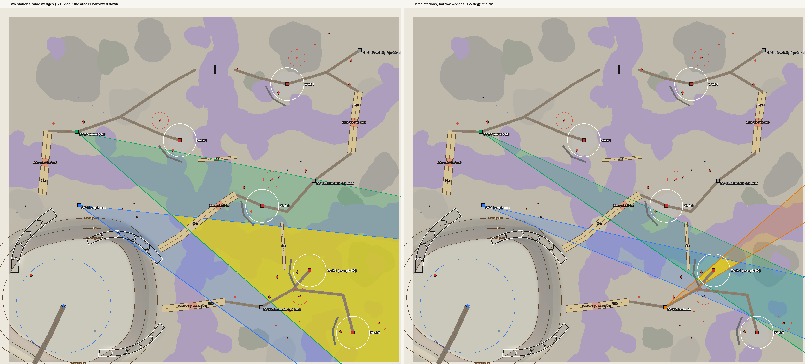

# Oder-Warthe mission: mission logic and flow (draft for review)

Status: first draft, 2026-11-16. Nothing is built. This document covers **what happens in the mission, in what order,
and the rules behind it**. The background (lore, location, alternatives) is in
[OderWartheMission.md](OderWartheMission.md). Every number here is a starting value to tune, and every item marked
**(open)** needs the owner's decision.

Layout: sketch C "Corner Ridge over the Lakes" (`MapDesigner/OderWarthe/df2_c.layout.json`).

Names used below come from the sketch: the base ridge (south-west), the three ramps (north, prow, east), the crossings
(Packlitz dam, island causeway, Kalau causeway, Lubow dam, Hochwald ford, two infantry boardwalks), the stations DF 1-5,
the bunker groups Werk 1-5 with their tunnel mouths, and the six outposts at the crossing heads.

## 1. The mission in one paragraph

The player arrives on a ridge in the south-west corner and builds a base. Somewhere in one of five identical bunker
groups across the lakes sits a Shield command post. The player cannot see it; they can only hear it. They take
direction-finder stations across the causeways, and each station draws a bearing wedge on the minimap. The wedges
narrow each time the command post transmits, and it transmits most when it orders attacks. Every wave the player
survives therefore brings them closer. Two stations narrow the search to two bunker groups, three find it. The player
then assaults the command post and destroys it.

## 2. Pacing at a glance

Target length: **30-40 minutes** on Normal (proposal).

| Phase | Rough time | What the player does | What the enemy does | Ends when |
|---|---|---|---|---|
| 0. Arrival | 0:00-1:00 | Watches the location intro and the briefing; the HQ truck drives up the ridge | Nothing | Briefing ends |
| 1. Dig in | 1:00-6:00 | Deploys the HQ, builds a refinery and metal extraction, takes DF 1 below the north ramp | Grace period, then the first wave | First wave is beaten |
| 2. Second bearing | 6:00-14:00 | Crosses the Packlitz dam, takes DF 2 and the metal dump, learns to bait the outposts | Waves on a timer, outposts reply | Two wedges overlap |
| 3. They notice | 14:00-25:00 | Takes a third station (DF 3, 4 or 5) and expands into its basin | Counterattacks held stations, bigger waves | Fix: one bunker group left |
| 4. The fix | about 30 s | Watches the reveal and the camera tour | The command post stops hiding | Tour ends |
| 5. Assault | 25:00-35:00 | Destroys the command post's three targets | Last-stand defence, all tunnel mouths launch | All three targets destroyed |
| 6. Aftermath | about 1:00 | (Optional) recovers the signals archive | Waves stop, garrisons stop reinforcing | Victory |

## 3. Step by step

### Phase 0: Arrival

1. **Location intro** (existing `ShowLocationIntro` node): "Festungsfront Oder-Warthe-Bogen, Lebus district, 1976."
2. The **HQ truck and a light escort** drive in on the old road from Frankfurt (Oder) and up onto the ridge. **(open)**
   whether the player starts with only the HQ truck, or also a barracks truck and a refinery truck.
3. **Briefing** (GermanAnnouncer portrait, about 30 s):
   - "The radio in Berlin caught Shield command traffic. One bearing points here, into the old bunker line. One bearing
     is a direction, not a place."
   - "There are five bunker groups out there. One of them is talking. Build up, take the listening posts, and find it."
4. **Fog:** the unexplored-fog reveal is on (`AMissionManager::bRevealUnexploredFog`), so the player sees the lakes,
   causeways and the five bunker groups as landscape. Enemy units and buildings stay hidden until seen.

### Phase 1: Dig in

5. **Objective "Establish the base":** deploy the HQ inside the ridge's build circle, then build a refinery on the
   radixite seep and metal extraction on the wrecked column. (The sketch uses "hold the ridge" as a stand-in; this
   step needs a small "build these buildings" objective, see section 6.)
6. **Objective "Take the listening post":** DF 1 Pump house sits at the foot of the north ramp, in the home basin, with
   no crossing and no guard. It is the tutorial station. When it is captured:
   - the first wedge appears on the minimap, wide (about +-20 degrees);
   - advisor: "Now we listen."
7. **The first wave** (proposal: released when DF 1 is held, or after the grace period at the latest, 5 minutes on
   Normal). It comes from one tunnel mouth, crosses its causeway and climbs one ramp.
   - The moment the wave is ordered, DF 1 hears the **attack-order burst** and its wedge visibly snaps narrower.
   - Advisor names the core rule: **"When they attack, they talk."**
8. The phase ends when the first wave is beaten. Reward: a small resource drop, or just the advisor line **(open)**.

Note: this order is a change from the sketch's objective chain, which has "hold through the first wave" before DF 1.
DF 1 comes first here so that the first wave teaches the mechanic.

### Phase 2: Second bearing

9. **Objective "Cross the Packlitz dam and take DF 2 Forester's hill"** in the north basin. The metal dump beside it
   is the first real expansion.
10. **Bait lesson:** the Packlitz outpost holds the north head of the dam. When the player attacks it, the command post
    answers 10-20 s later (the **reply burst**) and DF 1's wedge narrows. Advisor: "Every time we hit them, someone
    reports to the command post, and the command post answers."
11. When DF 2 is held, the **two wedges overlap**. The minimap shades the overlap. On this layout it always contains
    two of the five bunker groups.
    - Advisor: "Two bearings, a rough area. We need a third, and from a different angle."
12. Waves continue on a timer (section 4.4). Each wave launch is an attack-order burst for every held station.

### Phase 3: They notice

Triggered by the first two-wedge overlap.

13. **The command post reacts** (Shield operator line in Russian, with subtitles: "Someone is listening on our
    frequency."):
    - **station counterattacks:** every few minutes a small force tries to retake the most recently captured station;
    - **routine traffic drops** (bursts every 90-120 s instead of 60-90 s), so the player has to bait more;
    - **waves grow** one step (section 4.4).
14. **The third station is the player's choice.** Each one sits with a resource site, so the hunt and the economy pull
    the same way:

    | Station | Crossing | Resource beside it | Notes |
    |---|---|---|---|
    | DF 3 Kalau heath | Kalau causeway from the east ramp | Large radixite field | The default third station; makes the fix on every bunker group |
    | DF 4 Middle neck | Island causeway from the prow ramp | Rich metal (rail yard) | Between two bunker groups; strongly guarded |
    | DF 5 Lubow height | Hochwald ford or Lubow dam | Radixite vein | Hardest to reach; best angle for three of the five groups |

15. **Destroying a bunker group** is allowed. If it is not the command post, it drops out of the search (and its tunnel
    mouth stops launching waves). It is expensive, because every group has the same garrison, but it is a fair way to
    narrow the search.

### Phase 4: The fix

16. **Fix condition:** the overlap of three or more held wedges contains exactly one bunker group (section 4.3).
17. **Reveal**, reusing `USecureBaseMission`'s reveal, tour and markers:
    - vision bubbles over the bunker group for about 60 s;
    - a camera tour of about 20 s: "the transmitter array", "the command bunker entrance", "the tunnel railway entrance";
    - destroy markers and minimap icons on those three targets. They were camouflaged and could not be targeted until
      now.
    - Advisor: "There you are."

### Phase 5: Assault

18. **Objective "Destroy the Shield command post":** the three targets above.
19. **Last stand** (proposal):
    - the command post's own garrison digs in (an existing `AEnemyStrongpoint` with dig-in);
    - the other tunnel mouths launch waves at the player's **assault force**, not at the base;
    - routine bursts stop, because the bearings no longer matter.
20. **(open, Brutal only, from the main doc):** if the command post is not destroyed within N minutes of the fix, the
    commander escapes by the tunnel railway to another group, and the wedges reset to grey. Off by default.

### Phase 6: Aftermath

21. When the last target dies: waves stop, the remaining garrisons no longer reinforce, and the advisor celebrates.
22. **Optional objective "Recover the signals archive":** an infantry squad enters the destroyed command bunker.
    Reward: the Act 1 lore clue (1946 Red Army quarantine orders about "Fitofag" in the wheat) and the campaign-map
    reward **(open)**.
23. Victory.

## 4. The rules underneath

### 4.1 The command post

- At mission start, one of the five bunker groups is chosen as the command post. **(open)** random each playthrough
  (proposal), or fixed. Every group has the same garrison, the same surface buildings and a tunnel mouth, so nothing on
  the surface gives it away.
- The command post's three targets exist from the start, but they are hidden and cannot be targeted until the fix, or
  until the player's units reach that group's tunnel mouth.

### 4.2 Stations and wedges

- **Station states:** enemy-held, contested (the flag moves), player-held, lost. Only player-held stations hear bursts
  and narrow their wedge.
- **Wedge:** each station keeps a half-angle `H` and a centre error `E`.
  - Start: `H` = 20 degrees, `E` = a random angle up to 35% of `H`.
  - Each burst multiplies `H` (and `E` with it) by the burst's factor. Minimum `H` = 2 degrees.
  - A lost station keeps its wedge, drawn grey, and stops narrowing. Retaking it continues from the same wedge.

### 4.3 Bursts

| Burst | When | Factor (proposal) |
|---|---|---|
| Routine traffic | Every 60-90 s (90-120 s after phase 3) | x 0.9 |
| Reply | 10-20 s after the player attacks an outpost or any bunker group; at most once per outpost per 60 s | x 0.7 |
| Attack order | When any wave launches | x 0.5 |

- **Overlap:** the area covered by every held wedge. The minimap shades it.
- **Narrowed:** at least two held wedges; the overlap is shown.
- **Fix:** at least three held wedges, and the overlap touches exactly one bunker group that is still standing.
- **Feedback:** each burst plays a short Morse tone and jumps a signal-strength needle in the mission UI. The wedge
  narrowing is animated so the player sees which event caused it.

### 4.4 Waves

- **Source:** each wave comes from the tunnel mouth of a random standing bunker group, all with the same weight. Waves
  cross a causeway and climb one of the three ramps. The sketch's split is north ramp 40%, prow ramp 20%, east ramp 40%.
- **Interval** (proposal, Normal): first wave after DF 1 or at 5:00, then every 3:00. After phase 3, every 2:30.
- **Size** grows in steps: by time, and one step more after phase 3. Unit mix is **(open)** (Soviet infantry and light
  armour early, T-34s and AT teams later).
- Wrecks can seal the Packlitz sluice and the Kalau breach (both 10 m). The island causeway's blown culvert is 11 m on
  purpose, so one lane always stays open.

### 4.5 Win and lose

- **Win:** the command post's three targets are destroyed.
- **Lose:** the player's HQ is destroyed (`UDontLoseHQMission`).
- No hard timer.

## 5. Difficulty (proposal)

| Setting | Normal | Hard | Brutal / Ironman |
|---|---|---|---|
| Grace period before the first wave | 5:00 | 4:00 | 3:00 |
| Wave interval | 3:00 then 2:30 | 2:30 then 2:00 | 2:00 then 1:45 |
| Starting wedge half-angle | 20 degrees | 22 degrees | 25 degrees |
| Station counterattacks | One small force | Two forces | Two forces, more often |
| Decoy radio truck (main doc) | Off | **(open)** | **(open)** |
| Commander escapes by tunnel (main doc) | Off | Off | **(open)** |

## 6. What has to be built

| Piece | Exists? |
|---|---|
| Mission chain, objectives, triggers (`UMissionBase`, `AMissionManager`, trigger areas) | Exists |
| Reveal, camera tour, destroy markers (`USecureBaseMission`) | Exists |
| Waves from placed spawners (`AEnemyWaveSpawner`) | Exists; needs the "random standing group" picker and a hook that fires the attack-order burst |
| Dug-in defenders (`AEnemyStrongpoint`) | Exists |
| Lose condition (`UDontLoseHQMission`) | Exists |
| Location intro, portrait lines with subtitles | Exist |
| Unexplored-fog reveal | Exists |
| Capturable station with a rising flag | `ASupplyPoint` has capture; reuse unchecked |
| "Build these buildings" objective | **New** (small) |
| Direction-finding manager: command post pick, stations, bursts, wedges, overlap, fix | **New** (core of the mission) |
| Wedges and overlap on the minimap and the full map | **New** (the minimap draws lines today, not wedges) |
| Signal needle and Morse feedback | **New** |
| Hidden command post targets that unlock at the fix | **New** (small) |
| Station, bunker group and tunnel mouth assets | **New** assets |

## 7. Open questions for this review

1. Is the phase order right, in particular DF 1 before the first wave?
2. What does the player start with (HQ truck only, or more), and is the base-building kit limited?
3. Is the command post random each playthrough, or fixed?
4. Should destroying a wrong bunker group remove it from the search (step 15), or is that too easy a shortcut?
5. Wave timing and sizes: are the proposed intervals in the right range for a 30-40 minute mission?
6. Do station counterattacks belong in the mission, or do they make holding stations a chore?
7. The finale: last-stand waves at the assault force, and is the signals archive optional or required?
8. Decoy truck and tunnel escape: keep as optional difficulty modules, or drop?
