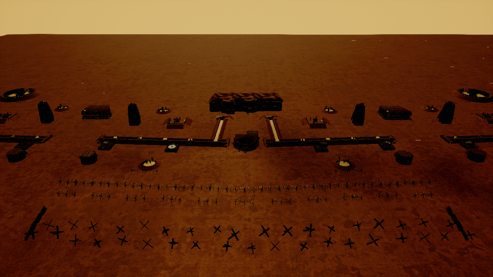
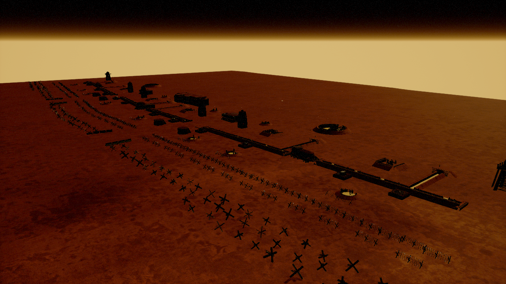
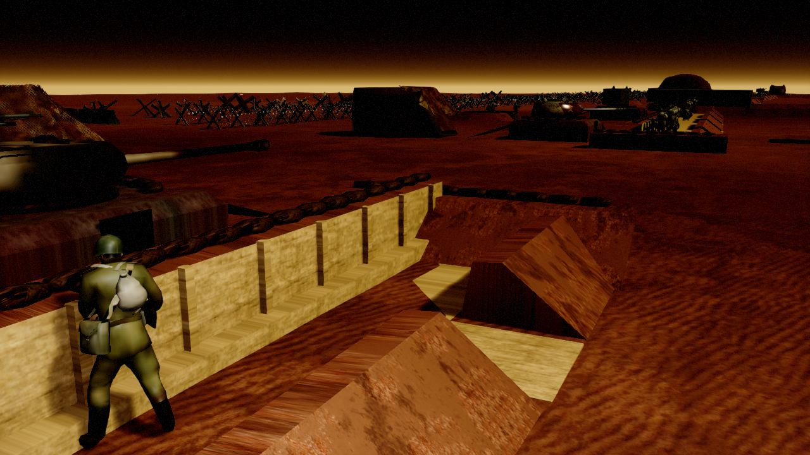
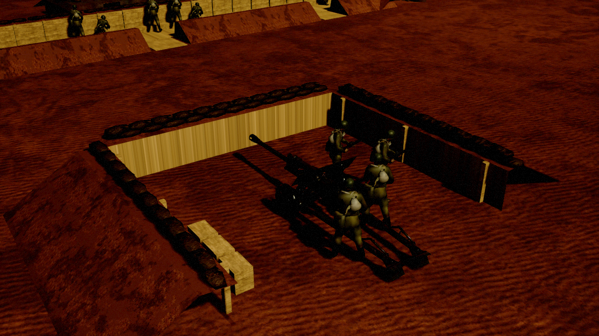
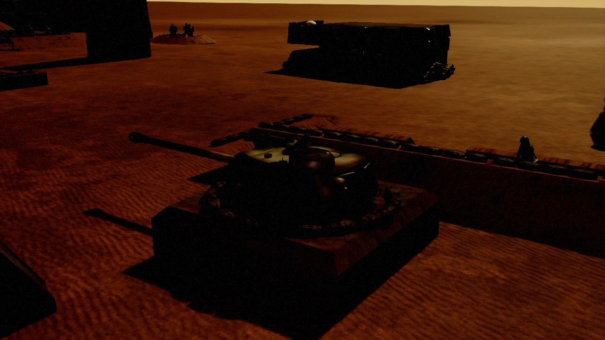
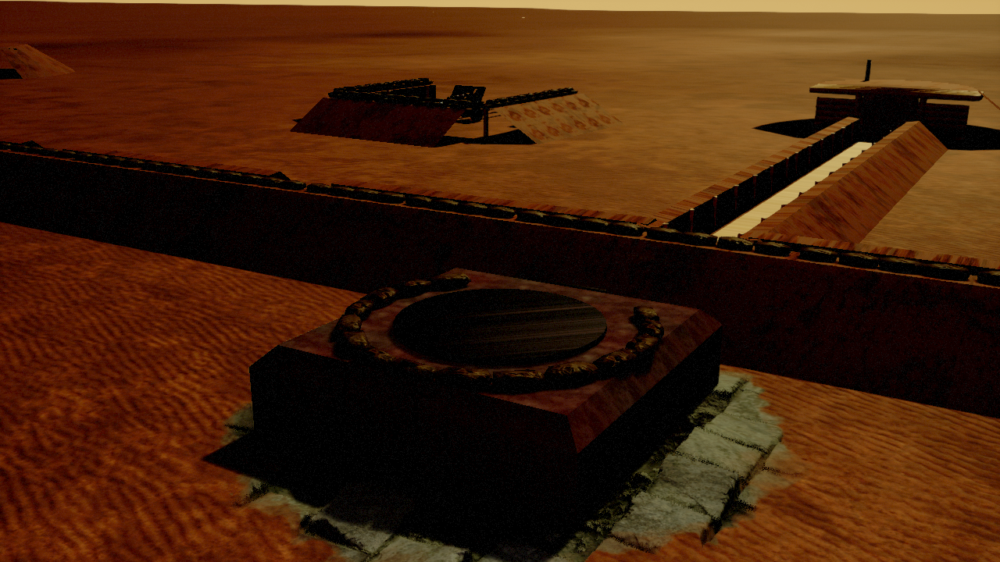
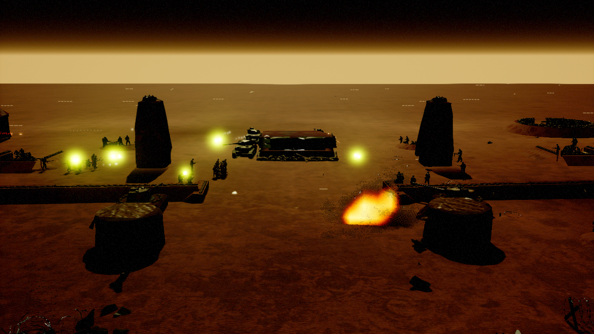

# RedLine

`/Game/RTS_Survival/Maps/GerMissions/RedLine` is a German mission map. It was copied from `Maps/ToCopy/RTS_ToCopySmall`, and a Soviet defense line runs across its middle. The player starts in the south-west and attacks north (+Y). Every piece of the line belongs to the enemy (player 2).



## Layout

The line bows forward to a salient at x = 0: y = 1800 + |x| · 1200 / 19500, refused on both flanks. Front to back:

| Belt | Distance in front of (−) / behind (+) the trench | Pieces |
|---|---|---|
| Hedgehogs | −4800 to −5700 | 172 hedgehogs (`Hedgehog`, `Hedgehog4`, `LargeHedgehog`) in staggered rows out to x ±23800. Concrete-barrier funnels lead into the two tank lanes. |
| Barbed wire | −3000 and −3600 | 110 `BarbedWireLong`, open at the tank lanes |
| Forward MG nests | −1700 | 8 `BP_RL_MGNest`, each with a Maxim team and short wire in front |
| Turret pillboxes | −620 | 12 `Rus_BXP_RL_TurretPillbox_*`. IS-2, IS-1 and two T-34-85 flank the tank lanes. |
| Fire trench | 0 | 6 sectors, 32 `BP_RL_Trench_Straight` (each with 8 cargo cover sockets), capped by `BP_RL_TrenchEnd` |
| Strongpoints in the joints | 0 | Dome bunker (garrison) in the salient; LongCamo bunkers at x ±14500 |
| Tank lanes at x ±6750 | | Lane edges: MG bunkers. Behind: Bunker02 ZiS AT bunker. Over the lane: two BT-7 guard towers. |
| Communication trenches and dugouts | +600 to +2500 | 12 `BP_RL_CommTrench`, 6 `BP_RL_Dugout` |
| Gun line | +1700 / +3000 | 6 `BP_RL_GunBay` with ZiS-3 and M1938 crews; 4 mortar pits (120 mm, 80 mm) |
| Artillery and command | +3900 / +4600 | MegaBunker command post at x = 0, B-4 howitzer pits at x ±12000, MG guard towers on the flanks |

There are 32 garrison squads (157 soldiers): Mosin and Mosin-PTRS squads behind the trench, Maxims in the nests, and a large PTRS reserve. When idle they walk into the trench cover by themselves.



## Assets

All new assets live in `/Game/RTS_Survival/Blueprints/Environment/RedLine/`.

### Field fortifications

- **Meshes:** generated procedurally in Blender by `D:\Blender\BlenderProjects\Marketplace\Scritps\RedLine\redline_fieldworks.py`. They are raised breastworks, so the landscape is not cut.
- **Import:** `Tools/RedLine/ue_redline_import.py`.
- **Blueprints:** `BP_RL_*` children of `BP_TrenchMaster`, so the socket cover system picks them up:
  - `cargo_N` sockets on the trenches are trench stand-up cover.
  - `crouch_N` sockets on the MG nest and the gun bay are crouch cover.
- **Sandbags:** the bags are the SandBagPack singles (`SM_SandBag_Single_01..03`, exported to `PackBags/` next to the generator), so their UVs match `MI_Rus_SandBag_01`. The trench lip has two uneven courses in running bond, and short stretches get a third. Gun bay banks close at the front corners and are capped at the rear.
- **Entry gap:** the fire trench's rear bank is higher than a soldier can step. Each straight segment therefore has a 2 m gap in the middle of the rear bank. Soldiers walk in through it, and communication trenches join there.




### Turret pillbox (`Pillbox/Rus_BXP_RL_TurretPillbox`)

- **Origin:** a copy of the B-4 pit BXP.
- **Structure:** a concrete box with earth banks and a sandbag collar. A Soviet tank turret sits on the `TurretMount` socket.
- **Variants:** the base mounts the KV-1 76 mm emplacement turret. Children `_T34_85`, `_IS2`, `_IS1`, `_KV2`, `_T70` and `_BT7` each swap the child turret.
- **Type:** expansion type `BTX_RusTurretPillbox` (T2 build time, heavy bunker health, reinforced armour).
- **Enemy builds:** the enemy controller can also build it as a satellite building.
- **Death:** it leaves `BP_Obstacle_RL_PillboxDestroyed`, a permanent wreck.




## Rebuilding the line

The layout is a script, so the map can be changed and re-laid. It is re-runnable: every placed actor is labelled `RL_*` and removed first.

1. Lay out the line. The landscape map only saves with rendering, so do not pass `-NullRHI`:
   ```
   UnrealEditor-Cmd <uproject> -run=pythonscript -script=<Source>/Tools/RedLine/ue_redline_layout.py -unattended -AllowCommandletRendering
   ```
2. Rebuild the navmesh. It is static with runtime modifiers only:
   ```
   UnrealEditor-Cmd <uproject> -run=ResavePackages -BuildNavigationData -MAP=RedLine -unattended -AllowCommandletRendering
   ```

The salient constants are mirrored in `RTS_Survival/Utils/RTSMapTests/RedLine/RedLineTourScenario.cpp`.

## Unattended test

`FRedLineTourScenario`:
```
UnrealEditor-Cmd <uproject> /Game/RTS_Survival/Maps/GerMissions/RedLine -game -unattended -RenderOffscreen -windowed
  -ResX=1280 -ResY=720 -benchmark -fps=30 -DisablePlugins=Fab -RedLineTour [-RedLineAssault] [-RedLineCapture=<folder>]
```

It checks:
- the pillboxes (count, enemy owner, mounted turret);
- the 32 trenches and their 256 registered cover points;
- that the garrison settles into the trenches (76 soldiers);
- with `-RedLineAssault`, that four Panzer IV G driving through the western lane draw pillbox fire;
- that a destroyed pillbox leaves a wreck that is still there 15 s later.

Last run: 15 checks, all PASS. The pillboxes fired 53 rounds and all four tanks died within 48 s.



Notes:
- **Run rendered.** Enemy vision is a GPU Niagara readback (`AFowManager::UpdateEnemyVision`). Under `-NullRHI` no unit is ever tagged as in enemy vision, so Soviet guns never fire.
- **Fixed alongside:** `ABuildingExpansion::PostInit_SetupAbilities` reported "Could not find bxp data for enemy bxp: BXT_Invalid" for every Soviet BXP, placed or built. None of them set their subtype in `BP_PostInit_SetupRTSSubtype`. It now waits silently for `InitBuildingExpansion`, which sets the abilities from the same data.
- **Wreck lifespan:** the B-4 pit wreck and the pillbox wreck inherited a 12 s `SetLifeSpan` from the MG-bunker wreck they were copied from. It was removed, so both stay as obstacles.
