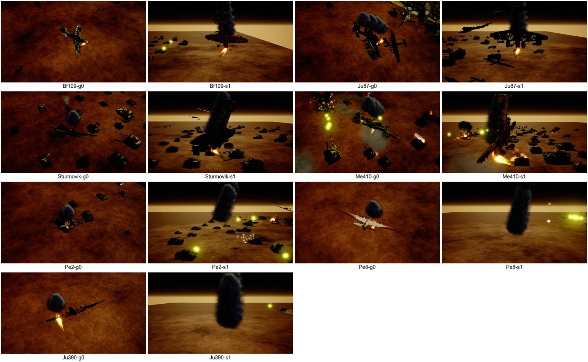
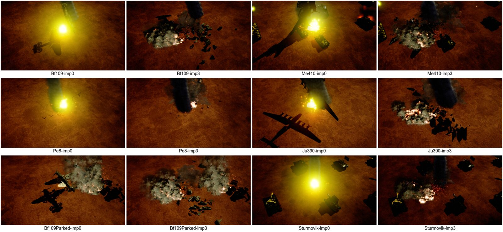

# Aircraft: anti-air targeting and the burning crash

## Anti-air targeting

Turrets whose `TargetPreference` is `Aircraft` look for aircraft first and fall back to ground targets
(`FGetAsyncTarget::ProcessTargetRequests`); every other turret never gets an aircraft. Three things kept them from
ever engaging one:

- **Aircraft were never registered.** Every aircraft Blueprint inherits `bAddToGameState = false` on its RTS component
  from `BP_Aircraft`, so no aircraft entered the game unit manager's alive lists and the target search never saw one.
  `AAircraftMaster::PostInitializeComponents` now switches the flag on (`URTSComponent::SetAddToGameState`) before
  the component registers in BeginPlay. Aircraft parked inside their airbase (`EAircraftLandingState::Landed`) are left
  out of the target data; they are engaged once they lift off.
- **Enemy aircraft could not be hit.** Aircraft collision comes from the Blueprints, which are authored for the player.
  `AAircraftMaster::BeginPlay_SetupWeaponHitCollision` sets the team channels for the real owner
  (`FRTS_CollisionSetup::SetupAircraftWeaponHitCollision`): the other side's traces and projectiles hit it, its own
  side's pass through; other responses stay as the Blueprint set them.
- **Only the Bofors was set to `Aircraft`.** These turret Blueprints now are too:
  `RTS_BP_EmbTurret_37mmFlak` (also used by the HQ flak platform and the flak bunker), `RTS_BP_EmbTurret_4x20mmFlak`,
  `RTS_BP_EmbTurret_88mmFlak`, `RTS_BP_EmbTurret_GerPit_Flak37`, `Ger_Turret_PZIII_AA`, `Rus_Turret_T34AA` (and its
  `_Soviet` child), and the towed flak team weapons `Ger_TW_Flak37MM` and `Ger_TW_Flak88` (they were `Tank`). The
  Aircraft preference cannot be changed by the player's target-preference button, by design.
- **The towed flak guns could not follow an aircraft.** Team weapons are turned by their crew within a yaw arc
  (Flak 37 ±90°, Flak 88 ±140°) and switch their gun off while the crew turns, so a circling aircraft kept leaving the
  arc. Both now have the arc 0, which the config documents as "traverses all the way round", and
  `ATeamWeapon::BeginPlay_ApplyTeamWeaponConfig` now makes such a team weapon a freely traversing turret instead of a
  crew-turned one (only these two use 0). Their pitch limits (35° and 40°) were left alone, as they drive the crew
  animation; the shots still go where the target is. The Flak 37's traverse (`WeaponYawRotationSpeed`) went from
  15 to 30 degrees per second (the Flak 88 has 25). Crewed guns still fire less often at an aircraft passing close by
  than the turrets do (the test asks one shot of them, three of the others): a balance setting.

Not changed: the DShK pit (a heavy machine gun, not set to anti-air) and `URTSComponent::ChangeOwningPlayer`, which
still re-registers tanks, squads and standalone turrets only. The VTOL resource shuttle (`AVTOLDropshipAircraft`)
stays out of the target lists (`GetIsTargetableByAntiAir` returns false): it is scripted scenery for its pad.

Registering aircraft also makes the checks that read the alive lists work for the first time: global-ability
requirements "player has an aircraft of type X" (`UGlobalAbilitiesManager::CheckDoesPlayerHaveAircraft`) and
`UMissionBase::DoesPlayerHaveAnyAircraftMastersOfType`. An aircraft a global ability spawns for a strafe or bombing
run counts while it flies.

Aircraft destroyed without being shot down (a bombing run that retreats off the map) now leave the alive lists in
`AAircraftMaster::EndPlay`, so the per-type aircraft counters stay right.

## The burning crash

`AAircraftMaster::UnitDies` no longer destroys the actor. It marks the unit dead, takes it out of the target lists,
stops weapons, bombs, timed runs, target acquisition and movement, frees its bay, deselects it, destroys a tank it was
carrying, and hands over to `UAircraftDeathComponent` (created on every aircraft):

- **Fire.** A single-propeller aircraft (one `B_Rotor*` bone: Bf 109, Ju 87, Il-2 Sturmovik, the VTOL dropship) burns at
  its nose engine; a multi-engine aircraft (Me 410, Pe-2, Pe-8, Ju 390) burns at one of its wing engines, chosen per
  aircraft (`FAircraftDeathMath::PickWingEngineIndex`, never the centre engine). The flame streams back from the
  engine (attached to the mesh at the engine, not to the spinning propeller bone), and dark smoke puffs are dropped into
  the world every `SmokeTrailSpacing` of the fall so they form a trail. `FireSocketOverride` / `FireOrigin` on the
  component override the choice per Blueprint.
- **Fall.** `FAircraftDeathMath::StepCrashFlight`: the wreck keeps the speed it had (at least `MinCrashSpeed`), the nose
  drops into a dive of at most `MaxDiveDegrees`, gravity and drag act on it. A burning wing drops: the wreck rolls over
  towards it and turns into a spiral; a nose fire only rocks it.
- **Impact.** A trace from the belly finds the ground (or any static object). An explosion, the impact sound, burning
  fuel on the ground, and the wreck: `AAircraftWreckActor` with the aircraft's crash geometry collection, crumbled into
  all its pieces at once, keeping part of the impact velocity (forward along the flight) and blown apart. Pieces land on
  the ground and pass through units; they shrink away once asleep and the wreck goes after `WreckLifeSeconds`. The
  aircraft actor is hidden and goes after its smoke has faded (8 s).
- **Parked.** An aircraft killed while landed on the ground (in its bay or on a field) collapses where it stands:
  its pieces get a fifth of the scatter, so they stay within about its own size and do not fly through bay walls.
  The airbase building has query-only collision: its walls do not stop pieces, only the low scatter keeps them in
  (checked for a Bf 109 in the German airbase; larger aircraft in bays are not tested). From the game camera the bay
  roof hides the wreck; fire and smoke rise from the bay. In one run a piece came to rest 1 m below the bay floor,
  out of sight under the building (the ground under it was not measured); the check compares each piece with the
  ground under it.
  A drop-ship aircraft waiting in the air for its drop order also reports "landed"; it falls like any other.
- After death the aircraft takes no more move, attack or return-to-base orders; at impact its engine sounds stop and
  it leaves the fog of war. A VTOL shuttle killed by splash damage stops its scripted descent and crashes too.

Effects scale with the aircraft's span (`FighterHalfSpan` 700 cm, up to x2); smoke grows with the square root of that
so a bomber's trail does not hide the bomber. Every effect is an `FAircraftDeathEffect` (system, user parameters,
scale) in `FAircraftDeathSettings`, editable per aircraft Blueprint on the `AircraftDeath` component. Defaults:
engine fire `NS_Jet_Fire_Continuous`, smoke `NS_SmokePuff4a` (x0.6), explosion `NS_RTS_Explosion_Big_9`, ground fire
`NS_LargeTank_OnFire`. They are listed in `CrashCollections/DA_AircraftDeathCookReferences` so the cook packs them
(C++ names them by path only). The tank fire, rocket smoke and smoking-unit systems were tried and dropped: from the
RTS camera they filled the screen with embers or haze, and their user parameters barely change that.




## Crash geometry collections

`/Game/RTS_Survival/Blueprints/Aircraft/CrashCollections/GC_Crash_<mesh>` (always cooked, see `DefaultGame.ini`), one
per set of aircraft meshes; the aircraft finds its own by the same name
(`FAircraftDeathMath::GetCrashCollectionAssetName`: the static frame names it when there is one, else the skeletal
mesh). Built by the editor command

```
RTS.Aircraft.BuildCrashCollections [AircraftClassNameFilter] [Overwrite]
```

run in a headless editor, e.g. a python script with
`unreal.SystemLibrary.execute_console_command(None, 'RTS.Aircraft.BuildCrashCollections Overwrite')` and
`UnrealEditor-Cmd <uproject> -run=pythonscript -script=<file> -unattended -nullrhi -DisablePlugins=Fab`.
It spawns every aircraft Blueprint in the editor world, appends its visible meshes, merges them into one geometry,
bakes that into collection space, Voronoi-cuts it with sites sampled on the aircraft's own surface (23-64 pieces by
size), removes the uncut parent geometry, sets removal on sleep and flags the aircraft materials for geometry
collections. Rebuild after an aircraft mesh changes. Lessons:

- Skeletal meshes arrive as one geometry per bone section (170 for the Bf 109) marked as embedded; mark them rigid
  before `MergeAllSelectedBones`, or nothing merges and every cell holds a piece of every part.
- Their bone transforms carry the import scale, which Chaos ignores: without baking into collection space the pieces
  simulate at a hundredth of their size, ~100 m from the aircraft.
- The uncut parent geometry stays in the collection after the cut, hidden but still casting the whole aircraft's shadow.
- `CutMultipleWithPlanarCells` must not set interior materials from the collection (its UV scale comes out
  non-finite on these meshes); the interior faces use material 0.
- A build still logs three harmless Chaos `ensure`s (`NumVertices == MeshDescription.Vertices().Num()` from the
  skeletal append, two `ManagedArrayCollection` element checks), so the commandlet exits with code 1; the log line
  `RTS_AIRCRAFT_CRASH_COLLECTION done built=7 failed=0` is the result.
- Pieces collide only with static geometry and each other. With the default solver iterations, heavy pieces piled on
  a thin wing panel of a parked aircraft squeezed it through the landscape (about every other run of the airbase case);
  the wreck now uses 16 position / 2 velocity / 4 projection iterations and some angular damping (5 of 5 airbase runs
  clean afterwards, and the full run). CCD is on too: it was added while chasing this and did not change it on its own;
  its benefit at crash speed and its cost with many wrecks at once are not measured.
- The wreck is placed so the lowest point of the collection's own geometry clears the highest ground under it
  (sampled on a 4x4 grid, at most 3 m above the impact so a tree or wall beside it does not count). The aircraft mesh
  bounds reach metres below the wheels (padded skeletal bounds) and dropped the pieces from 3 m up.
- Every piece's transform origin is the aircraft's centre (the geometry is baked into collection space), so where a
  piece is must be read from the centre of its geometry, not from its transform.

## Tests

- `RTS.Aircraft.Death.*` automation tests (`AircraftDeath/Tests/AircraftDeathMathTests.cpp`): fire origin by engine
  count, the burning engine on the right part, the wreck keeping its speed, a nose fire diving without rolling over, a
  wing fire dropping that wing and spiralling towards it, the dive limit, the collection naming.
- Map tests (`Units/Aircraft/Tests/AircraftTestSubsystem`, `RTS_AIRCRAFT_TEST` log lines), rendered offscreen on
  `UT_Nomadics` (fog of war needs rendering):
  - `-AntiAirValidate`: the Bofors bunker, 37 mm and 88 mm flak, Flak 37 pit, flak bunker, Panzer III AA, T-34 AA
    and the towed Flak 37 and Flak 88 squads must target, fire at and damage an enemy aircraft circling over them,
    then turn on an enemy tank. Optional `-AntiAirUnit=<label>`.
  - `-AircraftDeathValidate`: shoots down a Bf 109, Ju 87, Sturmovik, Me 410, Pe-2, Pe-8, Ju 390, both drop ships and
    the VTOL shuttle in flight, a Bf 109 parked on a field and a Bf 109 parked in a bay of an unpacked German airbase
    (`Ger_Airbase_Truck`, placed the way a trained aircraft is); checks dead-not-destroyed, out of the target lists,
    fire on the right engine, the fall starting with the speed it had and carrying it on, impact on the ground, the
    breakup, the fire ending, the actor being cleared, a parked aircraft's pieces staying within its own size, and in
    the airbase every piece staying inside the building and above the ground under it (203 checks; the aircraft are
    spread over rows of six so all twelve land on the test map). `-AircraftDeathOnly=<label>`,
    `-AircraftDeathCapture=<folder>` for pictures, and `-AircraftDeath<Fire|Smoke|Explosion|GroundFire>Vfx=<path|none>`
    / `...Params="Name:Value|Name:X,Y,Z|@Scale:S"` / `-AircraftDeathDumpVfxParams` to try other effects.

```
UnrealEditor-Cmd.exe RTS_Survival.uproject /Game/RTS_Survival/Maps/UnitTests/UT_Nomadics -game -unattended -nosound -RenderOffscreen -windowed -ResX=1280 -ResY=720 -AircraftDeathValidate -log
```

UT_Nomadics has aircraft of its own circling the map; their shadows show in the pictures.
