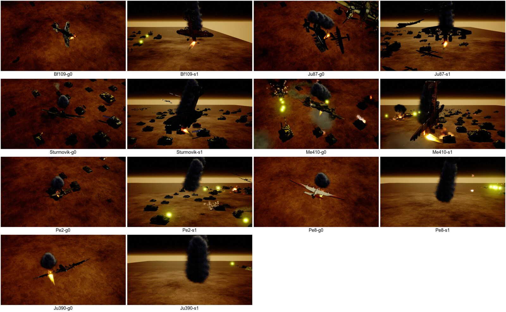
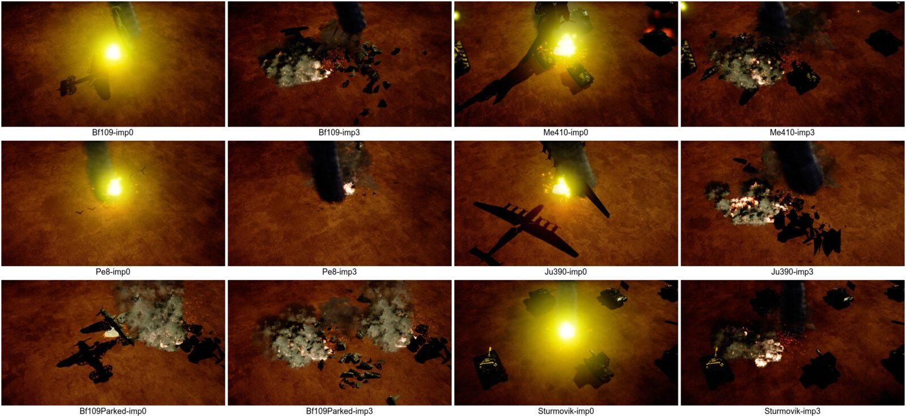

# Aircraft: anti-air targeting and the burning crash

## Anti-air targeting

Turrets whose `TargetPreference` is `Aircraft` look for aircraft first and fall back to ground targets
(`FGetAsyncTarget::ProcessTargetRequests`); every other turret never gets an aircraft. Three things kept them from
ever engaging one:

- **Aircraft were never registered.** Every aircraft Blueprint inherits `bAddToGameState = false` on its RTS component
  from `BP_Aircraft`, so no aircraft entered the game unit manager's alive lists and the target search never saw one.
  `AAircraftMaster::PostInitializeComponents` now switches the flag on (`URTSComponent::SetAddToGameState`) before
  the component registers in BeginPlay. Aircraft parked inside their airbase (`EAircraftLandingState::Landed`) are left
  out of the target data; they are engaged once they lift off.
- **Enemy aircraft could not be hit.** Aircraft collision comes from the Blueprints, which are authored for the player.
  `AAircraftMaster::BeginPlay_SetupWeaponHitCollision` sets the team channels for the real owner
  (`FRTS_CollisionSetup::SetupAircraftComponentCollision`): the other side's traces and projectiles hit it, its own
  side's pass through. Every aircraft primitive is query-only (or stays disabled), ignores physical object channels,
  and has physics, overlaps and navigation influence disabled, so aircraft pass through each other and off-map
  boundaries. Authored mouse/camera trace responses are retained for selection. The shared projectile object channel
  is ignored: projectile hits use the same team-specific traces and sweeps as other weapons.
- **Only the Bofors was set to `Aircraft`.** These turret Blueprints now are too:
  `RTS_BP_EmbTurret_37mmFlak` (also used by the HQ flak platform and the flak bunker), `RTS_BP_EmbTurret_4x20mmFlak`,
  `RTS_BP_EmbTurret_88mmFlak`, `RTS_BP_EmbTurret_GerPit_Flak37`, `Ger_Turret_PZIII_AA`, `Rus_Turret_T34AA` (and its
  `_Soviet` child), and the towed flak team weapons `Ger_TW_Flak37MM` and `Ger_TW_Flak88` (they were `Tank`). The
  Aircraft preference cannot be changed by the player's target-preference button, by design.
- **The towed flak guns could not follow an aircraft.** Team weapons are turned by their crew within a yaw arc
  (Flak 37 ±90°, Flak 88 ±140°) and switch their gun off while the crew turns, so a circling aircraft kept leaving the
  arc. Both now have the arc 0, which the config documents as "traverses all the way round", and
  `ATeamWeapon::BeginPlay_ApplyTeamWeaponConfig` now makes such a team weapon a freely traversing turret instead of a
  crew-turned one (only these two use 0). Their pitch limits (35° and 40°) were left alone, as they drive the crew
  animation; the shots still go where the target is. The Flak 37's traverse (`WeaponYawRotationSpeed`) went from
  15 to 30 degrees per second (the Flak 88 has 25). Crewed guns still fire less often at an aircraft passing close by
  than the turrets do (the test asks one shot of them, three of the others): a balance setting.

### Anti-air range

Ground weapons engage an aircraft at `DeveloperSettings::GameBalance::Ranges::AntiAirRangeMlt` (4x) their range, since
aircraft fly high and far and the range is measured in 3D. The weapon's own range is never changed, so the range the
player sees stays the ground range. The multiplier is applied in three places that must agree:

- **Search.** `FGetAsyncTarget::ProcessTargetRequests` compares an aircraft against the requested radius times the
  multiplier; ground actors keep the requested radius. No extra data goes to the thread: an aircraft only reaches the
  distance check for an `Aircraft` request. This also reaches attack-move and aggro searches of `Aircraft`-preference
  units.
- **In-range check.** `FWeaponTargetingData` caches `GetIsAircraftTarget` when a target is set
  (`FWeaponRangeData::GetIsAntiAirRangeTarget`: any `AAircraftMaster`), and the turret, standalone turret, hull weapon
  and infantry weapon range checks use `FWeaponRangeData::GetMaxRangeSquaredForTarget`. Without it a turret would drop
  the aircraft the search just gave it. A towed flak crew moving to get in range uses
  `ACPPTurretsMaster::GetMaxWeaponRangeForCurrentTarget`.
- **Shot reach.** `UWeaponState::GetFlightRangeMltForCurrentTarget` (the owner's target actor at fire time) lengthens
  traces (single, multi, laser) and the projectile flight range set in `AProjectile::SetupProjectileForNewLaunch`;
  otherwise shells expired at 1.67x range. Aircraft-mounted weapons are left out. A projectile's armour-pen falloff
  runs over that longer flight range; a trace hit beyond 1x range uses `ArmorPenMaxRange`.

Aircraft still have to be visible to the side searching (`RTSIsVisibleTarget`): beyond a flak unit's own vision the
longer range only helps when other units reveal the aircraft.

Not changed: the DShK pit (a heavy machine gun, not set to anti-air) and `URTSComponent::ChangeOwningPlayer`, which
still re-registers tanks, squads and standalone turrets only. The VTOL resource shuttle (`AVTOLDropshipAircraft`)
stays out of the target lists (`GetIsTargetableByAntiAir` returns false): it is scripted scenery for its pad.

Registering aircraft also makes the checks that read the alive lists work for the first time: global-ability
requirements "player has an aircraft of type X" (`UGlobalAbilitiesManager::CheckDoesPlayerHaveAircraft`) and
`UMissionBase::DoesPlayerHaveAnyAircraftMastersOfType`. An aircraft a global ability spawns for a strafe or bombing
run counts while it flies.

Aircraft destroyed without being shot down (a bombing run that retreats off the map) now leave the alive lists in
`AAircraftMaster::EndPlay`, so the per-type aircraft counters stay right.

## The burning crash

`AAircraftMaster::UnitDies` no longer destroys the actor. It marks the unit dead, takes it out of the target lists,
stops weapons, bombs, timed runs, target acquisition and movement, frees its bay, deselects it, destroys a tank it was
carrying, and hands over to `UAircraftDeathComponent` (created on every aircraft):

- **Fire.** A single-propeller aircraft (one `B_Rotor*` bone: Bf 109, Ju 87, Il-2 Sturmovik, the VTOL dropship) burns at
  its nose engine; a multi-engine aircraft (Me 410, Pe-2, Pe-8, Ju 390) burns at one of its wing engines, chosen per
  aircraft (`FAircraftDeathMath::PickWingEngineIndex`, never the centre engine). The flame streams back from the
  engine (attached to the mesh at the engine, not to the spinning propeller bone), and dark smoke puffs are dropped into
  the world every `SmokeTrailSpacing` of the fall so they form a trail. `NS_SmokePuff4a` loops forever, so every puff is
  switched off 0.15 s after its burst (`SpawnSmokePuff`); before that each puff kept re-puffing where the wreck had been,
  long after the crash. At the impact every effect on the aircraft actor (engine fire, Blueprint exhausts) is
  deactivated too. `FireSocketOverride` / `FireOrigin` on the component override the choice per Blueprint.
- **Fall.** `FAircraftDeathMath::StepCrashFlight`: the wreck keeps the speed it had (at least `MinCrashSpeed`), the nose
  drops into a dive of at most `MaxDiveDegrees`, gravity and drag act on it. A burning wing drops: the wreck rolls over
  towards it and turns into a spiral; a nose fire only rocks it.
- **Carried wreck.** At the hit a kinematic copy of the crash collection is spawned, hidden, where the aircraft is
  (`AAircraftWreckActor::StartCarried`). Its physics only exists some steps later (in editor runs one frame hitches by
  ~0.5 s right after the spawn), and Chaos places the pieces at the transform the component had at that moment: a wreck
  moved before then carries its pieces that far behind the aircraft for good. So it stays put until
  `GetIsObjectDynamic()` reports the physics up (2 s timeout), then follows the aircraft every tick (`FollowTransform`;
  the death component ticks in `TG_PrePhysics`, so the pieces stay under the engine fire), is shown two frames later,
  and the aircraft's meshes are hidden. Until then the aircraft flies its fall as itself.
  Letting a piece go (`ReleasePiece`) takes two steps in the wreck's tick: a huge external strain on the piece tears it
  out of its cluster (damage propagation spreads it, so the first tear frees every piece; each stays kinematic and
  follows on its own), and two frames later a small dynamic-state field around it makes it dynamic (after the first tear every piece is
  on its own and is made dynamic at once). The field is a radial sphere culling a uniform "dynamic" value
  (`Carried_MakeDynamicInSphere`, through `ApplyPhysicsField`), not `ApplyKinematicField`: that one sets every piece
  outside its sphere that is not already dynamic to kinematic, so pieces resting asleep on the ground turned kinematic,
  were carried on by the moving hull and left hanging metres up. The piece leaves with the speed its kinematic motion
  gave it plus a kick. Do not use `SetAnchoredByIndex(false)` for this: it switches
  the state of a collection particle without handing it to the solver's islands, so the piece reads dynamic but hangs
  frozen (or falls asleep) in the air. Anchoring pieces also stops strain from tearing them out. A field placed from
  a stale physics result can miss: six frames later the wreck reads the piece's state back
  (`GetDynamicCollection()->DynamicState`) and retries with a field twice as wide, up to four times (the kick velocity is added only once: it adds up). Loose pieces have
  `PieceLinearDamping` air drag (0.05; Chaos applies it far more strongly than its value suggests, 0.35 held torn parts
  to about 3 m/s). The carried wreck's pieces ignore each other (`ECC_PhysicsBody`) and have no CCD: released pieces
  overlapping held ones were thrown tens of metres, and CCD on pieces switching from kinematic to dynamic tripped a
  Chaos assert (`!Constraint->IsEnabled()` in `GenerateCollisionCCDImpl`); with the pieces ignoring each other it
  instead broke the ground's collision for the rest of the run (an aircraft fell through the world, ground traces
  failed). It uses motion-aware collision (`SetUseMACD(true)`) instead, which stopped fast pieces tunnelling through
  the landscape (Sturmovik 7-9 of 23 pieces under the ground before, 0 after). The parked-aircraft wreck keeps CCD and
  has no MACD: with CCD and MACD both on, pieces piled on each other were squeezed through the landscape (a Bf109
  blown up in its bay lost a piece under the floor in half the runs; CCD off was worse still). Without MACD the pile
  still pushed a thin panel through about one run in fifteen, so its pieces now pass through each other too, like the
  carried wreck's: 0 of 10 bay runs lost a piece. The Pe-2 and Pe-8 used to lose about a third of their pieces under the ground: their collections held only
  the propellers (see the crash collection notes below).
- **Breaking up in the air** (`bBreakUpInTheAir`). `AirBreakupDelaySeconds` after the hit the first part tears off with
  a small blast (`AirBreakupExplosion`): a burning wing loses its outer panel beyond the engine; a nose-fire aircraft
  loses its tail (60 %) or a wing tip. `AirBreakupPieceShare` of the pieces go, at least two; a second, smaller tear
  follows `AirSecondBreakupDelaySeconds` later. The first torn part trails smoke while it tumbles.
- **Impact.** Traces from the belly, from the nose (the nose leads in a dive) and from the lowest point of the held
  wreck pieces (`TraceLowestHeldPiece`: a banked Fw 189 touched down with an engine boom first, which sank into the
  ground before the impact and fell through it once let go) find the ground or any static object;
  `EAircraftDeathPhase::Impacted` is set at that first contact. The hull then ploughs on for `ImpactBreakupSeconds`
  (longer for bigger aircraft, and long enough that no piece moves faster than 25 m/s as the hull levels, along a
  smoothstep: easing out from the start brought a Ju 390's tail down at 45 m/s and threw its pieces tens of metres up): it skids along the ground with `ImpactSkidSpeedShare` of its horizontal speed, pivots on
  the nose as the tail slams down, and lets go of its pieces from the nose back, or as soon as a piece meets the
  ground: when its lowest point (its box projected on the ground normal) comes within 30 cm of the ground, or will
  within 0.08 s at its speed into it. Held until its centre came down, a big bomber piece was buried metres deep and
  fell through the ground once loose (40 % of a Pe-2's pieces). All of a released piece's speed into the ground is
  taken away: without CCD a thin panel driven into the ground at speed falls through it. That is the speed the piece
  really has in the physics (its simulated position frame to frame, `UpdatePiecePhysicsVelocities`), never more than
  the hull's: `ApplyLinearVelocity` adds to the physics velocity, and a piece whose physics lagged the hull was thrown
  20 m up by the difference. The blasts are spread over that time: dirt thrown up where the nose hit (`GroundBurst`), the main blast over
  the hull (`ImpactExplosion`, +0.08 s), the fuel fireball (`FuelFireball`, +0.2 s), one to three smaller blasts among
  the pieces (`SecondaryExplosion`, 0.45-1.4 s, more for bombers), fires on two to four pieces after 2 s
  (`BurningDebris`) and the burning fuel where the hull came to rest (`GroundFire`). The wreck's fires die down after
  `WreckFireSeconds` (10 s), before its pieces shrink away (8-14 s asleep); the wreck goes after `WreckLifeSeconds`.
  Pieces land on the ground and pass through units. The aircraft actor is hidden and goes after 8 s. Without a crash
  collection, or when it hits the ground before the carried wreck is up, the aircraft explodes the old way: everything
  at once, `PieceVelocityRetained` of the impact velocity, blown apart with `PieceScatterSpeed`. That old path has the
  same physics latency with no wait: the pieces sit whole for a moment and then burst (probably much of why the old
  impact looked like a dropped cup).
- **Parked.** An aircraft killed while landed on the ground (in its bay or on a field) collapses where it stands:
  its pieces get a fifth of the scatter, so they stay within about its own size and do not fly through bay walls.
  The airbase building has query-only collision: its walls do not stop pieces, only the low scatter keeps them in
  (checked for a Bf 109 in the German airbase; larger aircraft in bays are not tested). From the game camera the bay
  roof hides the wreck; fire and smoke rise from the bay. In one run a piece came to rest 1 m below the bay floor,
  out of sight under the building (the ground under it was not measured); the check compares each piece with the
  ground under it.
  A drop-ship aircraft waiting in the air for its drop order also reports "landed"; it falls like any other.
- After death the aircraft takes no more move, attack or return-to-base orders; at impact its engine sounds stop and
  it leaves the fog of war. A VTOL shuttle killed by splash damage stops its scripted descent and crashes too.

Effects scale with the aircraft's span (`FighterHalfSpan` 700 cm, up to x2); smoke grows with the square root of that
so a bomber's trail does not hide the bomber. Every effect is an `FAircraftDeathEffect` (system, user parameters,
scale) in `FAircraftDeathSettings`, editable per aircraft Blueprint on the `AircraftDeath` component. Defaults:
engine fire `NS_Jet_Fire_Continuous`, smoke `NS_SmokePuff4a` (x0.6), explosion `NS_RTS_Explosion_Big_9`, ground fire
`NS_LargeTank_OnFire`, air breakup `NS_RTS_Explosion_Medium_1` (x0.45), ground burst `NS_Explosion_Sand_6` (x0.8), fuel
fireball `N_RTS_Explosion_Fuel_01` (x1.1), secondary blasts `NS_RTS_Explosion_Medium_3` (x0.55), burning debris
`NFire_debris_00` (x0.5). They are listed in `CrashCollections/DA_AircraftDeathCookReferences` so the cook packs them
(C++ names them by path only). The tank fire, rocket smoke and smoking-unit systems were tried and dropped: from the
RTS camera they filled the screen with embers or haze, and their user parameters barely change that.




## Crash geometry collections

`/Game/RTS_Survival/Blueprints/Aircraft/CrashCollections/GC_AircraftCrash_<mesh>` (always cooked, see `DefaultGame.ini`), one
per set of aircraft meshes; the aircraft finds its own by the same name
(`FAircraftDeathMath::GetCrashCollectionAssetName`: the static frame names it when there is one, else the skeletal
mesh). Built by the editor command

```
RTS.Aircraft.BuildCrashCollections [AircraftClassNameFilter] [Overwrite] [DryRun]
```

`DryRun` builds every collection and logs `RTS_AIRCRAFT_CRASH_HULL` lines (pieces whose collision hull is under half
their size on any axis) without saving anything. On 2026-11-09 it showed every hull covers at least 58 % of its piece:
pieces that sink through the ground do so through the physics, not because of their hulls.

run in a headless editor, e.g. a python script with
`unreal.SystemLibrary.execute_console_command(None, 'RTS.Aircraft.BuildCrashCollections Overwrite')` and
`UnrealEditor-Cmd <uproject> -run=pythonscript -script=<file> -unattended -nullrhi -DisablePlugins=Fab`.
It spawns every aircraft Blueprint in the editor world, appends its visible meshes, merges them into one geometry,
bakes that into collection space, Voronoi-cuts it with sites sampled on the aircraft's own surface (23-64 pieces by
size), removes the uncut parent geometry, sets removal on sleep and flags the aircraft materials for geometry
collections. Rebuild after an aircraft mesh changes. Lessons:

- Skeletal meshes are appended before static ones: `FGeometryCollectionEngineConversion::AppendSkeletalMesh` builds
  its own collection and copies it over the target (`CopyTo`), replacing whatever was appended before. With the static
  frame appended first, the Pe-2 and Pe-8 collections held only their propellers: the bomber's body vanished when the
  wreck took over, and the tiny propeller pieces fell through the ground. Every geometry is also baked into
  collection space (`BakeAllGeometryIntoCollectionSpace`) before the merge, and the aircraft's root scale is baked in
  with the wreck spawned unscaled (all aircraft have scale 1 today). The rebuilt collections use the
  `GC_AircraftCrash_` prefix (new files, so the build works while an editor holds the old ones open); the
  `GC_Crash_*` assets are no longer used.
- Skeletal meshes arrive as one geometry per bone section (170 for the Bf 109) marked as embedded; mark them rigid
  before `MergeAllSelectedBones`, or nothing merges and every cell holds a piece of every part.
- Their bone transforms carry the import scale, which Chaos ignores: without baking into collection space the pieces
  simulate at a hundredth of their size, ~100 m from the aircraft.
- The uncut parent geometry stays in the collection after the cut, hidden but still casting the whole aircraft's shadow.
- `CutMultipleWithPlanarCells` must not set interior materials from the collection (its UV scale comes out
  non-finite on these meshes); the interior faces use material 0.
- A build still logs three harmless Chaos `ensure`s (`NumVertices == MeshDescription.Vertices().Num()` from the
  skeletal append, two `ManagedArrayCollection` element checks), so the commandlet exits with code 1; the log line
  `RTS_AIRCRAFT_CRASH_COLLECTION done built=7 failed=0` is the result.
- Pieces collide only with static geometry and each other. With the default solver iterations, heavy pieces piled on
  a thin wing panel of a parked aircraft squeezed it through the landscape (about every other run of the airbase case);
  the wreck now uses 16 position / 2 velocity / 4 projection iterations and some angular damping (5 of 5 airbase runs
  clean afterwards, and the full run). CCD is on too: it was added while chasing this and did not change it on its own;
  its benefit at crash speed and its cost with many wrecks at once are not measured.
- The wreck is placed so the lowest point of the collection's own geometry clears the highest ground under it
  (sampled on a 4x4 grid, at most 3 m above the impact so a tree or wall beside it does not count). The aircraft mesh
  bounds reach metres below the wheels (padded skeletal bounds) and dropped the pieces from 3 m up.
- Every piece's transform origin is the aircraft's centre (the geometry is baked into collection space), so where a
  piece is must be read from the centre of its geometry, not from its transform.

## Tests

- `RTS.Aircraft.Death.*` automation tests (`AircraftDeath/Tests/AircraftDeathMathTests.cpp`): fire origin by engine
  count, the burning engine on the right part, the wreck keeping its speed, a nose fire diving without rolling over, a
  wing fire dropping that wing and spiralling towards it, the dive limit, the collection naming.
- Map tests (`Units/Aircraft/Tests/AircraftTestSubsystem`, `RTS_AIRCRAFT_TEST` log lines), rendered offscreen on
  `UT_Nomadics` (fog of war needs rendering):
  - `-AntiAirValidate`: the Bofors bunker, 37 mm and 88 mm flak, Flak 37 pit, flak bunker, Panzer III AA, T-34 AA, BTR-152A
    and the towed Flak 37 and Flak 88 squads must target, fire at and damage an enemy aircraft circling over them,
    then turn on an enemy tank. Optional `-AntiAirUnit=<label>`. `-AntiAirRingRadius=<cm>` (default 1800) moves the
    ring out: beyond ground range the units must still engage the aircraft (anti-air range) and must ignore the tank.
  - `-AircraftDeathValidate`: shoots down a Bf 109, Ju 87, Ju 87 G, Fw 189, Sturmovik, Me 410, Pe-2, Pe-8, Ju 390, Ho 229, both drop ships and
    the VTOL shuttle in flight, a Bf 109 parked on a field and a Bf 109 parked in a bay of an unpacked German airbase
    (`Ger_Airbase_Truck`, placed the way a trained aircraft is); checks dead-not-destroyed, out of the target lists,
    fire on the right engine, the fall starting with the speed it had and carrying it on, impact on the ground, the
    breakup, the fire ending, the actor being cleared, a parked aircraft's pieces staying within its own size, and in
    the airbase every piece staying inside the building and above the ground under it, a part tearing off in the air
    (falls longer than 1 s), the hull coming apart from the nose, every piece on the ground when the actor is cleared, 8 s after the impact
    (`_pieces_came_down`: catches pieces left hanging in the air; `_pieces_stay_above_the_ground` allows 8 % of the pieces, at least 2, to slip under the ground: a few small Fw 189 pieces do now and then) and no trail smoke puff still spawning when the actor
    is cleared (`_trail_smoke_stops`) (203 checks; the aircraft are
    spread over rows of six so all fourteen land on the test map; a Ho 229 parked on a field is the fourteenth). `-AircraftDeathOnly=<label>`,
    `-AircraftDeathCapture=<folder>` for pictures (add `-ExecCmds="r.TextureStreaming 0"`, or effects used for the first time
    render as flat dark squares), and `-AircraftDeath<Fire|Smoke|Explosion|GroundFire>Vfx=<path|none>`
    / `...Params="Name:Value|Name:X,Y,Z|@Scale:S"` / `-AircraftDeathDumpVfxParams` to try other effects.

```
UnrealEditor-Cmd.exe RTS_Survival.uproject /Game/RTS_Survival/Maps/UnitTests/UT_Nomadics -game -unattended -nosound -RenderOffscreen -windowed -ResX=1280 -ResY=720 -AircraftDeathValidate -log
```

UT_Nomadics has aircraft of its own circling the map; their shadows show in the pictures.

Physics ticks async (10 ms steps) and a game frame is clamped to `MaxPhysicsDeltaTime` (33 ms). On a busy machine
(another editor compiling shaders, a Shorts render) frames run longer, physics falls behind game time, and thrown
pieces still hang in the air when the test checks them. Add `-benchmark -fps=60` (or 30) for a fixed timestep that
does not depend on machine load. All 341 checks passed at fixed 60 and 30 fps on 2026-11-09.
