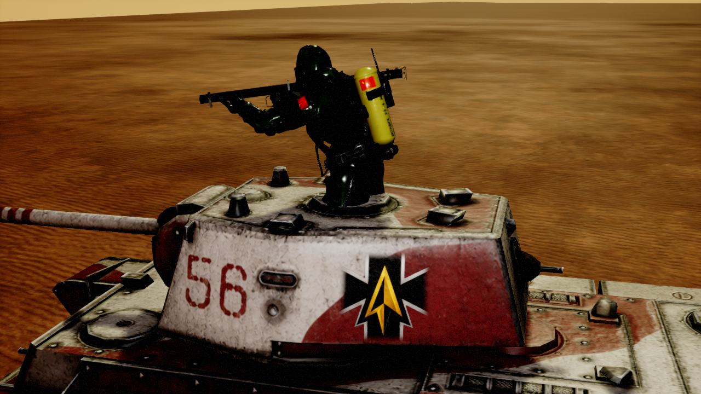
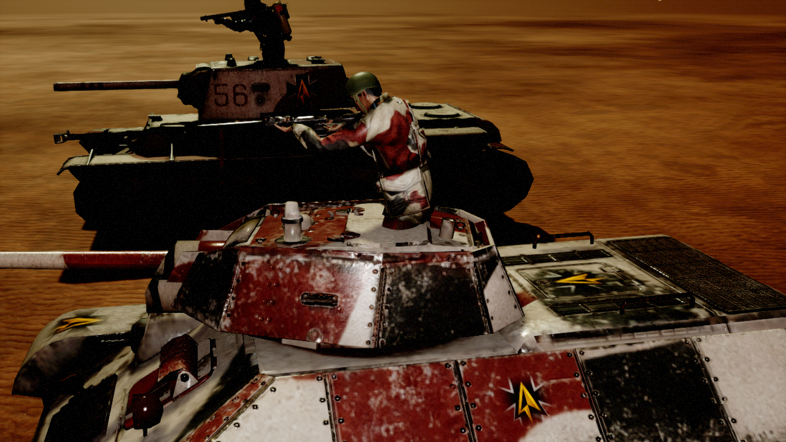

# Embedded infantry turrets

A soldier on the infantry master skeleton who stands in a tank's cupola (or on a building expansion) and fights
as one of its turrets. He turns as a whole, aims his weapon with the infantry rifle aim offset and plays the
infantry fire montages on every shot. He never collides, never affects navigation and never receives decals.



## Pieces

| Piece | What it does |
|---|---|
| `UEmbeddedTurretMountComponent` (`Weapons/Turret/EmbeddedInfantry`) | Add to a tank or BXP Blueprint. A tick after BeginPlay it spawns a random entry of `EmbeddedTurretClasses` in a runtime child actor component at `MountSocketName` + `MountLocalOffset`, calls the host's `SetupTurret` and starts auto-engage. |
| `AEmbeddedInfantryTurret` | `ACPPTurretsMaster` child. `TurretRoot` (turned in yaw) → `SoldierMesh` (yaw -90, like every squad unit) → `WeaponMesh` on `GunSocket` with the squad `Weapon` child actor transform. Aims from `GunSocket`. Turret tuning (rotation speed, pitch limits, idle) lives in `InfantryTurretSettings`, not in a Blueprint `InitChildTurret`. |
| `UEmbeddedInfantryTurretAnimInstance` | Eases `Pitch` to the turret's target pitch and plays `SingleFireMontage` / `BurstFireMontage`. |
| `Tests/EmbInfantryTurretTestSubsystem` | `-EmbInfantryTurretValidate` map test (below). |

Mount component settings: `bIsTankInfantryTurret` shows `MountMesh`:

- `TankTurretSkeletalMesh` / `TankTurretStaticMesh`: a mesh of one of the tank's turret actors that has the socket.
- `TankHullStaticMesh`: a static mesh of the tank itself.
- With `bIsTankInfantryTurret` off: any mesh of the owner that has the socket (BXPs).

`MountLocalOffset` defaults to (0, 0, -80): only the upper body shows above the hatch.

The infantry turret derives from `ACPPTurretsMaster`, not `AEmbeddedTurretsMaster`: the embedded master turns a
turret bone on the host's own skeleton through `IEmbeddedTurretInterface`, while the gunner owns his skeleton and
turns himself, which is the plain turret path. It reports `GetHasOwnVehicleModuleMount() == false`, so the host
registers no vehicle module for it.

## Assets (`/Game/RTS_Survival/Blueprints/Turrets/EmbInfantryTurrets`)

- `AnimBp_EmbInfantryTurret`: `Idle_Rifle_Ironsights` → Slot `FIreSlot` → AimOffset Player `AO_Rifle`
  (X = `Yaw` = 0, Y = `Pitch`) → Output. Fire montages `Standing_FireRifle` / `Standing_BurstFireRifle`.
  Graph script: `Tools/EmbInfantryTurret/build_anim_bp.py`.
- `RTS_BP_EmbInfantryTurretMaster`: Soviet soldier (`SK_RussianSoldier`, `M_RusSoldier_Soviet`) with the Mosin mesh.
- `RusBasic/Rus_EIT_BasicSoviet_Mosin`, `Rus_EIT_BasicSoviet_PTRS`, `Rus_EIT_Hazmat_Bazooka`
  (`SK_SovietBackroomHazmat`). Their EventGraph BeginPlay makes the same `Setup...Weapon` call as the infantry
  weapon Blueprint (`Rus_Weapon_Mosin1` / `Rus_Weapon_PTRS` / `Rus_Weapon_Bazooka`), with `WeaponMesh` as mesh.
  Copied by `Tools/EmbInfantryTurret/copy_weapon_graph.py`; rerun it after changing an infantry weapon. A Make Map
  of surface impacts becomes the variable `SurfaceImpactEffects` filled with Map_Add (the bridge cannot add Make Map
  entries).

Hosts:

| Host | Socket `Infantry` on | Turret |
|---|---|---|
| `Rus_Vehicle_T34E_Soviet` | `SM_T-34E_Turret` (-35, 0, 59): middle of the big roof hatch | `Rus_EIT_BasicSoviet_PTRS` |
| `Rus_Vehicle_KV-1_L11_Soviet` | `SM_KV-1_Turret` (-25, 0, 89): middle of the octagonal cupola | `Rus_EIT_Hazmat_Bazooka` |

The T-34E turret mesh has no raised commander cupola; the socket sits on its large rear roof hatch. The sockets are
on the shared turret meshes, so every T-34E / KV-1 (L-11) variant can mount a gunner by adding the component.



## Test

```
UnrealEditor-Cmd.exe <uproject> /Game/RTS_Survival/Maps/UnitTests/RTS_ToCopySmall -game -unattended -nop4 -nosound
  -RenderOffscreen -windowed -ResX=1280 -ResY=720 -DisablePlugins=Fab -benchmark -fps=30
  "-ExecCmds=r.TextureStreaming 0" -EmbInfantryTurretValidate -EITAt=16796,-15808
  -EITCapture=D:/UE5Projects/RTS_Survival/Saved/EIT/capture -abslog=<log>
```

(From Git Bash prefix `MSYS_NO_PATHCONV=1`.) Grep `RTS_EIT_TEST`. It spawns both hosts and checks: mounted turret class,
parent actor, turret static mesh + socket, location = socket ⊕ offset, registered in the tank's turrets, one weapon,
infantry anim instance, no collision/navigation/decals on every primitive; then an enemy T-34/76 at 60 % range:
targeted, fired, fire montage, turned to it (≤ 15°), aimed pitch reached by the pose. Then an attack-ground order
behind the hosts: each gunner must turn to it and fire. Last, an enemy KV-1 (L11) spawned 150 m away must be hidden by
fog of war together with its gunner (no gunner mesh `ShouldRender`), while the player's gunners still render.
43 checks, PASS on 2026-10-17. Without the attack-ground fix the gunners keep shooting the enemy (~145° off).

Unrendered soldiers only tick montages (`OnlyTickMontagesWhenNotRendered`), so the test forces
`AlwaysTickPoseAndRefreshBones` to see the aim pitch offscreen.

## Behaviour with attack orders

The gunner follows the host's attack orders like any turret, but `GetShouldReportRangeToOwner()` is false: he never
reports in/out of range to the host, so his shorter weapon range never drives a long-gun tank closer to its target.

Attack ground: `ATankMaster::ExecuteAttackGroundCommand` sends the ground location to every registered turret
(`Turrets`) as well as to directly attached ones; before, a gunner on a turret actor's mesh was not attached to the
tank directly and missed the order.

## Fog of war

Nothing extra is needed: the gunner's child actor component is owned by the host, so hiding the host
(`SetActorHiddenInGame`) updates the gunner's component visibility and `USceneComponent::ShouldRender` returns false
for every mesh of an actor whose parent child actor component's owner is hidden.

## Known limits

- A turret swap (`UTurretSwapComp`) replaces the turret actor the gunner rides on; he is not re-mounted.
