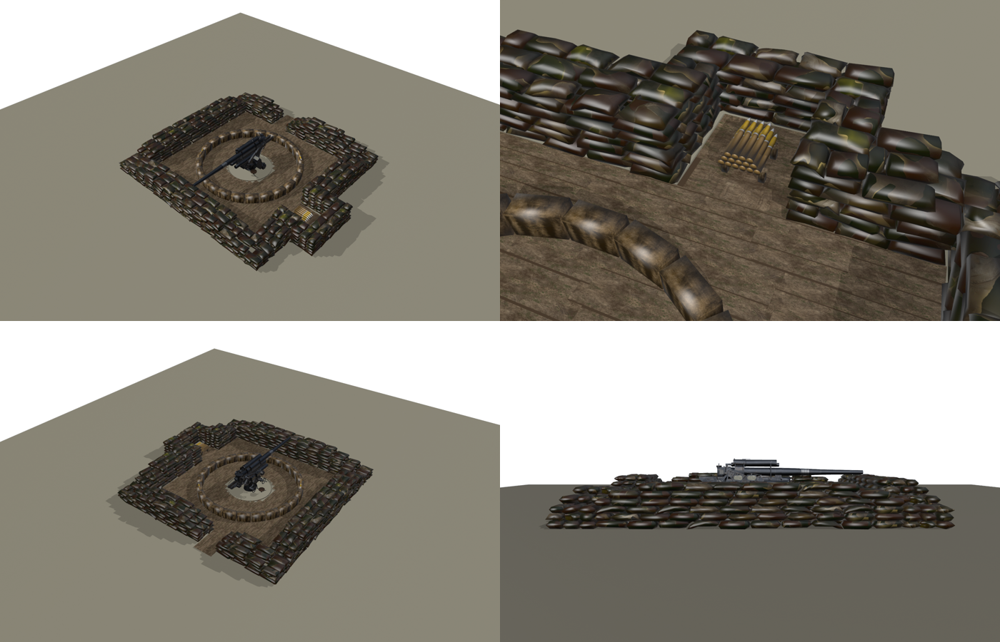
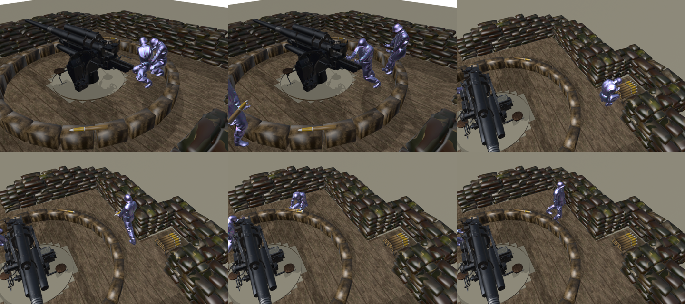
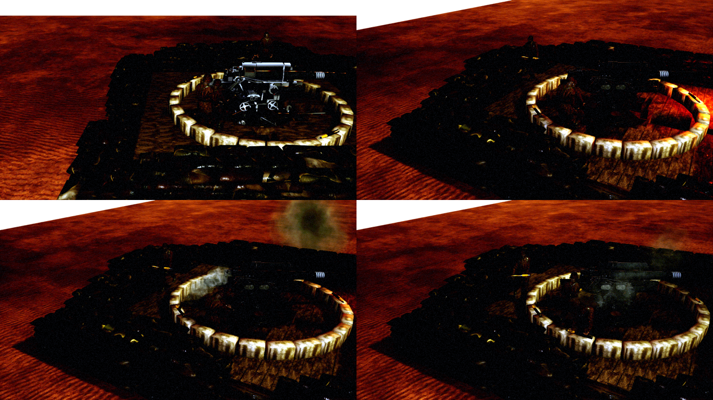

# German Flak 88 emplacement

The game's 8.8 cm Flak dug in behind high, thick sandbag walls, built from the German HQ's **Field Defenses** tab ([../UI/FieldDefenses.md](../UI/FieldDefenses.md)). The walls stand so high that the barrel only just clears them.

Three men keep the gun firing:
- the **ammo runner** walks back and forth between an ammo niche in the wall and a ring of ready-round crates around the gun;
- the **shell handler** takes the next round from the crate in front of him and holds it out to the loader;
- the **loader** lays it on the loading tray behind the breech and pushes it home.

The gun, the loader and the handler turn a full circle. The runner and the ring stay where they are, so the handler finds a crate in front of him at any traverse, and the runner always walks the same path.







| | |
|---|---|
| Expansion type | `BTX_GerFlak88Pit` ("Flak 88 Emplacement") |
| Blueprint (`.../BuildingExpansions/GerPits/`) | `Ger_BXP_GerPit_Flak88`, turret `Turrets/RTS_BP_EmbTurret_GerPit_Flak88` |
| Weapon | `Flak37_88MM`, the embedded 88's weapon and its effects (AAShell projectile, 88 sound, shell case, heavy-calibre impacts): 5 s reload, 1 s cooldown |
| Turret | 35 degrees per second, pitch 0 to 10 degrees: the barrel clears the walls by 6.5 cm at 0 degrees, so it may not dip |
| Health | 1.3 × the gun pit base (`FBxpDataHelpers::InitGerGunPitBxpData`) |
| Cost | 560 radixite, 360 metal (`DeveloperSettings::GameBalance::UnitCosts::Bxps`) |
| Requirement | Communication Center (the tier II building), like the howitzer pits |
| Build time | `BxpT2BuildTime` (25 s) |
| Footprint | 1200 × 1200 |

## The emplacement (`SM_GerFlak88Pit`, 34,700 triangles)

All in pit space: x forward, y right, ground at 0.
- **Gun.** The 88 stands 52 cm below the ground (the expansion's turret child actor sits at z = −52). Its static cross arms, up to 55 cm high, end under the 4 cm plank deck. The deck has a round hole of 1.16 m radius, where the turning carriage passes below deck level. The bore is 117 cm above the deck.
- **Walls.** Straight, three bags wide (stretchers in running bond), six courses: 107.5 cm, against the barrel's underside at about 114 cm over the walls at 0 degrees. The bags are the single bags of the German wall section `SM_Sandbags_1`, with their own UVs. The middle row is only laid where it shows: the top course, the steps and the wall ends. The square is 7.2 m inside and 9.5 m outside.
- **Stepped corners.** From the fourth course up, each course stops one bag length shorter towards every outer corner, so each corner steps down from six courses to three.
- **Entrance.** A gap in the rear wall, right of the centre, with cheeks that step back half a bag per course and a plank floor through it.
- **Ammo niche.** An open-topped bay through the left wall, 1.44 m wide, bulging 1.2 m out past it, with its own two-bag walls. Fifteen 88 mm rounds (`SM_Ammo_88mm`, its own UVs) lie in a 6-5-4 pyramid on a plank rack, their brass bases towards the pit.
- **Ready-round ring.** 24 closed crates at 2.62 m radius (the ammo box texture's "Luftdichter Patronenkasten" side), with a round lying on the runner's drop crate (rear left) and on one more.

Materials: `GerPit_Atlas` (deck, rack), `GerPit_Ammo` (crates), `GerPit_Sandbag` (bags) and `Flak88Pit_Shell` (`M_Flak88_Ammo`). Nanite is off.

## The gun

`Meshes/Flak88/SK_GerFlak88Pit_Gun` is the game's Flak 88 model (`GerDefenses/FlakSandbagged/S_FLak88.FBX`), imported into its own folder with its own skeleton (`SK_GerFlak88Pit_Gun_Skeleton`). The embedded 88's skeleton `S_FLak88` is left alone. The pit's skeleton carries:
- the embedded 88's fire sockets `BulletLaunch0` and `BulletOut0`;
- `PitOrigin` on `Flak88_Dock` (the carriage), at the deck top: the loader, the handler and the two handover rounds ride on it;
- `PitStatic` on the root, at the deck top: the runner stands on it.

`AnimBp_GerFlak88Pit` (parent `UGunPitAnimInstance`): reference pose → `DefaultSlot` → pitch on `Flak88_cannon` → yaw on `Flak88_Dock`. The gun has no animations of its own. The shot is the fire kick: the barrel (`Flak88_GunBarrel`) recoils 40 cm and the muzzle jumps 0.8 degrees (`Tools/GunPits/build_fire_feedback.py`). There is no loading-elevation curve: the gun keeps its aim (at most 10 degrees) while it is loaded.

## The crew

The loader and the handler are `Crew1` and `Crew2` on the `PitCrew` component (`UGunPitCrewComponent`, shell carry like the German gun pits: `Round1` / `Round2` on `SM_GerFlak88Pit_Round`). The runner is `Runner` (tag `PitRunner`) on a second crew component, `PitRunnerCrew`:
- `CrewAttachSocket` `PitStatic`;
- his loop as the only idle animation;
- no rounds of its own (`RoundTag` None), no drill and no brace.

His round, `RunnerRound`, is a static mesh on his unskinned spare bone `ik_foot_root`. The bake keys that bone onto the round while he carries it and shrinks it to 0.001 while his hands are empty. (`ik_hand_gun` and `ik_hand_l` are not usable: 33 vertices of the German soldier mesh are skinned to them.)

The loading drill is `AN_Infantry_LoadHowitzer` (the leFH loader), placed so the round he lays down lies on the tray along the bore, and resampled: its still moments are shortened from 9.03 s to 7.68 s. The game stretches it to the 4.75 s the 5 s reload leaves, so it plays about 1.6 times faster.

| s (of 7.68) | Loader | Handler |
|---|---|---|
| 0–0.95 | turns to his right rear | crouches and holds the round out |
| 0.95 | takes the round | lets go |
| 1–4.4 | carries it round to the tray | turns to the ring, takes the next round from the crate (2.8 s), goes back |
| 4.4–4.65 | lays it on the tray; it goes into the breech (4.65 s) | waits with the next round |
| 4.65–7.68 | pushes it home, steps back | |

The runner's loop (11 s):
- 0.5–1.55 he crouches in the niche opening and draws the top round out of the stack;
- 1.65–5.45 he carries it along the left wall;
- 5.8–6.75 he crouches at his crate and lays it down;
- 7.2–11 he walks back.

## Rebuilding

Blender side, in `D:/Blender/BlenderProjects/BlenderTanks/CustomMapItems/GerDefenses/Scripts` (Blender **4.0**):
1. `flak88_pit_build.py [-- preview]` builds the pit and the round into `Exports/Flak88Pit` and writes `flak88_pit_layout.json`. It prints the bag count and triangles, and checks the turning gun's lowest point beyond the inner wall face against the wall top.
2. `flak88_pit_crew.py` bakes the three men into `Exports/Flak88Pit/Crew`, with the hand reach misses printed, and writes `flak88_pit_carry.json`.
3. `flak88_pit_preview.py` renders the drill pictures; `-- icon` renders the option picture `Exports/Icons/T_BxpOption_GerPit_Flak88.png`.

Unreal side, in [Tools/Flak88Pit](../../Tools/Flak88Pit):
1. `ue_flak88pit_import.py` (in the editor) imports the gun with its own skeleton, the pit, the round (Nanite off) and the crew animations.
2. `build_flak88pit.py` (bridge) adds the skeleton sockets, builds the anim BP, the crew montages, the turret (a copy of the Pak 40 pit turret), the runner round's offset and the expansion. It reads both JSON files from the Blender export folder.
3. `Tools/GunPits/build_fire_feedback.py guns GerFlak88Pit` adds the fire kick.
4. `ue_flak88pit_register.py` (in the editor) imports the option picture, writes the `Train_BTX_GerFlak88Pit` row of `DT_TrainingOptions` and registers the expansion and its preview mesh with the async spawner. It needs an editor built with `BTX_GerFlak88Pit`, and both assets must be free to save: close any other editor that has them loaded.

The training option and the HQ slot are C++:
- `InitAllGameFieldDefenseTrainingOptions`: Communication Center requirement;
- `MakeDefaultHeadquartersLayout`: after the Panzerschreck foxhole.

The import deletes and reimports the crew animations. After reimporting them, run `build_flak88pit.py montages,turret,runner_round` and the fire kick again.

## Testing

`-GerFlak88PitValidate` on TestCover spawns the pit as the player's, orders it to attack the ground 60 degrees off its forward and checks:
- the gun stands 52 cm below the pit's ground;
- the two gun crew on `PitOrigin` and the runner on `PitStatic` with his round;
- the gun and its crew turned to the target;
- two shots;
- the barrel recoils and the crew brace;
- the handover drill: the handler holds the first round; the round passes to the loader (hand 16 cm away) and into the breech; the handler picks the next round (hand 24 cm away);
- the runner (`FGunPitRunnerWatch`): over two loops his round reaches the niche pose and his crate's pose, and shows only while he carries it.

```bash
MSYS_NO_PATHCONV=1 UnrealEditor-Cmd.exe RTS_Survival.uproject /Game/RTS_Survival/Maps/TestCover/TestCover -game -unattended -nop4 -nosound -NullRHI -benchmark -fps=30 -DisablePlugins=Fab -GerFlak88PitValidate
```

Add `-GerPitCapture=<folder> -CaptureExposureBias=3 -ExecCmds="r.TextureStreaming 0"` with `-RenderOffscreen -windowed` (no `-NullRHI`) for pictures.

## Not done

- When destroyed, the pit collapses like the other German pits and leaves no wreck.
- The loader's hands are baked at 0 degrees pitch; at the 10 degree limit the tray sits about 19 cm lower.
- The loader's drill plays about 1.6 times faster than the howitzer clip it comes from, to fit the 88's 5 s reload.
- TestCover's evening light shows the bags and the gun very dark in the test pictures.
