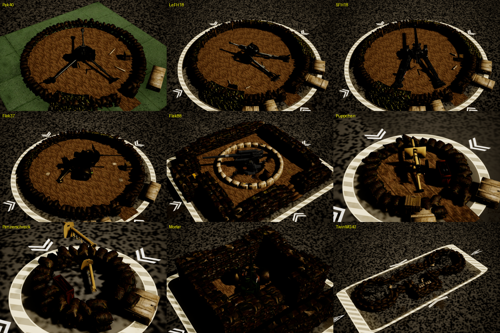
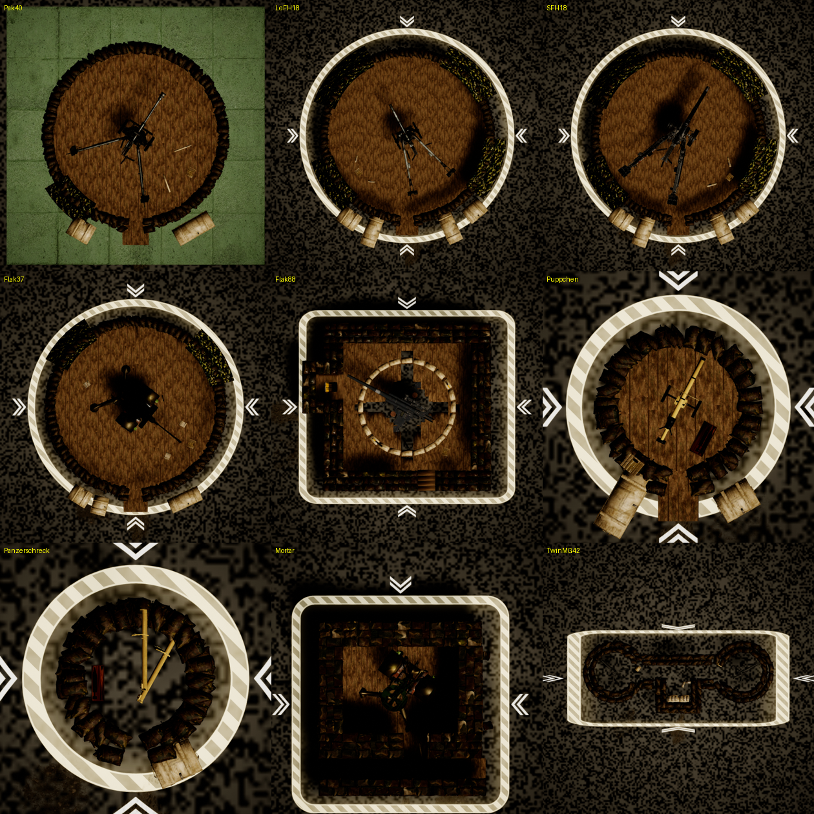

# Abandoned German pits (capture objects)

Every German pit also exists as an abandoned capture object a designer can place in a level. It shows:
- the pit mesh;
- the pit's gun, left in an abandoned pose: traversed off the pit's axis, barrel drooped or left high;
- loose rounds, spent casings and a tipped ready crate;
- footprints and dirt at the entrance, where the crew left;
- a striped capture border on the ground around the pit, with ">>" chevrons on its four sides.

When the player's units capture it, it is replaced by the player's working pit of the same type.

## Assets

All under `/Game/RTS_Survival/Blueprints/Environment/CaptureObjects/GerPits/`:

| Asset | What |
|---|---|
| `BP_CaptureGerPit_Base` | child of `BP_CaptureActor` (`ACaptureActor`): the components, the construction script and the capture logic |
| `BP_CaptureGerPit_{Pak40,LeFH18,SFH18,Flak37,Flak88,Puppchen,Panzerschreck,Mortar,TwinMG42}` | data-only children: each sets the base's class defaults, and nothing else |
| `Materials/M_GerPitCapture_BorderDecal` | the capture border (deferred decal, translucent, one Custom HLSL node) |
| `Materials/MI_GerPitCapture_Border_<Pit>` | one instance per pit, sized to that pit |
| `Meshes/SM_GerPitCapture_Points` | hidden helper with four `Capture_*` sockets, at ±100 cm on X and Y |

## How it works

**Construction script** (so the pit also looks right in the editor):
- sets `PitMesh` to `PitMeshAsset` and `Gun` to `GunMeshAsset` at `GunTransform`;
- gives `Gun` the pit gun's own anim BP (`GunAnimClass`), or for the mortar a single-node pose (`GunSingleAnim`, `Anim_Rus120Mortar_Deployed`);
- sets up `Gun2` with `Gun2Transform` when `UseGun2` is set (Twin MG42);
- attaches `MG42A/B` (`MG42Mesh`, scale `MG42Scale`) to bone `MG42Bone` of the DShK proxy rig, as `UPitMG42VisualComponent` does on the real pit;
- adds one static mesh component per `PropMeshes[i]` at `PropTransforms[i]` (no collision, no decals);
- adds one decal per `DirtDecals[i]` at `DirtTransforms[i]`;
- puts `BorderMaterial` on `BorderDecal` at `BorderTransform`, and `CapturePoints` at `CapturePointsTransform`.

**BeginPlay:**
- `SetupCaptureLocations(CapturePoints, "Capture")`: units stand on the pit's four sides, about 60 cm outside the border;
- `SetupComponentCollisions([PitMesh])`, as on the other capture objects;
- sets the `UTurretAnimInstance::Pitch` of `Gun` / `Gun2` to `GunPitch` / `Gun2Pitch`. The pit anim BPs turn that into the elevation bone rotation, as a turret's aim does on the real pit. The traverse is in the gun component's yaw instead, so it also shows in the editor;
- hides `GunHideBone` (Panzerschreck: `Elevation`, the tube held at the gunner's shoulder; a static Panzerschreck lies on the sandbags instead) and the DShK `Gun` bone under the MG42s.

**`BP_OnCapturedByPlayer`** (overrides `BP_CaptureActor`'s):
1. For player 1 only: turns off its own collision and spawns `Player1ClassOnCapture` (the `Ger_BXP_GerPit_<Pit>`) at its own transform, with AlwaysSpawn.
2. Sets that pit's `BuildingMeshComponent` to the pit mesh. A pit spawned outside the build queue keeps its class-default mesh, and the mortar pit's default is the Flak 88 pit mesh.
3. Makes every child actor component of the new pit visible. The Twin MG42 pit keeps its second gun hidden until it is built (`UPitAdditionalTurretComponent`).
4. Calls `SetTurretsToAutoEngage`, then destroys itself.

## Per pit

| Pit | Spawns | Units / seconds | Gun pose (yaw / pitch) | Border (half X × Y, cm) |
|---|---|---|---|---|
| Pak 40 | `Ger_BXP_GerPit_Pak40` | 3 / 15 | 34 / −6, cant 2° | 505 × 505, circle |
| leFH 18 | `Ger_BXP_GerPit_LeFH18` | 4 / 20 | −28 / 32 | 680 × 680, circle |
| sFH 18 | `Ger_BXP_GerPit_SFH18` | 4 / 25 | 31 / 24 | 680 × 680, circle |
| Flak 37 | `Ger_BXP_GerPit_Flak37` | 3 / 15 | 128 / 64 | 555 × 555, circle |
| Flak 88 | `Ger_BXP_GerPit_Flak88` | 4 / 25 | −62 / 48 | 530 × 590, rounded box |
| Püppchen | `Ger_BXP_GerPit_Puppchen` | 2 / 10 | 27 / −7 | 245 × 245, circle |
| Panzerschreck | `Ger_BXP_GerPit_Panzerschreck` | 2 / 8 | tube on the ground | 210 × 210, circle |
| Mortar | `Ger_BXP_GerPit_Mortar` | 3 / 15 | 35, deployed pose | 450 × 450, rounded box, centred on the pit walls (−112, −28) |
| Twin MG42 | `Ger_BXP_GerPit_TwinMG42` | 2 / 12 | left −48 / 38, right 62 / −14 | 290 × 650, rounded box |

The progress text is "Recrewing the abandoned pit...".

## The capture border decal

`M_GerPitCapture_BorderDecal` draws a rounded box in decal UV space (`Shape` 0 = circle, 1 = rounded box, with `AspectU/V` for a non-square decal):
- a band (`RingWidth`) with thin bright edges;
- diagonal hazard stripes inside the band. They are laid out in world space (`StripePeriod` cm), so they are the same width on every pit, and they crawl slowly (`StripeSpeed`);
- `ChevronCount` double chevrons outside the band, pointing into the pit;
- a faint inner glow;
- a slow pulse (`PulseSpeed`, `PulseMin`).

Colour `RingColor` is a warm white, the capture colour of the capture health bars. `ChevronColor` is white. Emissive is the colour × `EmissiveBoost`. The pit mesh, gun and props do not receive decals, so the border never paints the sandbags.

The instances are sized from the border's half size (`border_setup` in the build script):
- the band is 36 cm wide on every pit;
- the decal leaves 1.2 m outside the band for the chevrons;
- the decal is 2 × 120 cm deep.

## Rebuilding / changing

The sources and the build script are in `Saved/AgentScripts/GerPitCapture/`:
- `pit_config.py`: every per-pit value (meshes, pose, props, dirt decals, border);
- `gerpit_build_lib.py`: the decal material HLSL and its sizing;
- `ue_gerpitcapture_build.py`: builds everything, idempotent.
  - In the editor: `exec(open(...).read())`.
  - Headless dry run: set `GERPIT_DRY=1`; it builds into `/Game/__GerPitCapturePreview` and saves nothing.
- `decal_preview.py`, `dry_verify.py`: headless renders (`UnrealEditor-Cmd -run=pythonscript -AllowCommandletRendering -RenderOffscreen`).
- `pie_gerpitcapture_check.py`: the PIE check. It spawns all nine, checks the pose, captures three and checks the real pits that replace them.

A headless editor world never ticks animation. Its renders show the gun at zero pitch, and the Panzerschreck tube still at the shoulder. Both apply at BeginPlay in game.
