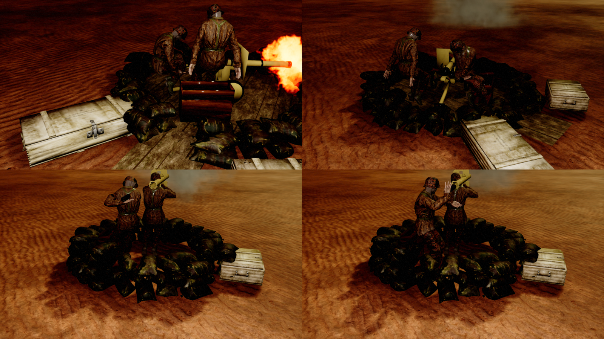
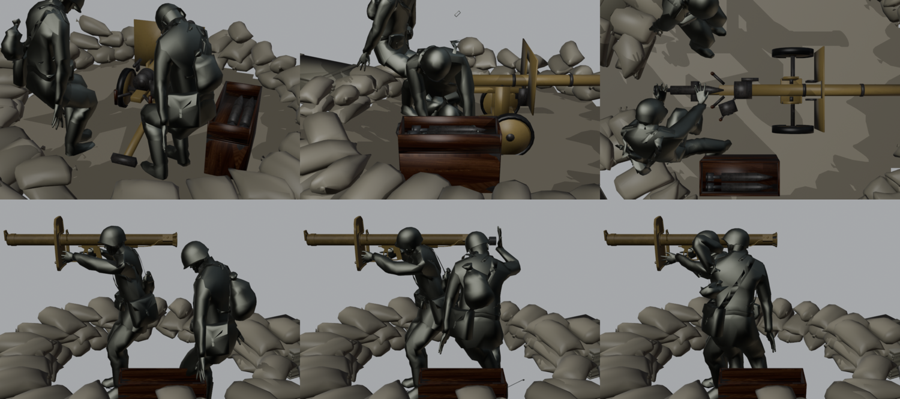

# German small pits: Püppchen pit and Panzerschreck foxhole

Two small, cheap German field defenses with a two-man crew, built from the German HQ's **Field Defenses** tab ([../UI/FieldDefenses.md](../UI/FieldDefenses.md)):
- the **Püppchen pit**: an 8.8 cm Raketenwerfer 43 "Püppchen" on its low wheeled carriage in a ring of German bags;
- the **Panzerschreck foxhole**: a Panzerschreck team behind a small ring of bags.

In both the loader carries a rocket from a crate into the weapon:
- in the Püppchen pit he swings the breech block open, lines the rocket up, pushes it home and closes the breech;
- in the foxhole he slides it into the back of the tube, plugs in the ignition lead and taps the gunner's shoulder.

The weapon, its rocket crate and both men turn a full circle together.

Both follow the [Soviet Ampulomet pit](RusAmpulometPit.md): same gun pit parts, crew solver and test.





| | Püppchen pit | Panzerschreck foxhole |
|---|---|---|
| Expansion type | `BTX_GerPuppchenPit` ("Puppchen Pit") | `BTX_GerPanzerschreckPit` ("Panzerschreck Foxhole") |
| Blueprint (`.../BuildingExpansions/GerPits/`) | `Ger_BXP_GerPit_Puppchen` | `Ger_BXP_GerPit_Panzerschreck` |
| Weapon | `Raketenwerfer43_88MM`: the Panzerschreck rocket, light-cannon range (3480), 1.1 × its penetration, 6 s reload, accuracy 78 | `PanzerSchreck_Pit`: the infantry Panzerschreck's data under its own name (small-arms range 3200, 8 s reload), so the emplacement is balanced apart from the infantry weapon |
| Health | 0.55 × `BxpHeavyBunkerHealth` | 0.4 × `BxpHeavyBunkerHealth` |
| Cost | 280 radixite, 130 metal | 160 radixite, 60 metal |
| Build time | 15 s (`GerPuppchenPitBuildTime`) | 12 s (`GerPanzerschreckPitBuildTime`) |
| Footprint | 500 × 500 | 400 × 400 |
| Pit | bag ring 2.8 m inside, 4 m across, plank deck, rear entrance | bag ring 2.1 m inside, 3.3 m across, rear entrance |

The cost, health and build time are in `DeveloperSettings` (`UnitCosts::Bxps`, `TrainingTime`) and `FBxpDataHelpers::InitGerGunPitBxpData`.

## The weapons

**Püppchen.** Modelled from atlas primitives on the German infantry weapon atlas, in dunkelgelb:
- a 1.6 m barrel with a breech block that swings open to the right;
- a cradle with two spade grips, a sight and a small shield;
- disc wheels and a single trail with a spade.

The rocket crate (an open box of rockets on a closed crate) stands beside the loader.

**Panzerschreck.** The game's infantry mesh (`SM_Ger_InfWeapon_PanzerShrek`), used as it is with its own UVs, at real size (1.64 m). It rests with its shoulder bracket on the gunner's right shoulder, 1.6 m up, with his head beside the tube behind the shield. The turn point is just behind the gunner. That keeps the loader, the rocket he lines up behind the tube and his rocket pack inside the small ring, while the muzzle reaches out over the bags.

Both guns use `M_GerSmallPit_Gun`, a copy of `MM_Ger_Infantry_Weapons` with *Used with Skeletal Mesh* set.

| Bone | Püppchen | Panzerschreck |
|---|---|---|
| `Root` | static | static |
| `Traverse` | carriage, wheels, trail, shield, rocket crate; the crew ride on its `PitOrigin` socket | rocket pack; the crew ride on `PitOrigin` |
| `Elevation` | trunnions (cradle pitch) | at the gunner's shoulder (tube pitch) |
| `Gun` | barrel, breech housing, grips, sight; the fire kick bone | the Panzerschreck; the fire kick bone |
| `BreechBlock` / `Terminal` | the breech block and its handle (swings 110°) | the ignition contact box at the tube's rear |
| `Rocket` | the round: hidden in the barrel, then the loader's rocket | the same, in the tube |

Sockets: `PitOrigin` on `Traverse` at the gun frame origin, `Muzzle` on `Gun`. The anim BPs (`AnimBp_GerPuppchenPit`, `AnimBp_GerPanzerschreckPit`, parent `UGunPitAnimInstance`) work like the Ampulomet's:
- pitch on `Elevation`, yaw on `Traverse`;
- the fire kick on `Gun`;
- the loading-elevation curve `Ger<Pit>Pit_LoadingElevation`, which levels the weapon while it is loaded.

The turrets copy the Pak 40 pit turret and fire the infantry Panzerschreck's projectile setup: Bazooka projectile, its launch sound, the rocket launch flash, heavy-calibre impacts and no shell case. Pitch is limited (Püppchen 15°, Panzerschreck 10°) because the crew's hands are baked at 0°.

### Drills

The game starts a single-shot weapon's reload at its next fire attempt, after the cooldown, so both drills start from rest. The `Rocket` bone stays hidden in the weapon after the shot. It moves, still hidden, to the crate's empty slot and appears in the loader's hands as he takes it. It ends the drill at its rest pose in the weapon, so the montage ends without a pop.

| Püppchen (6 s) | Panzerschreck (7 s) |
|---|---|
| 0.3–1.3 the loader swings the breech open by its handle; the gunner lets go and steps aside | 0.3–1.05 the loader takes a rocket from the pack |
| 1.45–2.35 he takes a rocket from the crate | 1.05–2.2 he lines it up behind the tube |
| 2.35–3.3 he lines it up behind the breech, side-on | 2.4–3.0 he pushes it in with his right hand |
| 3.5–4.1 his left hand pushes it home | 3.2–3.95 he plugs in the ignition lead |
| 4.25–5.15 he closes the breech | 4.15–4.85 he taps the gunner's shoulder twice |
| 5.2–5.85 the gunner takes the grips again | the gunner holds the tube on his shoulder throughout |

## Rebuilding

The Blender side is in `D:/Blender/BlenderProjects/BlenderTanks/CustomMapItems/GerDefenses/Scripts` (Blender **4.0**):
- `puppchen_pit_build.py` and `panzerschreck_pit_build.py` build the rigged gun and its animations, both crews' animations (hand reach misses printed), the pit and `<pit>_pit_info.json` into `Exports/PuppchenPit` and `Exports/PanzerschreckPit`. Add `-- preview` for drill renders.
- `ger_small_pit_common.py` holds what they share: the German atlas patches, rockets, crates, rig, grips, crew bake, bags (from `gerpit_build.py`, whose `main()` is now guarded so it can be imported) and preview.
- `ger_small_pit_icons.py` renders the option pictures into `Exports/Icons`.

The Unreal side is in [Tools/GerSmallPits](../../Tools/GerSmallPits). Copy each `<pit>_pit_info.json` next to it first. Then, per pit (`Puppchen` or `Panzerschreck`):
1. `ue_gersmallpit_import.py` (in the editor, with `PIT = '<Pit>'` set first) imports the gun, the material copy, both animation sets with the loading curve, and the pit (Nanite off). Each gun goes to its own folder, `Meshes/<Pit>`: Interchange gives a new skeletal mesh any skeleton already in its folder, and once put the Panzerschreck on the Püppchen's skeleton.
2. `build_gersmallpit_animbp.py <Pit>` adds the sockets, builds the anim BP and the montages.
3. `Tools/GunPits/build_fire_feedback.py guns Ger<Pit>Pit` adds the fire kick.
4. `build_gersmallpit_turret.py <Pit>` builds the turret.
5. `build_gersmallpit_bxp.py <Pit>` builds the expansion. It needs an editor built with the new expansion types.
6. `ue_gersmallpit_register.py` (in the editor) imports the option pictures and brushes, writes the `DT_TrainingOptions` rows and registers both pits with the async spawner (expansion class and placement preview mesh).

The training options and the HQ layout slots are C++:
- `InitAllGameFieldDefenseTrainingOptions`: no requirement, the shorter build times;
- `MakeDefaultHeadquartersLayout`: the Püppchen in the Field Defenses tab's first row, the Panzerschreck in its second.

The import deletes and reimports the animation sequences. After reimporting them, run `build_gersmallpit_animbp.py <Pit> base,montages` and then `build_gersmallpit_turret.py <Pit> --crew-only`.

## Testing

`-GerSmallPitValidate` on TestCover spawns both pits as the player's, orders each to attack the ground 60° off its forward and checks:
- two crew on `PitOrigin`;
- the gun and crew turned to the target;
- two shots;
- the gun bucks and both crew brace at the shot;
- the rocket travelled (Püppchen 86 cm, Panzerschreck 137 cm) with the loader's hands on it (13 and 16 cm);
- the loader's hand on the breech block (6 cm) or the contact box (4 cm);
- the gunner's firing shake played.

The log also prints each pit's weapon and its range. Add `-GerPitCapture=<folder> -CaptureExposureBias=3 -ExecCmds="r.TextureStreaming 0"` for pictures.

```bash
MSYS_NO_PATHCONV=1 UnrealEditor-Cmd.exe RTS_Survival.uproject /Game/RTS_Survival/Maps/TestCover/TestCover -game -unattended -nop4 -nosound -RenderOffscreen -windowed -ResX=1280 -ResY=720 -benchmark -fps=30 -DisablePlugins=Fab -GerSmallPitValidate
```

## Not done

- When destroyed, the pits collapse like the other German pits and leave no wreck.
- The crew's hands are baked at 0° pitch; the weapons' small pitch range moves the grips a few centimetres.

The infantry `PanzerSchreck` once read a range of 7000 instead of 3200. `RTS_BP_GameState` had saved an old copy of the `PanzerSchreck` and `PanzerFaust` weapon data. The weapon data maps are now `SkipSerialization`, so the C++ values apply. The foxhole keeps its own entry (`PanzerSchreck_Pit`).
