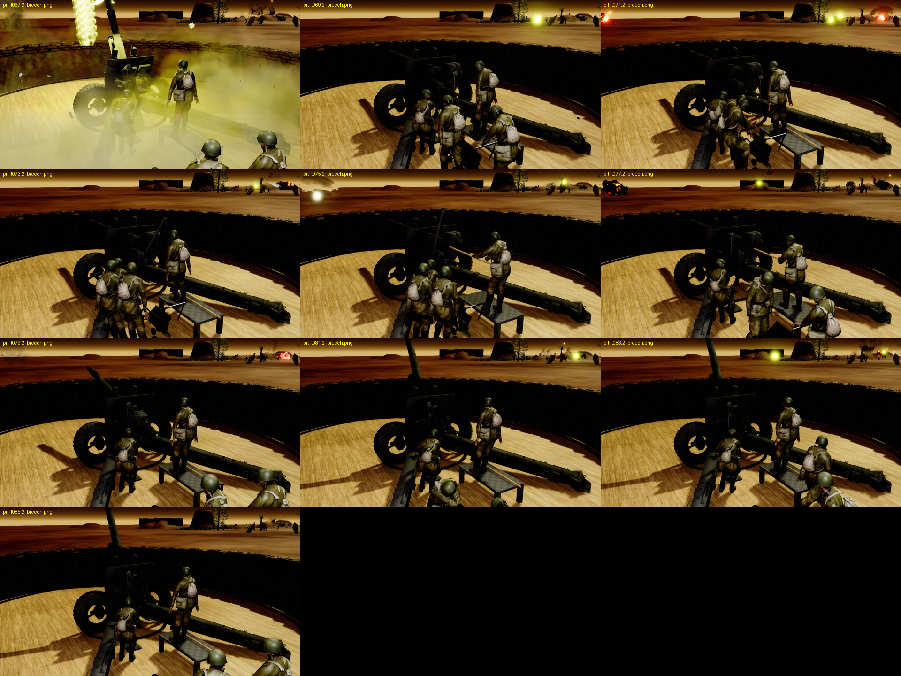
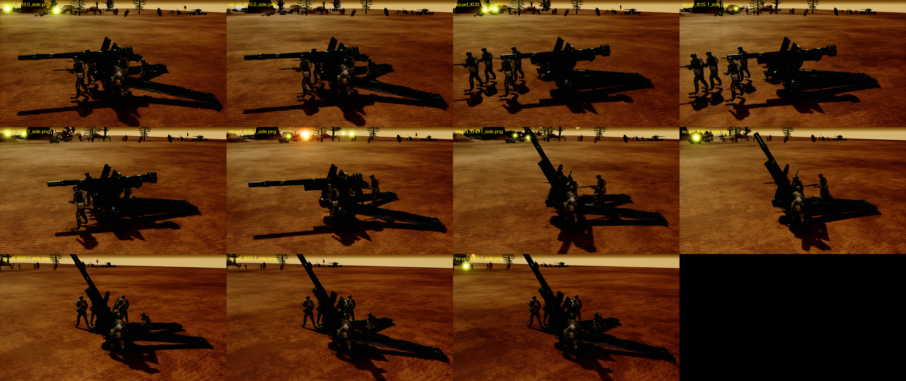

# ML-20 152mm gun-howitzer (team weapon + Soviet gun pit)

The ML-20 is built like the B-4 ([B4Howitzer/B4Howitzer.md](B4Howitzer/B4Howitzer.md)) and reuses as much of it as
possible. It exists twice in the game:

- **Team weapon** `Squad_Rus_ML20_152mm`: a crewed, towable gun-howitzer that packs (trails closed, barrel pulled
  back), moves on its wheels, deploys and fires (weapon `ML20_152MM_TW`, reload 10 s, yaw arc ±15°, pitch −2..60°).
- **Building expansion** `BTX_RusML20Pit`: the B-4 pit with the ML-20 on the turntable. The B-4's crane, ammo cart,
  rack, rammer and its four-man crane drill are reused, with a smaller 152 mm shell. Weapon `ML20_152MM_Pit`
  (reload 18 s, 20 % more range, less accurate). Only the gun fights; the crew is decoration.

## Assets

Everything lives under `/Game/RTS_Survival/Blueprints/Squads/TeamWeapons/Soviet/ML20_152MM/`.

| Asset | Purpose |
|---|---|
| `Mesh/SK_TW_ML20` | Team weapon mesh (Soviet green, baked AO), one material slot `MI_ML20_Atlas`. Sockets `Launch`, `Out`, `PitOrigin`, `ShellMount`, `CartMount`, `RammerMount` on `SK_TW_ML20_Skeleton`. |
| `WeaponAnims/AO_ML20` | Aim offset, yaw −15..15, pitch −2..60 (additive mesh-space poses on `Anim_ML20_Deployed`). |
| `AnimBp_TW_ML20` | `AnimBp_TW_B4` retargeted to the ML-20 skeleton, with `AO_ML20` and the ML-20 montages. |
| `BP_TW_ML20`, `Rus_SquadTW_ML20`, `DestroyedTW_ML20` | Team weapon actor, its squad (the B-4's Soviet crew) and the scavengeable wreck (`Mesh/SM_ML20_Destroyed`, one slot `MI_ML20_Atlas_Burnt`). |
| `Pit/Meshes/SK_ML20Pit_Gun` | Pit gun mesh: the team weapon mesh plus the B-4's crane on a steel pedestal and the loader's timber step. Same skeleton as the team weapon, one slot `MI_ML20_Atlas`. |
| `Pit/Meshes/SM_ML20Pit_Shell` | The 152 mm shell: the B-4's cartridge at 0.75 scale (63 cm, 15 cm across). |
| `Pit/AnimBp_ML20Pit_Gun` | `AnimBp_B4Pit_Gun` retargeted (parent `UB4HowitzerPitAnimInstance`): yaw on `B_Root`, pitch on `B_Mantlet`, faded out by the curve `B4_LoadingElevation` while loading. |
| `Pit/Anims/Montage_ML20Pit_Reload` / `_Fire` | 24 s crane loading drill / recoil. |
| `Pit/Crew/Montage_ML20PitCrew{1-4}_Reload` | Crew drills. The crew anim BP is the B-4's `AnimBp_B4Pit_Crew`. |
| `Pit/RTS_BP_EmbTurret_ML20Pit` | Copy of the B-4 pit turret: the ML-20 gun, its drills, the 152 mm shell on the hook and in the rack. |
| `Pit/Rus_BXP_ML20Pit` | Copy of the B-4 pit expansion (emplacement, sandbags, B-4 pit remains). It leaves `DestroyedTW_ML20`. |

The spawner (`RTS_BP_RTSAsyncSpawner`) maps `Squad_Rus_ML20_152mm` to `Rus_SquadTW_ML20` and `BTX_RusML20Pit` to
`Rus_BXP_ML20Pit` (preview mesh `SM_B4Pit_Emplacement`). Game data (costs, health, weapons) is in `ACPPGameState`
next to the B-4 entries. Like the B-4 pit, the ML-20 pit is placed by designers, owned by the enemy and engages at
once. It is **not** in `SatteliteBuildingsForBase` on `RTS_BP_EnemyController`, because the B-4 pit is not in that
list either. To add it, run `python build_ml20_pit.py enemy`.

## How the B-4 pit was reused

The ML-20 rig uses the B-4's bone names (`B_Root`, `B_Turret`, `B_Mantlet`, `B_Gun`, `B_Breech`, the crane bones,
`B_Shell`, `B_AmmoCart`, `B_Rammer`). So the B-4's anim blueprints work after one change, `TargetSkeleton`, which is
editable from Python. The same goes for the crew component (tags `B4PitCrew` and `B4PitSocket:<Socket>`) and the
death graph.

The drill is the B-4's timeline (`b4_pit_animations.py`), with the constants replaced for the ML-20's layout
(`ml20_pit_layout.py`):

- **Split trails.** The B-4 cart lane would cross the ML-20's left trail, so the cart, rack and their two crew run
  between the trails. They are moved 127 cm towards the gun axis, and the pickup end 38 cm further back.
- **Crane.** The ML-20 has no crane, so the B-4's crane geometry and bones were moved onto a steel pedestal inside
  the left trail. They are turned 53° about the mast, so the winch man stands clear of the trail.
  - The B-4's crane solver only searched boom angles 0..180°. Close to the mast, it could not raise the hook over
    the bore and left the cable pointing up. The ML-20 solver searches −90..180° and hits every hook point with the
    cable hanging down.
- **Lower bore** (167 cm against 202): the crane sits 25 cm lower, and the loader stands on a 48 cm timber step,
  where the B-4 loader stood on its box trail.
- **Smaller shell:** 0.75 × the B-4 cartridge. Cart tray height, rack heights and the crew's grips on the shell
  scale with it. The shell waits 13 cm behind the open breech and is rammed 80 cm.
- **Breech block.** It came sorted to the cradle; it now recoils with the barrel (`B_Breech`, child of `B_Gun`) and
  swings 100° open to the right during the drill.

The crew was rebaked with the B-4 crew solver (`b4_pit_crew.py`) against this drill. Their hand-reach misses match
the shipped B-4 crew, and are slightly better where the shell is steadied on the cart.



## One atlas, upright tyres

All three ML-20 meshes use one material, `Materials/MI_ML20_Atlas` (`MI_ML20_Atlas_Burnt` on the wreck), on a
4096 atlas (`T_ML20_Atlas_D` / `_ORM`):

| Tile | Size | Holds |
|---|---|---|
| Gun, Carriage | 2048 | the ML-20 sets at full resolution |
| Wheels, Tyres | 1024 | the ML-20 sets |
| B-4 Trails | 1024 | the crane, which only uses the B-4's trails texture |
| Steel, Timber | 512 | painted tiles for the crane pedestal and the loader's step |

There is room left in the atlas for more parts.

The ORM tiles copy the source pixels unchanged, so the meshes look as before:
- the ML-20 sets store linear values, imported as sRGB like the per-set textures were;
- the B-4 tile stores the B-4's sRGB-encoded `ORMs`.

The .max import placed each tyre ring turned 90° about the vertical: its axle ran along the barrel, while the hub, the
finned drum and the hub nut sat on the true axle. `ml20_fix_wheels_atlas.py` turns the tyre, its tread blocks and the
wheel disc back about the tyre's vertical axis: left +90°, right −90°, so the disc ends inboard against the drum.
Bones and animations are unchanged. The skeleton is the same, so every anim blueprint and montage keeps working.

## Triangle budget

Both gun meshes were cut to about 9k triangles in Blender (`ml20_decimate.py`):

| Mesh | Before | After |
|---|---|---|
| `SK_TW_ML20` | 79,460 | 8,468 |
| `SK_ML20Pit_Gun` | 81,782 | 9,177 |

**Why Blender, not Unreal's mesh reduction.** The meshes are rigidly skinned: every vertex has exactly one bone at weight 1.0, and each bone's parts are their own islands. The script therefore:
- splits the faces per bone;
- decimates each bone's part by edge collapse, with its UVs interpolated;
- joins them back.

A collapse never meets a vertex of another bone, so every vertex keeps its single full weight, and the script checks this. The skeleton and every animation are untouched. The 14 crane faces that span two bones are left as they are.

**Per-bone budget.** The trails (51k triangles of rivets and clamps) were cut hardest, to 1,350 each. The wheels got 850 each, the shield and top carriage 1,650, the cradle 650, the barrel 600, and the crane's bones about 700 in total. Edges sharper than 40° are marked sharp, so the low-poly hard surfaces shade cleanly. The FBX carries the split normals; Unreal's render vertex count (16.7k / 18.1k) is higher than Blender's for that reason.

Each mesh has one LOD and no Unreal reduction settings. The ML-20 squad-and-pit test passes on the cut meshes.

`SM_ML20_Destroyed` (the wreck) is built from the cut team weapon mesh: 7,979 triangles, down from about 79k. It is a Nanite mesh, so Unreal reports its Nanite fallback (2,386 triangles) for LOD0; that is not a reduction of the mesh itself.

## Rebuilding the art

Blender scripts: `D:\Blender\BlenderProjects\Marketplace\Scritps\AnimTeamWeapons\ML20_152mm\`, run headless with
Blender 5.2. They export to `D:\Blender\BlenderProjects\BlenderTanks\(KADO-3D)\(EXPORTS)\ML20_152mm\`.

1. `ml20_prepare.py -- <ML-20.max> <export_dir> 2048 24`
   - Imports the 3ds Max file with the `io_scene_max` extension, patched to keep nested Boolean operands (the
     barrel).
   - Levels the barrel, sorts parts to bones, bakes AO and an edge mask, and composes the textures.
2. `ml20_build_team_weapon.py -- <export_dir>`: rig, aim and pack poses, fire and wheel animations. The skeleton
   already carries the pit bones.
3. `ml20_destroyed.py -- <export_dir>`: the wreck mesh.
4. `ml20_pit_animations.py -- <export_dir>`: the pit gun mesh (crane taken from `B4_Rig.blend`), the drill and
   `ml20_pit_curves.json`.
5. `ml20_pit_crew.py -- <export_dir>`: the four crew drills (B-4 crew solver; Blender 5 action API).
6. `ml20_fix_wheels_atlas.py -- <export_dir> <B4_203mm/Textures>`:
   - turns the tyres upright;
   - atlases `ML20_Pit.blend` and `ML20_Rig.blend`;
   - writes the atlas textures;
   - re-exports `SK_ML20Pit_Gun.fbx` and `SK_TW_ML20.fbx`.

   Run this step after steps 2 and 4 whenever they rebuild the blends: they start from `ML20_Prepared.blend`, which
   still has the source's turned tyres and four material sets.
7. `ml20_decimate.py -- <export_dir>`: cuts both gun meshes to about 9k triangles and re-exports them. Back up
   `ML20_Rig.blend` / `ML20_Pit.blend` first, since it overwrites them.
8. `ml20_destroyed.py -- <export_dir>` again: the wreck is built from the cut team weapon mesh (7,979 triangles).

Then reimport everything with `ue_ml20_atlas_import.py` (`STEPS = ['meshes', 'wreck']`).

Unreal, all in `Tools/ML20/`:

- **Inside the editor:**
  - `ue_ml20_import.py` (team weapon);
  - `ue_ml20_pit_import.py` (pit mesh, drills, crew, shell);
  - `ue_ml20_atlas_import.py` (the atlas textures and materials, and the three meshes reimported on the existing skeleton with one slot). Run it last.
- **Bridge clients**, which need `uecp.py` importable:
  - `ml20_sockets.py`
  - `build_ml20_teamweapon.py` (wreck, montages, anim BP, team weapon, squad, spawner)
  - `build_ml20_pit.py` (montages, anim BP, turret, expansion, spawner)

## Testing

The B-4 scenario runs the ML-20: `-B4HowitzerSquad` swaps the squad, and `-B4HowitzerPit=ML20` swaps the pit (its
turret, 18 s reload and wreck):

```
UnrealEditor-Cmd.exe RTS_Survival.uproject /Game/RTS_Survival/Maps/TestCover/TestCover -game -unattended -NullRHI -nosound -benchmark -fps=60 -B4HowitzerValidate -B4HowitzerSquad=/Game/RTS_Survival/Blueprints/Squads/TeamWeapons/Soviet/ML20_152MM/Rus_SquadTW_ML20.Rus_SquadTW_ML20_C -B4HowitzerSquadReload=10 -B4HowitzerPit=ML20
```

Last run (2026-10-15): `RESULT PASS failed_checks=0`.
- Squad: reload 10.8 s, deploy, pack, move and redeploy all pass.
- Pit: drill 16.1 s against an 18 s reload, reload interval 16.8 s.
- The cart pusher's hands come to 11 cm of the shell.
- The pit dies into the B-4 pit remains plus `DestroyedTW_ML20`.

The plain `-B4HowitzerValidate` (B-4) still passes.



From Git Bash, set `MSYS_NO_PATHCONV=1`, or the map path turns into `C:/Program Files/Git/Game/...` and the run quits
at once.

## Fire feedback

On every shot the gun bucks and the crew brace. See [GunPitFireFeedback.md](GunPitFireFeedback.md).

## Concrete pit

The ML-20 also has a concrete-apron pit (`Rus_BXP_ML20ConcretePit`): see [B4Howitzer/B4ConcretePit.md](B4Howitzer/B4ConcretePit.md).
