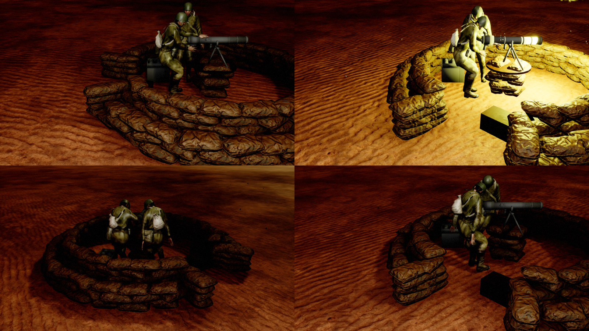
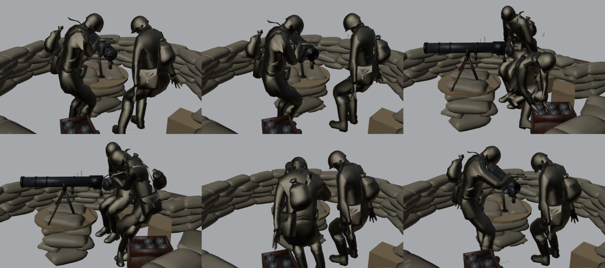

# Soviet Ampulomet pit

A small Soviet sandbag pit with the 125 mm **Ampulomet M1941** on its tripod, worked by two men:
- the **gunner** holds the pistol grip and the tube, shakes with the shot, and steps aside while the gun is loaded;
- the **loader** opens the breech, carries an incendiary ampoule from the crate into the chamber and closes it.

The gun, its tripod, the ampoule crates and both crew turn a full circle on a sandbag gun pillar in the middle of the pit. It is an enemy emplacement (owner 2) that engages as soon as it is placed in a level, like the [DShK pit](RusDShKPit.md), and is built from the same parts (gun pit crew component, B-4 crew solver, pit generator).

| | |
|---|---|
| Expansion type | `BTX_RusAmpulometPit` ("Ampulomet Pit") |
| Blueprint | `/Game/RTS_Survival/Blueprints/Buildings/BuildingExpansions/RusAmpulometPit/Rus_BXP_AmpulometPit` |
| Weapon | `Ampulomet_125MM`, the infantry Ampulomet's data: fire damage with a wide splash, magazine 1, 6 s reload, 1 s cooldown, the Bazooka's projectile speed (0.9 × `BaseProjectileSpeed`) and accuracy (70) |
| Firing | direct-fire projectile (`SetupProjectileWeapon`, Bazooka projectile, as the infantry Ampulomet): the ampoule flies fast and flat at its target. Molotov fire splash (`NS_MolotovImpact`) on every surface, no shell case |
| Health | the DShK pit's: `T2BxpBunkerHealth`, reinforced resistances, armed abilities |
| Cost | 280 radixite, 140 metal (`DeveloperSettings::GameBalance::UnitCosts::Bxps`) |
| Footprint | 900 × 900; the bags are 3.5 m inside, the berm runs out to about 8 m |

## The gun

The model is the infantry Ampulomet (`Infantry/Infweapons/NewSovietWeapons/build_ampulomet.py`), rebuilt from the same atlas primitives at real size: its 125 mm bore sets the scale (1.19 m long). For the pit:
- the folded legs swing down into a tripod with the pivot post;
- the breech is split into a cap that turns and a hinge that swings;
- an ampoule and two ampoule crates are added.

It uses one material, `M_AmpulometPit_Gun`. This is a copy of the infantry weapon material `MM_Rus_InfantryWeapons` with *Used with Skeletal Mesh* set; the original is not flagged for skeletal meshes.

### Gun skeleton (`SK_AmpulometPit_Gun`)

| Bone | Pivot (cm) | Carries |
|---|---|---|
| `Root` | ground | nothing (the pillar is part of the pit mesh) |
| `Traverse` | pivot, 98 cm | yoke, tripod and the two ampoule crates with five spare ampoules; yaws the whole weapon on the pillar, and the crew ride on its `PitOrigin` socket |
| `Elevation` | trunnion, 112 cm | the trunnion pins; pitches the tube |
| `Gun` | on the bore | tube, chamber, grips and sight; the fire kick bone |
| `BreechHinge` | chamber's left rear edge | swings the cap open, 150° back along the chamber |
| `BreechCap` | bore axis | cap, nut and loading lever; turns 40° to unlock |
| `Ampoule` | in the chamber | the loaded round, hidden while it is in the chamber or crate |

Sockets:
- `PitOrigin` on `Traverse`, at the gun frame origin on the pit floor (+X forward).
- `Muzzle` on `Gun`, the fire socket.

The anim BP (`AnimBp_AmpulometPit`, parent `UGunPitAnimInstance`) rotates `Elevation` (pitch) and `Traverse` (yaw) additively in component space after `DefaultSlot`. The fire kick acts on `Gun`. The reload carries the curve `AmpulometPit_LoadingElevation`; the anim BP's `LoadingElevationCurveName` uses it to level the tube while it is loaded.

The turret is not an artillery turret: it aims level at its target, so the gunner's hands, baked at 0° pitch, stay on the grips. The ampoule leaves along the line to its target, not along the tube, so the tube's small pitch does not change the shot. Maximum pitch is 20°.

### The reload drill (6 s, stretched to the reload time)

A single-shot weapon reloads on its next fire attempt, after the 1 s cooldown, so the drill starts from rest after the shot has played out:

| s | Loader | Gunner |
|---|---|---|
| 0.3–0.95 | steps to the breech and turns the lever knob over the top (unlock) | lets go of the gun and steps back to his right |
| 0.95–1.7 | pulls the cap open; it folds back along the chamber | watches the breech |
| 1.7–2.55 | crouches at the crate and takes the ampoule from its slot | |
| 2.55–3.55 | carries it behind the breech | |
| 3.55–4.1 | holds it at the mouth, then pushes it home with his palm | |
| 4.3–5.35 | swings the cap shut and turns the lever back (lock) | |
| 5.35–5.9 | goes back to his place | takes the grips again |

The `Ampoule` bone is shrunk to nothing while it sits in the chamber after a shot. It moves, still hidden, to the crate's empty slot and grows in the loader's hands as he takes it. It ends the drill at its rest pose in the chamber, so the montage ends without a pop.

## Rebuilding

The Blender side is in `D:/Blender/BlenderProjects/BlenderTanks/CustomMapItems/SovietsStuff/AmpulometPit`. `Scripts/ampulomet_pit_build.py` (Blender **4.0**) builds everything:
- the rigged gun and its three animations;
- both crew members' animations, with hand reach misses printed;
- the pit mesh;
- `ampulomet_pit_info.json`.

`-- preview` also renders the drill to `Exports/Preview`. The script imports the DShK pit generator (`MGPit/Scripts/dshk_pit_build.py`) for its sandbag pieces, rig helpers and the B-4 crew solver, and uses the DShK's `Source` folder (soldier, standing mocap, pack sandbags).

The Unreal side is in [Tools/AmpulometPit](../../Tools/AmpulometPit). Copy `Exports/ampulomet_pit_info.json` next to it first, because the editor's sandboxed Python only reads project files. Then:
1. `ue_ampulometpit_import.py` (in the editor) imports the gun, the material copy, both animation sets with the loading curve, and the pit (Nanite off). Set `STEPS` to run single steps.
2. `build_ampulometpit_animbp.py` adds the sockets, builds the anim BP and the montages.
3. `Tools/GunPits/build_fire_feedback.py guns AmpulometPit` adds the fire kick to the anim BP.
4. `build_ampulometpit_turret.py` builds the turret (a copy of the German leFH 18 pit turret) and swaps the leFH's arch projectile weapon for a direct-fire projectile weapon. `--direct-fire-only` makes only that swap on an existing turret.
5. `build_ampulometpit_bxp.py` builds the expansion (a copy of the DShK pit) and sets its type.

The import deletes and reimports the animation sequences, which leaves the montages and the anim BP's base pose pointing at nothing. After a reimport of the animations, run `build_ampulometpit_animbp.py base,montages` and then `build_ampulometpit_turret.py --crew-only`.

## Testing

`-AmpulometPitValidate` on TestCover spawns the pit, orders it to attack the ground 60° off its forward and checks:
- two crew on `PitOrigin`;
- the gun and crew turned to the target;
- two shots;
- the gun bucks and both crew brace at the shot;
- the breech drill ran: the ampoule travelled 100 cm, the loader's hands came within 12 cm of it and 8 cm of the breech cap;
- the gunner's firing shake played;
- the first ampoule flies direct: the test follows it from the muzzle to its impact and fails if it rises more than a tenth of its ground distance above the straight line between them (`GunPitProjectileFlightWatch`). The other gun pits only log their flight (`RTS_GERPIT_TEST <pit> flight ...`).

It shares the DShK pit's bone-drill checks (`DrillPropBone` / `DrillSecondBone` in `FGunPitUnderTest`).

Add `-GerPitCapture=<folder> -CaptureExposureBias=3 -ExecCmds="r.TextureStreaming 0"` for pictures. Enemy guns only fire in a rendered run (`-RenderOffscreen -windowed`).

## Not done

- When destroyed, the pit collapses like the DShK pit and leaves no wreck.
- The enemy AI does not build it, and there is no spawner entry; it is placed in levels.
- The gunner's hands are baked at 0° pitch; the tube's pitch (at most 20°) moves the grips a few centimetres.
- TestCover's evening light shows the tube, the walnut crates and the plank top very dark in the test pictures; the metal tube has no reflections to pick up offscreen.
