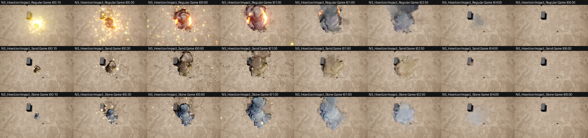
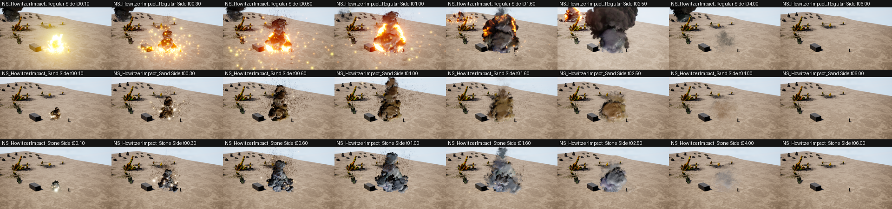

# Howitzer impacts

Three Niagara systems in `/Game/RTS_Survival/ImpactSfxVfx/5Artillery/Howitzer/` are the impacts of every howitzer:

| System | Surfaces | Look |
|---|---|---|
| `NS_HowitzerImpact_Regular` | Metal, Flesh, Air | The tank explosion's fireball, sparks and debris; the fireball turns into a dark, lit smoke column (~4 s) |
| `NS_HowitzerImpact_Sand` | Sand | A dark brown dirt column that rises fast, swells into a lit dust mass and hangs as a brown cloud (~4 s) |
| `NS_HowitzerImpact_Stone` | Stone | The same eruption in grey, more sparks |




Both sheets: `ImpactScale` 2.6, at 0.1 / 0.3 / 0.6 / 1 / 1.6 / 2.5 / 4 / 6 s, capture sky fill 1; the grey block is a
6.5 m tank, the post next to it a soldier. Game camera = the RTS camera (spring arm 3000, -70 degrees, 90 degree FOV).

## Why they look like this (redesign of 2026-11-09)

The first version spread its dirt as a wide radial burst of velocity-aligned rays plus pale translucent dust sheets. From
the -70 degree RTS camera that projects onto the ground as a flat star. The tank explosions read as volume because they
are compact, have a dark mass that rises, and are lit. The impacts now follow that:

- **Volume layers** (stateless emitters, all masked + lit with the MsvFx pack's normal-mapped smoke puff sheet
  `MI_Smoke_01`, so the sun shades one side of the mass and the masses cast shadows):
  - `dirt_column`: narrow (9 degree) and fast, the darkest layer: the eruption stands tall before it spreads;
  - `dust_mass`: thrown up at 30 degrees, slows, swells and hangs: the lit body of the blast;
  - `dust_billow`: starts at 0.25 s, drifts up and grows into the cloud that hangs to ~4 s;
  - `ground_roll`: dark dust rolling out low along the ground (no shadow): the dark base under the column.
- **Classic layers kept**: the flash (`impact`), sparks, debris (`parts` / `debris`) and dirt clods. Left out of the
  sand pack system: `main`, `main001`, `smoke`, `smoke001`, `wisp`, `dust` (the radial rays and flat dust sheets).
- Regular is now built on `AA_OptimExplosions/NS_Expl_Tank_1` (the game state's vehicle death explosion) instead of
  `NS_Explosion_Big_8`, whose fireball flipbook ends in a flat black sheet.
- Tints multiply a light grey sheet under strong sun and the material's default (glossy) roughness, so mid browns wash
  out to grey: the palettes in `make_recipe.py` are dark and saturated on purpose. Particle colour does reach the
  material (base colour = particle colour x sheet; alpha = opacity).

Rejected along the way: the pack's pyro-sim dust (`MI_Pyro_Dust_01`, `M_Pyro`) renders blocky, because its packed HDR
data texture is capped at `max_texture_size` 512 (each 8x10 frame is ~64 px); and its granular soil plume
(`MI_Soil_Exp_01`) is too faint to read against the ground even fully saturated.

## Size comes from the weapon's ImpactScale

The systems are built at the AllExplosions pack's own scale (about 5 m at scale 1); the size per gun is the
`ImpactScale` on the turret's / team weapon's `Make Weapon VFX` node:

| Weapon | Blueprints | ImpactScale |
|---|---|---|
| 105 mm leFH | `RTS_BP_EmbTurret_GerPit_LeFH18`, `RTS_BP_EmbTurret_LeFH_105mm`, `Ger_Turret_PantherII_Lehf`, `BP_TW_Lefh`, `BP_TW_Lefh18` | 2.2 |
| 122 mm M1938 | `BP_TW_M1938` | 2.4 |
| 150 / 152 mm | `RTS_BP_EmbTurret_GerPit_SFH18`, `RTS_BP_EmbTurret_ML20Pit`, `BP_TW_ML20` | 2.6 |
| 203 mm B-4 | `RTS_BP_EmbTurret_B4Pit`, `BP_TW_B4` | 3.1 |

The impact pool applies it as the component scale. That moves positions and velocities of local-space emitters (the
stateless layers simulate in local space), but **sprite sizes do not follow the component scale**. The stateless
layers multiply their size curve by the user parameter `ImpactSpriteScale` (Vector2), which
`ImpactVfxSpriteScale::ApplyImpactScale` (`Weapons/ImpactVfxAuthoring/ImpactVfxSpriteScale.h`) sets next to the
component scale: `FWeaponImpactPool::Activate` and the capture subsystem call it. Anything else that plays these
systems with a scale must call it too, or the volume layers stay at scale-1 size.

The old systems (`NS_Artillery_DefaultImpact` / `_Sand` / `_Stone`) are untouched; the aircraft bombs, the global
bombing ability and the Hetzer / Panzer III rocket abilities still use them.

## How they are built

`Source/Tools/ImpactVfx/make_recipe.py` writes the recipe `howitzer_impacts.json` (layer specs, palettes, which classic
emitters to keep); the editor-only console command `RTS.ImpactVfx.BuildFromRecipe <recipe.json>`
(`Weapons/ImpactVfxAuthoring/ImpactVfxNiagaraAuthoring.cpp`) builds it:

- `base` / `add` / `disable` / `spawn_scale` / `materials` / `user`: copy and trim classic emitters (see the file header);
- `stateless`: duplicates the `Fountain` emitter of the engine's `FountainLightweight` template
  (`UNiagaraSystem::DuplicateEmitterHandle`) and sets emitter, module and renderer properties by reflection from Unreal
  import text (distributions get their runtime values and curve tables from the module's edit hook);
  `sprite_scale_parameter` binds `ScaleSpriteSize.ScaleCurveRange` to the user parameter and adds it to the system;
- every Collision module is disabled.

Rebuild after changing the specs (headless editor; the open editor must not have the systems loaded, or the save fails
with `saved=0` in the log):

```
python Source/Tools/ImpactVfx/make_recipe.py
Source/Tools/ImpactVfx/build_systems.sh
```

While the shared editor runs the Development DLL, run the scripts on the DebugGame editor (build
`RTS_SurvivalEditor Win64 DebugGame` first): `ENGINE_EXE=.../UnrealEditor-Win64-DebugGame-Cmd.exe`.

## Cost

- No collision, no refraction.
- Peak live particles (ImpactScale 2.6): Regular ~720 (mostly GPU sparks), Sand ~410, Stone ~450 (old version: 240 /
  720 / 800). The volume layers are ~40 CPU (stateless) sprites per impact.
- All large sprites are masked (dithered), so no blended overdraw; the column, mass and billow cast shadows (~30 masked
  sprites in the shadow pass for ~4 s per impact). Turn `bCastShadows` off in a layer spec if that shows up in a profile.
- One short point light per impact (the flash).

## Looking at impacts without the editor

`UImpactVfxCaptureSubsystem` (`Utils/RTSMapTests/ImpactVfxCapture`) plays systems in an offscreen game run and saves
scene captures from the game camera, a far game camera and a low side view, and logs the peak particle count per
emitter:

```
SCALE=2.6 SKY_FILL=1 Source/Tools/ImpactVfx/run_capture.sh /Game/A/NS_A+/Game/B/NS_B <out folder>
python Source/Tools/ImpactVfx/compare_sheet.py <out folder> Game 00.10,00.30,01.00 <sheet.png>
```

`SUFFIX=_Dev SCALE=2.6 SKY_FILL=1 iterate.sh <round>` does recipe + build + capture + sheets in one go on
`NS_HowitzerImpact_*_Dev` copies (delete them afterwards). Notes:

- It runs on `UT_B4Howitzer` (neutral ground). Do not point it at a map that is open in the editor: the run holds
  the package and the editor's save fails.
- The capture adds a sky light (`SKY_FILL`, default 3) because the test map is dark. At 3 it turns lit dust blue-white;
  judge colours at 1.
- Scene captures have no temporal AA, so masked (dithered) edges look dotted there; in game TSR resolves them.
- Pack systems compile their shaders on first use; the subsystem plays each effect once before the pictured run.
- A milky square sometimes shows at t=0.1 in the third system of a run (the flash quad); it is a capture artifact.
- `FParse::Value` stops at commas: list switches are read with `bShouldStopOnSeparator` off, and the first copy of a
  switch wins (pass changed defaults through the runner's variables).
