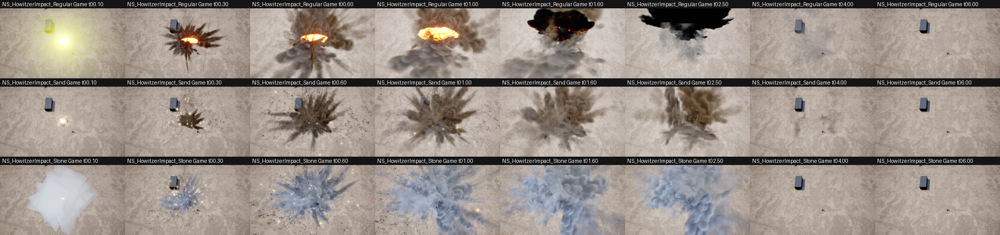
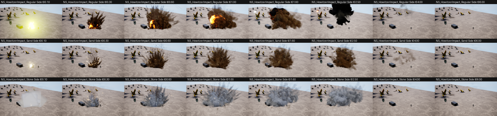

# Howitzer impacts

Three Niagara systems in `/Game/RTS_Survival/ImpactSfxVfx/5Artillery/Howitzer/` replace the old flat artillery
impacts on every howitzer:

| System | Surfaces | Look |
|---|---|---|
| `NS_HowitzerImpact_Regular` | Metal, Flesh, Air | Flash, rolling fireball, radial dirt rays and clods, sparks, debris, then a tall black smoke column (~4 s) |
| `NS_HowitzerImpact_Sand` | Sand | Brown radial dirt eruption with flying clods and sparks, lingering brown dust (~3 s) |
| `NS_HowitzerImpact_Stone` | Stone | Same eruption in grey stone dust, more sparks |




Both sheets: `ImpactScale` 2.6, at 0.1 / 0.3 / 0.6 / 1 / 1.6 / 2.5 / 4 / 6 s; the grey block is a 6.5 m tank,
the post next to it a soldier. Game camera = the RTS camera (spring arm 3000, -70 degrees, 90 degree FOV).

## Size comes from the weapon's ImpactScale

The systems are built at the AllExplosions pack's own scale (about 5 m at scale 1); the size per gun is the
`ImpactScale` on the turret's / team weapon's `Make Weapon VFX` node (the impact pool sets it as the component
scale, and every layer scales with it):

| Weapon | Blueprints | ImpactScale |
|---|---|---|
| 105 mm leFH | `RTS_BP_EmbTurret_GerPit_LeFH18`, `RTS_BP_EmbTurret_LeFH_105mm`, `Ger_Turret_PantherII_Lehf`, `BP_TW_Lefh`, `BP_TW_Lefh18` | 2.2 |
| 122 mm M1938 | `BP_TW_M1938` | 2.4 |
| 150 / 152 mm | `RTS_BP_EmbTurret_GerPit_SFH18`, `RTS_BP_EmbTurret_ML20Pit`, `BP_TW_ML20` | 2.6 |
| 203 mm B-4 | `RTS_BP_EmbTurret_B4Pit`, `BP_TW_B4` | 3.1 |

The old systems (`NS_Artillery_DefaultImpact` / `_Sand` / `_Stone`) are untouched; the aircraft bombs, the global
bombing ability and the Hetzer / Panzer III rocket abilities still use them. Point them at the new systems the same
way if those should get the bigger look.

## How they are built

Layers from existing systems, composed by the recipe `Source/Tools/ImpactVfx/howitzer_impacts.json`:

- Regular: base `AllExplosions/Big/NS_Explosion_Big_8` (fireball, sparks, smoke, debris) plus `main`, `dirt`, `dust`
  from `AllExplosions/Sand/NS_Explosion_Sand_8` (dirt rays, clods, dust).
- Sand: base `NS_Explosion_Sand_8` plus `smoke_shockwave` from `NS_Explosion_Big_8`, `LifetimeMult` 1.5.
- Stone: base `NS_Explosion_Sand_8` with its two dirt flipbook materials swapped for
  `Howitzer/Stone/MI_HowitzerStoneDust_1/2` (grey copies of `T_Expl_39/40`, made by
  `make_stone_flipbooks.py`, imported at 2048 instead of 4096), `LifetimeMult` 1.4.

Rebuild after changing the recipe (headless editor; the open editor must not have the systems loaded, or the save
fails with `saved=0` in the log):

```
Source/Tools/ImpactVfx/build_systems.sh
```

The build command is `RTS.ImpactVfx.BuildFromRecipe <recipe.json>` (editor only,
`Weapons/ImpactVfxAuthoring/ImpactVfxNiagaraAuthoring.cpp`). It copies emitters between systems without a parent
link, renames / disables emitters, sets per-emitter spawn count scale (a scalability override for all platforms),
swaps renderer materials, sets user parameters and disables every Collision module.

## Cost

- No collision: every Collision module is disabled (`collision_modules_disabled` in the build log).
- No refraction: the packs' distortion shock dome (`refr_mesh`) is off; at these sizes it turned into a milky blob
  and needs its own distortion pass.
- Peak live particles (ImpactScale 2.6): Regular ~250, Sand ~550-650, Stone ~750-950. Most are GPU sparks (tiny
  additive sprites); trail smoke is cut to 40 %, sparks to 60 % (Regular / Sand).
- The large smoke and dirt flipbooks use masked (dithered) materials, so they add no blended overdraw; the only
  large translucent sprites are the fireball (1 sprite), the flash and the few dirt-dust sprites.
- One short point light per impact (the flash).
- The packs' ground-ring smoke (`NS_Arty_SplashGround_1`) and ground cloud (`NS_RTSDebrisExplosion_Huge`) were tried
  and left out: from the RTS camera they became large pale fog with heavy translucent overdraw.

## Looking at impacts without the editor

`UImpactVfxCaptureSubsystem` (`Utils/RTSMapTests/ImpactVfxCapture`) plays systems in an offscreen game run and saves
scene captures from the game camera, a far game camera and a low side view, and logs the peak particle count per
emitter:

```
SCALE=2.6 Source/Tools/ImpactVfx/run_capture.sh /Game/A/NS_A+/Game/B/NS_B <out folder>
python Source/Tools/ImpactVfx/compare_sheet.py <out folder> Game 00.10,00.30,01.00 <sheet.png>
```

`iterate.sh <round>` does build + capture + sheets in one go. Notes:

- It runs on `UT_B4Howitzer` (neutral ground). Do not point it at a map that is open in the editor: the run holds
  the package and the editor's save fails.
- Pack systems compile their shaders on first use; the subsystem plays each effect once before the pictured run.
- A milky square blob sometimes shows at t=0.1 in the third system of a run; it did not reproduce when the same
  system ran first, so it is a capture artifact, not part of the effect.
- `FParse::Value` stops at commas: list switches are read with `bShouldStopOnSeparator` off, and the first copy of a
  switch wins (pass changed defaults through the runner's variables).
