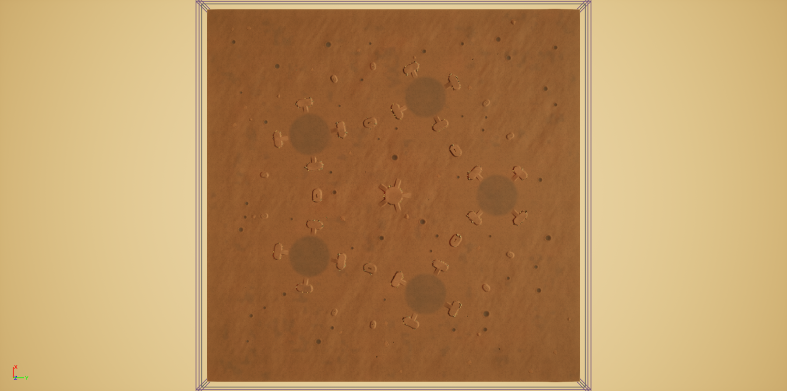

# 10 — Level design: SM_Desert_01

Map: `/Game/RTS_Survival/SurvivalMode/Maps/SM_Desert_01` (duplicated in the editor from
`/Game/RTS_Survival/Maps/ToCopy/RTS_ToCopyMap`). Owner: level-designer agent.



| Image | What it shows |
|---|---|
| `img/SM_Desert_01_overview.png` | Whole landscape from 1.6 km up. **Image up = +X, image right = +Y.** Crater decals hidden for this shot (from that height they draw as dark squares; at RTS camera height they look right). |
| `img/SM_Desert_01_start0_topdown.png` | Start 0 (0, 42000) from 420 m up: flat disc, the four hills with ramps, wreck-ring craters, mesa at the left edge. Same orientation. |
| `img/SM_Desert_01_start0_oblique.png` | Start 0 from an RTS-like angle (looking outward from the map centre). |
| `img/SM_Desert_01_generator_preview.png` | Generator preview (**+Y up, +X right**, different from the editor shots): paint layers shaded by height; red marks cells that a tracked vehicle cannot reach from start 0 when it can only climb slopes under 25°. The red areas are hill flanks, buttes and the mesa flanks only. |

## 1. Map size and landscape

| Item | Value |
|---|---|
| Landscape actor | `SM_Landscape` (replaces the template's `Landscape1`) |
| Extent | X and Y from -75 600 to +75 600 (151 200 cm square, about 1.5 km), centre (0, 0) |
| Grid | 24 × 24 components, 63 quads each, 1 section per component, 1513 × 1513 vertices, 100 cm per quad, Z scale 100 |
| Edit layers | off (`bCanHaveLayersContent = false`), so heights and weights can be re-imported by script |
| Height | flat build discs at Z = 600; hill plateaus at Z = 1350; mesa top at Z = 1500; terrain min ≈ 242 |
| Material | `MI_RTS_Landscape_DesertPaintable` (reused, unchanged) |
| Paint layers | `Sand` (base), `DesertGravel`, `DesertRockDark` (slopes > ~17°, hill and butte flanks), `Weedy` (darker cracked ground on the build discs), `ScorchSandyStone` (crater floors), `ScorchConcrete` (present, all zero). All LayerInfos are the existing ones in `Materials/ground/Landscape/DesertPaintable/` |
| Collision | template landscape `body_instance` copied (custom profile; units only drive on ground that blocks the Landscape channel), phys material `PM_Sand` |
| Playable area | `BP_FogOfWar_Manager` moved to (0, 0, 600), `MapExtent` 52 500 → **75 000** (camera bounds = FOW square). `RenderTargetSize` left at 1024, so the fog is now about 146 cm per pixel instead of 102 |
| Blocking walls | `BoundaryTop` (+X), `BoundaryBottom` (-X), `BoundaryRight` (+Y), `BoundaryLeft` (-Y) moved to ±76 200, 600 thick, 153 600 long, 10 000 tall (Left/Right had yaw -90; reset to 0) |
| Nav bounds | `RTS_NavMeshVolume` at (0, 0, 1500), extent 75 800 × 75 800 × 3 000 |
| Navmesh | Built in the editor for all 4 agents (Character, LightTank, MediumTank, HeavyTank). Build took 13.6 s; the `.umap` is now about 128 MB, mostly navmesh data |

## 2. Start locations (5)

There are 5 start areas on a regular pentagon around the map centre, all at radius 42 000. Every start area is
**the same stamp rotated** so that its local +X points at the map centre, so all five are equally good. The only
difference between them is how far they are from the map edge (see the last column).

Layout of one stamp (all distances measured from the start centre):
- **Build area:** a disc of radius **8 000** at exactly Z = 600, no slope at all. It stays exactly flat out to 8 600 and then blends out to about 10 400.
- **Resource ring (8 000–14 000):** nearly flat (at most about 25 cm of relief). There are 4 rocky hills on the
  diagonals (local angles 45°, 135°, 225° and 315°, hill centre at r = 13 000). The four **gaps** between them, at
  local angles 0°, 90°, 180° and 270° and r ≈ 11 000, are the natural spots for resource fields.
- **Hills:** a capsule-shaped plateau 6 000 × 2 600 cm at Z = 1350 (750 above the base). The flanks are steep (more than 60°), so no navmesh covers them. Each hill has **one ramp**, 1 300 wide, running straight towards the start centre. The ramp head is at r ≈ 11 700 and the foot at r ≈ 8 700. Ramp slope is 19° (p99) and 23° at most.
- **Wreck ring (15 000–21 000):** gentle ground. It holds 3 small craters and 3 cactus-cover clusters per start, the
  same in every stamp. Wrecks are not pre-placed; `GeneratePlayerStartContent` places them at runtime.
- Dunes reach full height beyond 25 000.

| # | Centre X, Y, Z | Yaw to map centre | Build radius | Nearest map edge |
|---|---|---|---|---|
| S0 | 0, 42000, 600 | -90° | 8000 | 33 600 |
| S1 | -39944, 12979, 600 | -18° | 8000 | 35 656 |
| S2 | -24687, -33979, 600 | 54° | 8000 | 41 621 |
| S3 | 24687, -33979, 600 | 126° | 8000 | 41 621 |
| S4 | 39944, 12979, 600 | -162° | 8000 | 35 656 |

`PlayerStart` and `RTS_PLayerStart` were moved to S0. The director replaces them at runtime anyway.

### Defense points (hilltop = plateau centre; ramp_head = top of the ramp on the two hills facing the map centre)

| Start | Kind (local angle) | X | Y | Z |
|---|---|---|---|---|
| S0 | hilltop 45 | 9192 | 32808 | 1350 |
| S0 | hilltop 135 | 9192 | 51192 | 1350 |
| S0 | hilltop 225 | -9192 | 51192 | 1350 |
| S0 | hilltop 315 | -9192 | 32808 | 1350 |
| S0 | ramp_head 45 | 8273 | 33727 | 1347 |
| S0 | ramp_head 315 | -8273 | 33727 | 1347 |
| S1 | hilltop 45 | -28361 | 18881 | 1350 |
| S1 | hilltop 135 | -45846 | 24562 | 1350 |
| S1 | hilltop 225 | -51527 | 7077 | 1350 |
| S1 | hilltop 315 | -34042 | 1396 | 1350 |
| S1 | ramp_head 45 | -29520 | 18290 | 1347 |
| S1 | ramp_head 315 | -34633 | 2554 | 1346 |
| S2 | hilltop 45 | -26721 | -21139 | 1350 |
| S2 | hilltop 135 | -37527 | -36012 | 1350 |
| S2 | hilltop 225 | -22653 | -46819 | 1350 |
| S2 | hilltop 315 | -11847 | -31945 | 1350 |
| S2 | ramp_head 45 | -26517 | -22423 | 1347 |
| S2 | ramp_head 315 | -13131 | -32148 | 1346 |
| S3 | hilltop 45 | 11847 | -31945 | 1350 |
| S3 | hilltop 135 | 22653 | -46819 | 1350 |
| S3 | hilltop 225 | 37527 | -36012 | 1350 |
| S3 | hilltop 315 | 26721 | -21139 | 1350 |
| S3 | ramp_head 45 | 13131 | -32148 | 1346 |
| S3 | ramp_head 315 | 26517 | -22423 | 1347 |
| S4 | hilltop 45 | 34042 | 1396 | 1350 |
| S4 | hilltop 135 | 51527 | 7077 | 1350 |
| S4 | hilltop 225 | 45846 | 24562 | 1350 |
| S4 | hilltop 315 | 28361 | 18881 | 1350 |
| S4 | ramp_head 45 | 34633 | 2554 | 1346 |
| S4 | ramp_head 315 | 29520 | 18290 | 1347 |

Each plateau is about 60 m × 26 m, which is room for 2–4 emplacements. Keep the ramp clear: it leaves the plateau's
inner long side at its middle, 13 m wide. Place defenses on a plateau with a ground trace. The plateau is
exactly flat at Z 1350 within 11 m of the hilltop point, and flat along the capsule axis
(±17 m tangential).

### Resource-ring notes (gap centres at r = 11 000; fields may use r 8 500–14 000 inside each 90° gap)

| Start | Gap 0° (towards map centre) | Gap 90° | Gap 180° (towards map edge) | Gap 270° |
|---|---|---|---|---|
| S0 | 0, 31000, 596 | 11000, 42000, 599 | 0, 53000, 597 | -11000, 42000, 601 |
| S1 | -29483, 9580, 598 | -36545, 23440, 610 | -50406, 16378, 597 | -43344, 2517, 602 |
| S2 | -18221, -25080, 597 | -33586, -27513, 601 | -31153, -42878, 594 | -15788, -40444, 609 |
| S3 | 18221, -25080, 606 | 15788, -40444, 599 | 31153, -42878, 606 | 33586, -27513, 600 |
| S4 | 29483, 9580, 608 | 43344, 2517, 595 | 50406, 16378, 602 | 36545, 23440, 600 |

Avoid: the hill footprints (capsule radius about 1 900 around the hill axis, 3 400 long either side of the hill centre)
and the ramp corridors, which run from the ramp head towards the start centre for 3 000, ±1 100 wide.

## 3. Edge spawn zones (9)

Every zone is 2 500 inside its edge (3 000 inside the FOW square) on gentle dune ground. Nothing with collision
stands within 9 000 of the map edge, and all zones are on navmesh for all 4 agents.

| # | Centre X, Y, Z | Edge | Length along edge | Inward direction (yaw) |
|---|---|---|---|---|
| Z0 | -42000, 72000, 666 | +Y | 16000 | (0, -1) / -90° |
| Z1 | 42000, 72000, 674 | +Y | 16000 | (0, -1) / -90° |
| Z2 | 72000, 48000, 533 | +X | 16000 | (-1, 0) / 180° |
| Z3 | 72000, -22000, 621 | +X | 16000 | (-1, 0) / 180° |
| Z4 | 52000, -72000, 507 | -Y | 16000 | (0, 1) / 90° |
| Z5 | 0, -72000, 586 | -Y | 16000 | (0, 1) / 90° |
| Z6 | -52000, -72000, 499 | -Y | 16000 | (0, 1) / 90° |
| Z7 | -72000, -22000, 668 | -X | 16000 | (1, 0) / 0° |
| Z8 | -72000, 48000, 530 | -X | 16000 | (1, 0) / 0° |

Waves can enter anywhere along the edges. The zones above are spread so that no start has a zone directly in front
of it at less than about 33 000 cm.

## 4. Other terrain features

- **Central mesa** at (0, 0): plateau radius 3 400 at Z 1500, steep rock flanks, and **5 ramps**, one pointing at each start.
  Ramp heads: (0, 3400), (-3234, 1051), (-1998, -2751), (1998, -2751), (3234, 1051). It is neutral high ground, the same distance from every start.
- **5 rock buttes** between neighbouring starts at r = 31 000. They have no ramps (obstacle and cover with Megascans spires on top):
  (-18221, 25080), (-29483, -9580), (0, -31000), (29483, -9580), (18221, 25080).
- **10 small rock mounds** at r = 53 000 (Megascans cliff pieces). **49 craters** in total: 15 stamped into the wreck rings and 34 random in the open desert, each with a sandy crater decal.
- Low dunes across the open desert: p99 slope 7.4°, flattened to 55 % near the edges.

All coordinates, features and crater positions are in `LevelTools/SM_Desert_01_layout.json`, which the
generator writes.

## 5. Dressing (all removable: label prefix `SMD_`, outliner folder `SurvivalDressing/`)

| Folder | Count | Assets |
|---|---|---|
| Rocks/Hills | 240 | Brushify `S_Rock_02..06` with their `MI_Rock_0x_Desert`, scale 3–5, on the hill flanks (ramp side kept clear) |
| Rocks/Mesa | 12 | same rocks, ring around the mesa (ramp corridors kept clear) |
| Rocks/Buttes | 30 | `S_Desert_Western_Spire_Layered_Xl_04` (0.75) on each butte plus 5 boulders around it |
| Rocks/Mounds | 10 | `S_Desert_Western_Cliff_Layered_Xl_14` (0.42) |
| Props/Cactus | 45 | `BP_Desert_Dest_Cactus` (destructible) |
| Props/DeadTrees | 14 | `BP_Scorch_Dest_DeadTree` (each spawns its own `RTS_BP_NavBlocker_CharOnly*` companion actor) |
| Props/GroundStones | 26 | `BP_Desert_Ground_Stones1-3` |
| Props/CactusCover | 75 | `BP_Cover_CactusBush_*` natural-cover clusters (1 large + 2 small): 3 per start, stamped the same way, plus 10 in the open desert |
| Craters | 49 | `MI_Decal_Crater_Dirt_0{1,2,3,4,6}_Sandy` / `_04_SandyRock` decals. `05_Sandy` is left out because it renders white and glossy |
| Foliage | 3 776 | Dead shrubs: 6 foliage types `SurvivalMode/Maps/Foliage/FT_SM_DeadShrub_*` (copies of the Megascans `FT_Deadshrub-01_*`, scale 2.6–4.6, **no collision**), 90 patches outside the build discs |

No colliding prop stands inside a build disc (random props keep 16 000–22 000 cm from start centres), on a ramp, or within
9 000 cm of the map edge. The template had no green foliage, grass or trees, so nothing had to be replaced.

## 6. Actors removed / kept (from the RTS_ToCopyMap template)

**Removed:**

| Actor | Class |
|---|---|
| `Rus_Vehicle_T26`, `Rus_Vehicle_T27` | `Rus_Vehicle_T26_C` (two pre-placed Soviet tanks). Their embedded turrets `RTS_BP_EmbeddedT_T260/261` went with them |
| `TestInFog` | `TestInFog_C` (FOW test helper) |
| `BP_TestFowVisiblity` | `BP_TestFowVisiblity_C` (FOW test helper) |
| `Landscape1` | old 1 050 × 990 m landscape (`M_LandscapeOld`) → replaced by `SM_Landscape` |

**Kept** (some moved, see above): `BP_FogOfWar_Manager`, `RTS_BP_EnemyController` (moved to (0, 0, 2100)),
`BP_MissionManager` (moved to (0, -2000, 2100)), `RTS_PLayerStart`, `PlayerStart`, `Sun`, `SkyLight`,
`ExponentialHeightFog`, `PostProcessVolume`, `SM_Skybox_Mesh`, the 4 `Boundary*` BlockingVolumes,
`RTS_NavMeshVolume`, the 4 `RecastNavMesh-*` actors. World settings are unchanged (GameMode override
`RTS_BP_GamemodeBase`, KillZ -1 048 575).

**Note for the integrator:** the template does **not** contain an async spawner or separate game-state actors (the
brief expected them). They must be spawned by the game mode or controller at runtime. Please confirm. `BP_MissionManager` is
the template's mission manager. If survival must not run mission scripting, decide whether to keep it (I left it in
place).

## 7. Verification done

- Line traces at all 5 start centres, 10 hilltops, 4 edge zones and the mesa top returned exactly the generated heights.
- The generator's flood fill (slope < 25°, from S0) reaches all 5 starts, all 30 defense points and all 9 edge
  zones. Build discs: Z range 600.000–600.000, slope 0.000°.
- Navmesh, `project_point_to_navigation` with an extent of 250 cm: 45 key points (starts, defense points, zones,
  mesa) are on all 4 agents' navmesh. In a 4 000 cm grid over open ground (1 293 points) Character misses 0 and HeavyTank
  misses 3 (cactus-cover clusters). Build discs (1 115 sample points per agent) have 0 misses.
- Paths: start → every hilltop is a full path for HeavyTank and Character, about 130 m long, via the ramps.
  Every start → mesa top (0, 0, 1550) is also a full path for HeavyTank and Character; it ends on the plateau at Z 1510.
- `LevelTools/SM_Desert_01_layout.json` → `files` points at the session scratch folder where the raw files were
  written. Those files are not kept. Re-run `survival_terrain_gen.py` (deterministic, same seed) to regenerate them.

## 8. Risks / open points

1. **Long paths go partial.** With the project default `DefaultMaxSearchNodes = 2048`,
   `FindPathToLocationSynchronously` from an edge zone to a start more than about 90 000 cm away returns a partial path that ends 10 000–25 000 cm
   short (16 of 45 zone→start pairs). Splitting the same route at its midpoint gives two full paths, so
   connectivity is fine: the node budget runs out. Squads move with `bAllowPartialPath = true`. The waves agent
   should repath on arrival, use waypoints, or raise `DefaultMaxSearchNodes` on this level's 4 `RecastNavMesh-*` actors.
   I tried raising it on the actor through reflection, but that does not refresh the default query filter, so I reverted it.
2. FOW `RenderTargetSize` 1024 over the larger playable area (146 cm per pixel). Raise it to 2048 if fog edges look blocky.
3. The landscape material samples a runtime virtual texture (RVT), but the template has no RVT volume (`RTS_ToCopySmall` has one). This matches
   the template's previous state. Add `RVT_Environment`/`RVT_Height` volumes if something needs them.
4. The `.umap` is about 128 MB (navmesh for 4 agents over 1.5 km). Not tested in PIE: the survival actors are not
   compiled yet.
5. Crater decals draw as dark squares from very far away (1.6 km camera). They are fine at RTS camera height.
6. The shrub foliage types use cull distance (0, 0), which means never culled, so all 3 776 instances always draw. The meshes are tiny,
   so this is probably fine. Set a cull distance on `FT_SM_DeadShrub_*` if foliage shows up in profiling.

## 9. Template: how to make the next survival map the same way

All tools are in `Source/RTS_Survival/SurvivalMode/Docs/LevelTools/`:

| File | Runs | Does |
|---|---|---|
| `survival_terrain_gen.py` | **local** Python 3 + numpy (+ Pillow for the preview) | Builds the height field and paint weights from a config dict, checks slopes and reachability, writes `<map>_height.raw`, `<map>_<Layer>.raw`, `<map>_layout.json`, `<map>_preview.png` |
| `survival_map_build.py` | inside the editor (`execute_python`) | `load_layout`, `step_cleanup_template`, `step_replace_landscape` (`RTSShortsLandscapeLibrary.create_painted_landscape`), `step_reimport_heights` (height-only iterations through `import_stage_heights`), `step_fit_level_actors` (FOW, walls, nav bounds, starts), `save_level`, `clear_dressing`, ground-trace spawn helpers, `nav_check` |
| `survival_map_dress.py` | inside the editor | `step_rocks`, `step_craters`, `step_props` (re-runnable; stamps per start in the start's local frame), `shrub_patches()` (patch list for UECP `paint_foliage`) |

Steps:
1. Duplicate a template map with `unreal.EditorAssetLibrary.duplicate_asset(src, '/Game/RTS_Survival/SurvivalMode/Maps/<Name>')`. Save it with
   `EditorLoadingAndSavingUtils.save_packages([pkg], False)`; `save_asset` returned False for the new World. Check that the
   `.umap` exists on disk. Open it with UECP `open_level`. (UECP `duplicate_asset` could not find the
   map, and `EditorAssetLibrary.does_asset_exist` returns False for maps.)
2. Copy the `CONFIGS["SM_Desert_01"]` dict in `survival_terrain_gen.py` under the new name. Change the seed, start count/radius,
   hills, dunes and edge zones, then run
   `python survival_terrain_gen.py <scratch_dir> <Name>`. Read the report: disc slope must be 0, ramp max under 25°,
   "unreachable: none". Look at the preview.
3. In the editor (each line its own `execute_python` call, saving in between):
   ```python
   import sys, importlib; sys.path.insert(0, r"D:/UE5Projects/RTS_Survival/Source/RTS_Survival/SurvivalMode/Docs/LevelTools")
   import survival_map_build as smb; importlib.reload(smb); smb.load_layout(r"<scratch_dir>/<Name>_layout.json")
   smb.step_cleanup_template(); smb.save_level()
   smb.step_replace_landscape(); smb.save_level()      # reads the template landscape's collision first
   smb.step_fit_level_actors(); smb.save_level()
   import survival_map_dress as smd; smd.step_rocks(); smd.step_craters(); smd.step_props(); smb.save_level()
   ```
   Paint shrubs with `execute_uecp_script` looping `uecp.foliage.paint_foliage(**patch)` over `smd.shrub_patches()`.
   In that action, density is instances per m², capped at 500 per call.
4. UECP `rebuild_navmesh`. It runs synchronously for about 14 s; check `LogNavigationDataBuild` in the log. Then
   `smb.nav_check(points)` and split-path checks as in section 7. Save, and check the `.umap` mtime.
5. Screenshots: `UnrealEditorSubsystem.set_level_viewport_camera_info(loc, rot)` followed by UECP
   `take_viewport_screenshot(file_path=...)`. Inline images sometimes fail on large replies, so write to a file instead.
6. Fill a doc like this one from `<Name>_layout.json`.

Gotchas from this build:
- The template landscape (4 620 components of 15 quads, edit layers off) cannot take new paint layers from
  Python. Replacing it with `create_painted_landscape` is easier and also cuts the component count from 4 620 to 576.
- Do not use UECP landscape *query* actions on the landscape actor (they crashed the editor in earlier sessions). Line traces
  (`SystemLibrary.line_trace_single`, channel 1) work.
- The template's `BoundaryLeft`/`BoundaryRight` have yaw -90. Reset the rotation before scaling to world extents.
- `BP_Scorch_Dest_DeadTree` spawns an extra `RTS_BP_NavBlocker_CharOnly*` actor without the `SMD_` prefix.
  `clear_dressing` removes those too.
- Brushify `Rock_01` has no `_Desert` MI and keeps a blue-grey material, so it is not used.
